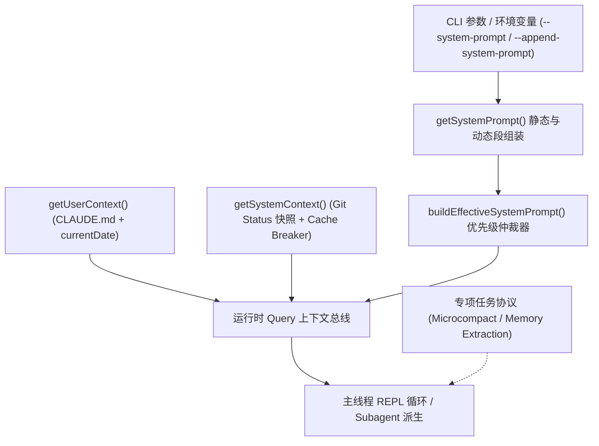

# Claude Code 工业级魔改工程：Prompt 体系解构、tweakcc 引擎补丁与版本升级追踪

本项目针对 Anthropic Claude Code 进行深度逆向工程与工业级重构，覆盖 Prompt 运行时解构、提示词分片规范重塑、`tweakcc` 注入引擎底层修复、本地单文件二进制全局注入，以及上游版本升级追踪闭环。

---

## 1. 工程状态总览 (Status Overview)

| 核心维度 | 关键指标 / 状态 | 规范标准与实现细节 |
|---|---|---|
| **核心提示词分片** | **644 个核心分片已全部重构完成** | 覆盖 `agent-prompt-*` (98), `system-prompt-*` (202), `skill-*` (82), `tool-description-*` (262)。完成 `agent-first-docs` 规范与去 Claude Code 化，**0 变量丢失**（严格保护所有 `${VARIABLE}` 插值）。 |
| **待处理分片** | **292 个 `data-*` + 270 个辅助分片** | `data-*` 属于静态列表与模板数据，保持原始待处理状态；系统提醒与参数微调分片按需扩展。 |
| **注入引擎** | **`tweakcc` v4.4.0 编译就绪** | 78/78 测试套件通过（843 passed tests）。合入 `installationDetection.ts`（pnpm shell shim 穿透解析）与 `patches/systemPrompts.ts`（多行反引号开界符回溯）。 |
| **本地全局注入** | **Claude Code `2.1.325` (`4.4.0 (tweakcc)`)** | 通过软链 `~/.tweakcc/system-prompts` 全局挂载，542 个定制提示词精准热补丁注入；原生备份保存于 `~/.tweakcc/native-binary.backup`。 |
| **升级追踪档案** | **`upgrade-tracking/` 全量就绪** | 基于原生二进制与 `prompts-2.1.325.json` 构建 `MANIFEST.json`（含 Bun chunk 映射）、全分类 `diffs/`、`UPGRADE_GUIDE.md` / `UPGRADE_GUIDE_CN.md` 及 `generate_archive.mjs`。 |

---

## 2. 目录拓扑结构 (Directory Topology)

```text
claude-code-mod/
├── README.md                                  # 本工程全景架构与操作指南
├── piebald-claude-code-system-prompts/        # 提示词分片资产库 (软链挂载源)
│   └── system-prompts/                        # 1,206 个提示词 Markdown 文件 (含 644 个重构核心分片)
├── tweakcc/                                   # 针对 Claude Code 原生二进制的注入与补丁引擎
│   ├── src/installationDetection.ts          # 核心补丁：pnpm/npm shell shim 穿透与二进制直寻
│   ├── src/patches/systemPrompts.ts           # 核心补丁：多行反引号界定符回溯与零深度转义
│   └── dist/                                  # 编译构建产物 (node dist/index.mjs)
├── upgrade-tracking/                          # 官方版本升级追踪档案库
│   ├── MANIFEST.json                          # 机器可读映射：Prompt ID -> 元数据、Hash、Bun Chunk 映射
│   ├── UPGRADE_GUIDE.md                       # 英文全量升级 SOP 与冲突排查手册
│   ├── UPGRADE_GUIDE_CN.md                    # 中文精简升级操作指南
│   ├── generate_archive.mjs                   # 差异与清单全自动生成器
│   └── diffs/                                 # 针对 Claude Code 2.1.325 原版的分分类统一补丁
│       ├── agent-prompt.diff                  # 98 个 Subagent 提示词差异
│       ├── system-prompt.diff                 # 178 个系统提示词差异
│       ├── skill.diff                         # 82 个技能提示词差异
│       ├── tool-description.diff              # 237 个工具描述差异
│       └── tweakcc-src.diff                   # tweakcc 引擎 2 处关键补丁源码差异
├── claude_agy_prompt_tree.json                # 23+ 核心提示词节点的树状 JSON 结构索引
├── build_prompt_tree.py                       # 提示词树构建与 AGY 哲学标注脚本
├── extract_all_prompts.py                     # 全量提示词提取工具
└── claude-code-analysis/                      # Claude Code 全量逆向分析库 (源码与架构剖析)
```

---

## 3. 核心提示词体系重构 (644 Shards Refactoring)

工程对 Claude Code 原生提示词进行了彻底的去特化与工程化重构，剔除针对特定评测模型（如 Capybara）的反作弊补丁、过度防守的口语化否定句以及品牌绑定，转换为基于 `agent-first-docs` 规范的高自主性智能体指令。

### 3.1 核心分片分类与状态矩阵

| 分片分类前缀 | 数量 | 重构状态 | 核心覆盖范围与工程目标 |
|---|---|---|---|
| `agent-prompt-*` | 98 | 100% 已重构 | Subagent 派生、Reviewer 评审、代码架构师、Git 自动化、安全熔断协议 |
| `system-prompt-*` | 202 | 100% 已重构 | 主系统规则、任务执行状态机、代码风格约束、文件编辑规范、环境安全边界 |
| `skill-*` | 82 | 100% 已重构 | 领域专业技能、斜杠指令分发、文档同步、上下文管理、测试驱动流 |
| `tool-description-*` | 262 | 100% 已重构 | Bash/Git/文件/网络各内置工具调用规范、输入校验约束、危险操作二次确认 |
| `data-*` | 292 | 保持待处理 | 纯数据、模版列表及常量分片，无业务逻辑侵入，维持上游基线状态 |
| 辅助分片 (reminders/params) | 270 | 按需待处理 | 系统运行时提醒（`system-reminder-*`）与工具参数解释（`tool-parameter-*`） |

### 3.2 重构原则 (Agent-First Standards)

1. **去 Claude Code 特化**：
   - 剔除对特定基底模型的弱点防御补丁（如 Capybara 防幻觉口癖）。
   - 将“禁止做 X、绝不要做 Y”等发散性否定指令转化为“规则优先（Rule-First）表格与正向确定性约束”。
2. **结构化边界与零无谓示例**：
   - 采用标准 XML 标签定义上下文范围（如 `<harness>`、`<task_tracking>`、`<safety>`）。
   - 严禁冗长 Demo 代码，使用模式（Schema）与规则断言指导行为。
3. **变量 100% 完整性保护**：
   - 严禁修改或遗漏 `${VARIABLE}` 插值符。
   - 所有 644 个重构分片在 `tweakcc` 编译与内存注入阶段实现 **0 undefined identifier** 警告。

---

## 4. Claude Code 6 层 Prompt Runtime 解构

Claude Code 提示词并非静态字符串，而是分层计算、按优先级仲裁的动态运行时：



| 层级 | 运行阶段 | 核心机制 | 缓存与注入策略 |
|---|---|---|---|
| **第 1 层：静态可缓存主干** | 启动装载 | 包含身份定义、系统规范、工程准则、工具规范与基调 | 享有跨会话 Blake2b 前缀缓存，保持极高命中率 |
| **第 2 层：动态组装段落** | 会话初始化 | Session 引导、Memory 指引、语言偏好、MCP 注入、Scratchpad | 位于边界之后，按环境和项目配置动态计算 |
| **第 3 层：有效 Prompt 仲裁器** | 请求前置处理 | 仲裁优先级：`Override` > `Coordinator` > `Agent` > `Custom` > `Default` | 尾部支持追加 `AppendSystemPrompt` |
| **第 4 层：运行时上下文总线** | 每轮推理注入 | 读取 `CLAUDE.md`，注入 Git Status 脏文件快照与时间戳 | 上下文隔离，动态感知工作区状态 |
| **第 5 层：专项任务协议家族** | 专项子任务 | `/compact`（零工具摘要协议）、`SessionMemory`、`ExtractMemories` | 专用沙箱提示词与单工具限制 |
| **第 6 层：启动期追加总线** | 模式切换时 | Proactive 模式、Teammate 模式、Chrome 自动化插件行动指南 | 动态追加至有效 Prompt 末尾 |

---

## 5. `tweakcc` v4.4.0 引擎底层修复

为支持原生 Bun 单文件二进制与现代包管理器环境，对 `tweakcc` 引擎源码进行了针对性加固：

### 5.1 `installationDetection.ts`: pnpm Shell Shim 穿透解析
- **缺陷**：全局通过 `pnpm` 安装 Claude Code 时，`which claude` 指向 shell 脚本包装器（含 `#!/bin/sh` 与 `# cmd-shim-target=...`）。原生 `tweakcc` 启发式检测将其误判为普通 JavaScript 脚本，导致二进制寻址失败。
- **修复**：新增 `maybeResolveShimWrapper`，递归解析 shell wrapper 与 Windows `.cmd` shim，穿透提取底层原生 Mach-O / ELF 二进制路径；优化 `detectFileTypeHeuristic` 忽略非 node/bun 的 shebang 脚本。
- **验证**：`npx vitest run src/installationDetection.test.ts` 全部通过。

### 5.2 `patches/systemPrompts.ts`: 多行模板反引号开界符回溯
- **缺陷**：在多行模板字符串（template literal）中，提示词前存在缩进空格或换行时，原生 `applySystemPrompts` 仅检测 `content[mIndex - 1]`，误将前导空白判为双引号包裹，导致深度为 0 的反引号未经转义直接注入，编译后引发 `SyntaxError: Unexpected identifier 'git'` 等运行时崩溃。
- **修复**：新增 `findEnclosingDelimiter` 函数，沿代码逆向跳过所有空白字符，正确定位真正的外层开界符（``` ` ```, `"`, `'`），实现精准的反引号深度转义。
- **验证**：`npx vitest run src/patches/systemPrompts.test.ts` 全部通过。

---

## 6. 本地全局注入与运行验证 (Local Injection & Smoke Test)

### 6.1 注入拓扑配置
`tweakcc` 通过软链直接读取本项目定制的分片库，实现开发态与注入态物理统一：

```bash
# 建立软链 (指向项目分片目录)
ln -s /Users/xr/IDEA.localized/multiagent-orchestration/claude-code-mod/piebald-claude-code-system-prompts/system-prompts ~/.tweakcc/system-prompts
```

### 6.2 编译与全局应用
```bash
cd /Users/xr/IDEA.localized/multiagent-orchestration/claude-code-mod/tweakcc
# 1. 编译引擎产物
pnpm run build

# 2. 应用注入 (自动备份原生二进制至 ~/.tweakcc/native-binary.backup)
node dist/index.mjs --apply -y
```

### 6.3 运行结果验证
- **版本输出**：
  ```bash
  claude --version
  # 2.1.325 (Claude Code)
  # 4.4.0 (tweakcc)
  ```
- **注入统计**：
  - 本地原生安装：`/Users/xr/Library/pnpm/global/5/node_modules/@anthropic-ai/claude-code/claude.exe`
  - 备份校验：`~/.tweakcc/native-binary.backup` (347 MB 原版副本)
  - 注入成果：**542 个定制提示词分片**精准命中并成功写入二进制，**0** 语法解析错误，CLI 交互与 `--help` 运行完全正常。

---

## 7. 升级追踪档案体系 (`upgrade-tracking/`)

当 Anthropic 官方发布新版 Claude Code 时，通过 `upgrade-tracking/` 档案库实现无痛差异追踪与合入。

### 7.1 核心档案清单

| 档案文件 | 规范格式 | 作用说明 |
|---|---|---|
| [`MANIFEST.json`](./upgrade-tracking/MANIFEST.json) | JSON (541 KB) | 机器可读索引：记录 597 个文件针对 2.1.325 原版的 Hash、字节变化、变量签名与 Bun Chunk 映射（如 `/$bunfs/root/chunk-*.js`） |
| [`UPGRADE_GUIDE.md`](./upgrade-tracking/UPGRADE_GUIDE.md) | Markdown (英文) | 详尽技术维护协议、Bun Chunk 解包审计命令与冲突排查手册 |
| [`UPGRADE_GUIDE_CN.md`](./upgrade-tracking/UPGRADE_GUIDE_CN.md) | Markdown (中文) | 针对运维与开发者的精简版 7 步标准升级实操 SOP |
| [`generate_archive.mjs`](./upgrade-tracking/generate_archive.mjs) | Node.js ESM 脚本 | 自动化构建工具：从原生备份与缓存中提取基准，生成全量差异补丁与清单 |
| [`diffs/`](./upgrade-tracking/diffs/) | Unified Diff | 涵盖 `agent-prompt.diff`、`system-prompt.diff`、`skill.diff`、`tool-description.diff` 与 `tweakcc-src.diff` |

### 7.2 标准升级闭环流程

```text
1. 安装上游新版 (pnpm update -g @anthropic-ai/claude-code) & 还原纯净备份
                           │
2. 自动化审计冲突 (对比 MANIFEST.json 与新版 prompts-<ver>.json)
                           │
3. 三方差异合并 (更新 ccVersion，严守变量零丢失，应用 agent-first 规范)
                           │
4. tweakcc 编译与注入 (pnpm run build && node dist/index.mjs --apply -y)
                           │
5. 验证冒烟测试 (claude --version && claude --help)
                           │
6. 刷新升级档案 (node claude-code-mod/upgrade-tracking/generate_archive.mjs)
```
