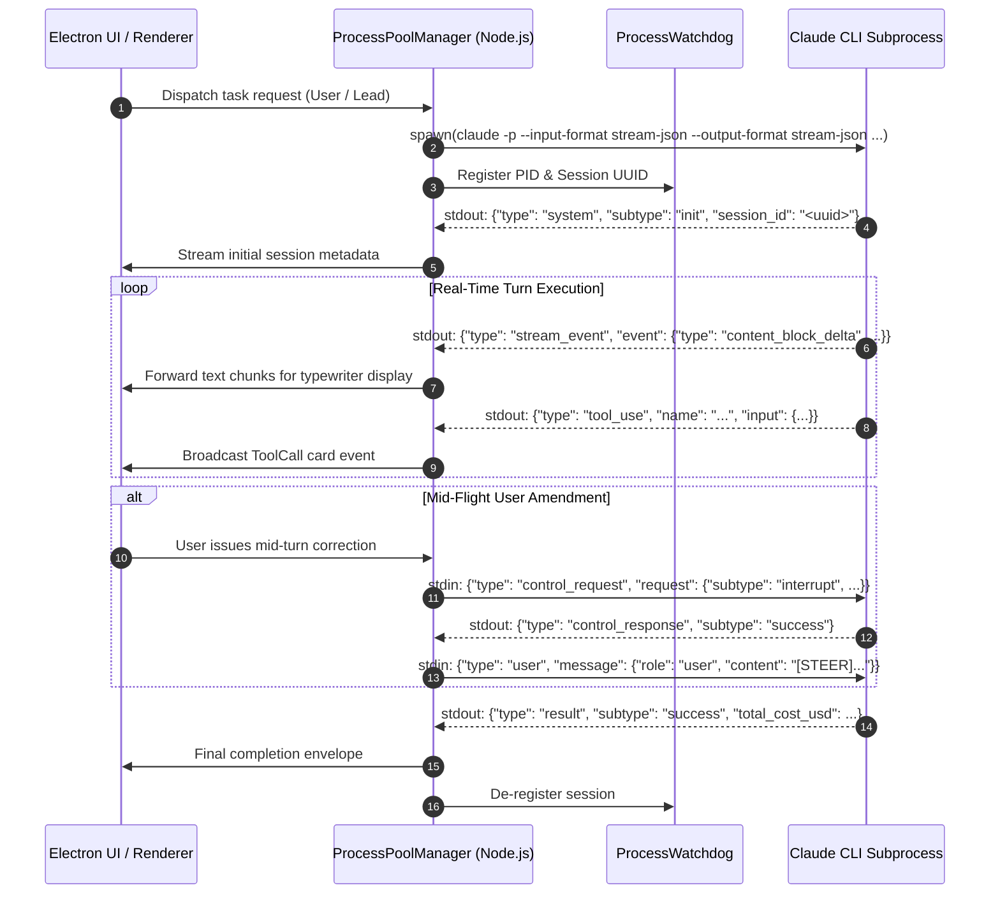
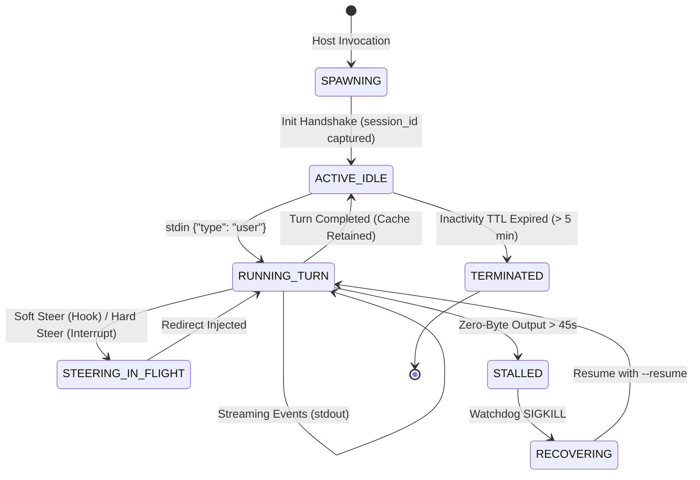

# System Architecture: Headless Subprocess Pool & Full-Duplex Stream Engine

## 1. Executive Summary

This specification governs the runtime architecture of the multi-agent coordination platform powered exclusively by the native Claude Code CLI (`/opt/homebrew/bin/claude`). The platform completely strips third-party SDK dependencies, proprietary wrapper harnesses, and PTY terminal parsing, replacing them with a deterministic, low-latency, full-duplex Newline-Delimited JSON (NDJSON) streaming pipeline.

---

## 2. Process Pool & Full-Duplex NDJSON Lifecycle



---

## 3. Subprocess Launch Invariants & CLI Flag Configuration

The host engine initiates worker processes with strict parameter matrices depending on the agent category:

### 3.1 Standard Subprocess Parameter Matrix

| Parameter / Flag | Value | Operational Purpose |
| :--- | :--- | :--- |
| `Binary` | `/opt/homebrew/bin/claude` | Direct execution of the native CLI binary. |
| `-p` | Flag active | Headless, non-interactive execution mode. |
| `--input-format` | `stream-json` | Real-time NDJSON stream ingestion via `stdin`. |
| `--output-format` | `stream-json` | Real-time NDJSON event broadcasting via `stdout`. |
| `--verbose` | Flag active | Mandatory: prevents output suppression, ensures intermediate events are emitted. |
| `--include-partial-messages` | Flag active | Mandatory: delivers delta tokens for real-time UI streaming. |
| `--dangerously-skip-permissions`| Flag active | Bypasses terminal approval prompts in sandboxed headless execution. |
| `--append-system-prompt` | `"$(cat SOUL.md)"` | Appends agent identity and behavioral constraints without overriding native tools. |
| `--mcp-config` | `./mcp.json` | Mounts agent-specific MCP tool definitions. |
| `--allowedTools` | Specific whitelist | Restricts tool boundaries (e.g., `mcp__rea__*,Read,Grep,Bash(r2 *)`). |
| `cwd` | `partners/<id>/` | Sets the execution context to the partner's root directory. |

---

## 4. Prompt Caching Economics & Process Lifecycle

### 4.1 The 5-Minute Cache Window Invariant
Anthropic Claude 3.5 / 3.7 models enforce a 5-minute Prompt Cache expiration TTL. In multi-agent collaborative workflows:
- Cold spawns require 2–4 seconds of initialization latency and force full re-reading of directory context.
- Terminating processes via `SIGTERM` destroys the active cache shard, causing a $10\times$ cost surge and $5\times$ latency penalty on subsequent calls.

### 4.2 Lifecycle States


---

## 5. Host-Side Process Watchdog Specification

To protect against Claude CLI Issue #53584 (headless process entering silent sleep state with zero CPU and open TCP connection):

```typescript
export interface WatchdogConfig {
  heartbeatTimeoutMs: number; // Default: 45,000ms
  checkIntervalMs: number;    // Default: 5,000ms
  longToolGraceMs: number;    // Default: 180,000ms (for compiler/build tasks)
}
```

1. **Activity Monitor**: Host tracks timestamp of last received `stdout` byte.
2. **Tool Awareness**: If `tool_use` is emitted for a known long-running tool (e.g. `Bash` running a build or analysis), timeout window expands to `longToolGraceMs`.
3. **Execution**: If time since last activity exceeds threshold:
   - Force kill stale PID.
   - Spawn recovery process immediately with:
     `claude -p --resume "<SESSION_UUID>" --input-format stream-json --output-format stream-json ...`
   - Log automated watchdog recovery event to audit database.

---

## 6. Bot Group Coordination & Multi-Repo Directory Architecture

For collaborative taskforce execution (governed by [BOT_GROUP_ORCHESTRATION_SPEC](./dev-rules/bot-group-orchestration.md)):

### 6.1 Two-Tier Directory Decoupling Model
1. **Group Private Storage Folder (`~/.multiagent-orchestration/groups/<id>/`)**:
   - Stores the group's own assets: `GROUP_CHARTER.md`, shared blackboard memory `GROUP_MEMORY.md`, division plans (`plans/`), and intermediate execution logs.
   - Decoupled from user codebases: Zero internal coordination clutter is written to customer projects.
2. **Mounted Target Projects (`mountedDirs`)**:
   - The actual repositories being analyzed and patched (e.g. `/Users/xr/IDEA.localized/cliproxyapi`, `/Users/xr/IDEA.localized/Prism-Browser`).
   - Injected into tool sandbox whitelists so partners operate directly across repositories without directory replication.

### 6.2 Session Channels & Context Increments
- **Canonical 1:1 Direct Chat**: Exactly 1 persistent session per partner (`dm_<id>`).
- **Hidden Group Lane Session**: Exactly 1 persistent session per `(group, partner)` (`route_key: group:<groupId>`).
- **Thread Lane Isolation**: Discrete topic threads run in independent sessions (`route_key: group:<groupId>:thread:<rootMessageId>`), preventing sub-conversations from polluting the main timeline.
- **Incremental Turn Context**: Host tracks `lastSeenSequence` watermark per member, delivering only new peer message deltas wrapped in `<untrusted-json-block>`, strictly preserving System Prompt integrity.
- **Owner Intent Boundary (PR #8075)**: Automatic tool execution review derives exclusively from verified human owner text (`autoReviewUserText`), preventing peer quote-card privilege escalation.

