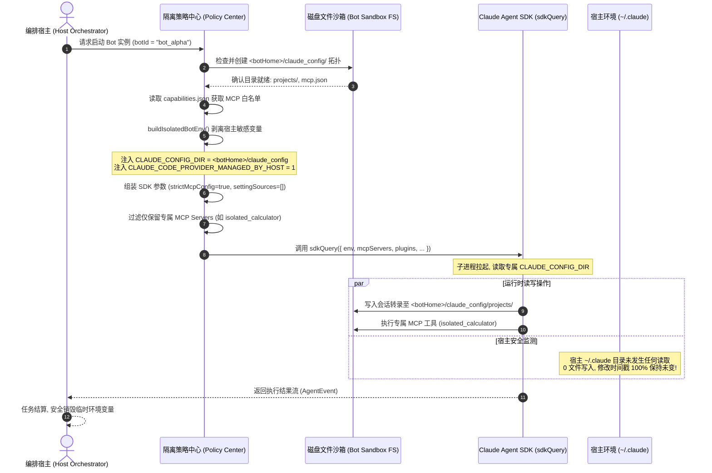

# 独立 Bot MCP Tools 与 Plugins 物理隔离架构设计规范

**文档版本**: 1.0.0  
**状态**: 正式设计规范 (Approved Architecture Specification)  
**更新日期**: 2026-11-05  
**关联任务**: `ORIGINAL_REQUEST.md` (R3, R4)  
**涉及核心**: `@anthropic-ai/claude-agent-sdk@0.3.292`, `CindyR/packages/maker-core/src/agents/claude-code/env-builder.ts`, `CLAUDE_CONFIG_DIR` 隔离机制

---

## 目录

1. [架构背景与核心痛点](#1-架构背景与核心痛点)
2. [总体隔离目标与设计原则](#2-总体隔离目标与设计原则)
3. [独立 Bot 存储目录拓扑规范](#3-独立-bot-存储目录拓扑规范)
4. [环境变量隔离与动态注入机制](#4-环境变量隔离与动态注入机制)
5. [Claude Agent SDK 选项锁定与双重白名单策略](#5-claude-agent-sdk-选项锁定与双重白名单策略)
6. [专属凭证管理与安全权限边界](#6-专属凭证管理与安全权限边界)
7. [运行时动态装载全流程 (Mermaid Sequence)](#7-运行时动态装载全流程-mermaid-sequence)
8. [PoC 原型验证规范与断言契约 (R4 衔接)](#8-poc-原型验证规范与断言契约-r4-衔接)

---

## 1. 架构背景与核心痛点

在当前的 Claude Code 与 Cindy 实现中，桌面宿主为了复用开发者本机现有的订阅登录（OAuth Bearer），在拉起 Claude Code 子进程时**刻意未设置独立的 `CLAUDE_CONFIG_DIR`**（见 `CindyR/apps/desktop/src/main/maker-host/auth-adapters.ts-740`）。这种设计在单用户个人编码场景下提供了开箱即用的便利，但在多 Agent（Multi-Bot）并发协同的架构下，暴露了四大致命隐患：

```
当前共享宿主 ~/.claude 的架构缺陷:
┌────────────────────────────────────────────────────────────────────────┐
│                        宿主用户环境 (~/.claude/)                        │
│                                                                        │
│   ├── projects/<encoded_dir>/<sessionId>.jsonl                         │
│   │   ▲ 所有 Bot 在相同目录下运行时，转录日志直接写入同一目录，发生碰撞与泄露! │
│   ├── .credentials.json                                                │
│   │   ▲ 宿主个人订阅或主 API Key 处于完全敞开状态，任何 Bot 均可读取窃取!      │
│   ├── ~/.claude.json (全局 MCP 配置)                                    │
│   │   ▲ 用户个人配置的 MCP 工具被无差别加载给所有 Bot，破坏最小权限原则!       │
│   └── skills/ 与 agents/                                               │
│       ▲ 宿主全局 Skill 与子代理被所有 Bot 自动感知，无法实现 Bot 自主专属定制! │
└───────────────────────────────────┬────────────────────────────────────┘
                                    │ 共享读取与落盘 (并发竞态与污染)
        ┌───────────────────────────┴───────────────────────────┐
        ▼                                                       ▼
 智能体 Bot A (数据分析)                                  智能体 Bot B (代码重构)
```

1. **项目转录碰撞与历史泄露 (Transcript Collision)**:
   Claude Code 底层默认将每个会话的 JSONL 转录日志保存在 `$CLAUDE_CONFIG_DIR/projects/<hash>/<sessionId>.jsonl` 中。若两个不同的 Bot 在同一个工作区协同，它们的转录文件混杂在一起，导致历史 Resume 混乱、上下文回溯错误。
2. **全局凭证共享与越权隐患 (Credential Leakage)**:
   宿主目录下的 `.credentials.json` 包含用户的最高权限 Token。一旦某个 Bot 调用了外部不受信的 Bash 工具或恶意脚本，便能轻易读取宿主私有凭证。
3. **MCP 工具全局混杂 (MCP Tool Contamination)**:
   宿主全局 `~/.claude.json` 中配置的数据库、Git 甚至支付工具会被无差别注入给每个 Bot，破坏了职责单一与最小特权（Principle of Least Privilege）原则。
4. **插件与技能交叉感染 (Plugin / Skill Bleed)**:
   Bot 动态自学的专用 Skill 若写入公共目录，会导致其他 Bot 的提示词被不相干的技能污染，拉高 Token 消耗并降低推理准确率。

---

## 2. 总体隔离目标与设计原则

为彻底根治上述问题，本架构方案确立了**“Bot 自治、物理沙箱、零宿主污染”**的三大铁律：

| 目标维度 | 架构要求 | 达成效果 |
|---|---|---|
| **宿主零污染 (Zero Host Touch)** | 严禁读取、修改或向用户 `~/.claude` 写入任何字节 | 宿主原有配置、凭证和转录完全保持原样，哈希值与修改时间戳 100% 不变 |
| **Bot 间物理隔离 (Bot-to-Bot Isolation)** | 每个 Bot 拥有独立无交集的物理配置目录 | Bot A 与 Bot B 拥有各自独立的 MCP、技能、凭证和转录历史，互不可见 |
| **细粒度自主管理 (Autonomous Management)** | Bot 通过自身的 `capabilities.json` 声明工具 | 支持为不同 Bot 动态配置异构 MCP 工具（如 Bot A 仅加载计算器，Bot B 仅加载文本格式化器） |
| **配置完全锁定 (Configuration Lockdown)** | 彻底阻断任何外部 settings 与全局继承 | 启用 `strictMcpConfig: true` 与 `settingSources: []`，切断隐式加载链路 |

---

## 3. 独立 Bot 存储目录拓扑规范

每一个 Bot 拥有一个标准化的自治根目录（位于 `~/.multiagent-orchestration/partners/<botId>/` 或工作区中的 `Bots/<botId>/`），其拓扑规范严格定义如下：

```
<botHome>/ (例如 ~/.multiagent-orchestration/partners/bot_alpha/)
├── SOUL.md                       # Bot 核心人设、口吻与边界原则
├── MEMORY.md                     # Bot 长期私有经验与业务共识记忆
├── capabilities.json             # 【自主声明】该 Bot 启用的 MCP 服务与插件白名单
│
├── claude_config/                # 【核心隔离目录】绑定为该 Bot 的 CLAUDE_CONFIG_DIR
│   ├── config.json               # Claude Code 本地运行时偏好 (主题、自动更新禁用等)
│   ├── mcp.json                  # 专属 MCP 服务器配置声明 (声明式工具注册)
│   ├── .credentials.json         # 沙箱独立凭证 (支持为空，优先由内存环境变量覆盖)
│   └── projects/                 # 该 Bot 专属的项目会话 JSONL 转录持久化目录
│
├── skills/                       # Bot 专属技能/插件定义 (SKILL.md)
│   ├── data-analyst/
│   │   └── SKILL.md
│   └── ...
│
└── workspace/                    # Bot 私聊交互时的独立执行工作区沙箱
```

### 3.1 核心配置目录文件规范

1. **`capabilities.json` (能力白名单清单)**:
   用于声明该 Bot 运行时允许加载的 MCP 服务名称及启用的本地技能插件：
   ```json
   {
     "version": "1.0.0",
     "botId": "bot_alpha",
     "mcpServers": [
       "isolated_calculator",
       "cindy_memory"
     ],
     "enabledSkills": [
       "data-analyst"
     ],
     "permissionMode": "whitelist"
   }
   ```
2. **`claude_config/mcp.json` (专属 MCP 声明与「Host as Loader」模式)**:
   遵循标准 MCP 规范，仅定义该 Bot 专属的 STDIO / HTTP 服务：
   ```json
   {
     "mcpServers": {
       "isolated_calculator": {
         "command": "node",
         "args": ["<projectRoot>/tools/calculator.mjs"],
         "env": {
           "CALC_PRECISION": "4"
         }
       }
     }
   }
   ```
   > **⚠️ 核心设计闭环 —「Host as Loader」模式**:
   > 根据官方 `@anthropic-ai/claude-agent-sdk` 规范，一旦启用 `strictMcpConfig: true`，Claude Code 子进程将**彻底忽略磁盘上的任何 MCP 配置文件**（包括用户 `~/.claude.json`、项目 `.mcp.json` 及磁盘 frontmatter MCP），仅且仅加载由内存选项 `options.mcpServers` 显式注入的服务。
   > 因此，系统采用 **Host as Loader（宿主加载器）** 模式：由 Host 主进程在拉起 Bot 前主动读取并解析 `<botHome>/claude_config/mcp.json`，结合 `capabilities.json` 白名单进行合法性过滤后，由 Host 将其反序列化装配并直接注入到 `options.mcpServers` 内存选项中。这样既保持了 Bot 目录维护静态 MCP 配置的声明式优势，又完全闭环了 `strictMcpConfig: true` 的最高安全隔离级要求。
3. **`claude_config/projects/` (隔离转录库)**:
   该 Bot 运行过程中的所有 Query 历史、Turn 记录和恢复快照全部落盘于此。即使与其它 Bot 协同分析同一个 Git 仓库，转录文件名与索引哈希也在各自目录内闭环，**碰撞概率降为 0**。

---

## 4. 环境变量隔离与动态注入机制

为了让底层的 `@anthropic-ai/claude-agent-sdk` 以及拉起的 Claude Code 子进程精准绑定专属配置目录，必须在运行时实施**动态环境变量重构与净化**。

```
                    宿主父进程环境变量 (Host Process Env)
                                  │
                                  ▼
               cleanProcessEnv() / stripSensitiveAnthropicEnv()
               强制剥离: ANTHROPIC_API_KEY, ANTHROPIC_AUTH_TOKEN,
                         CLAUDE_CONFIG_DIR, CLAUDE_CODE_ENTRYPOINT
                                  │
                                  ▼
                       基础安全环境 (Clean Base Env)
                                  │
          ┌───────────────────────┴───────────────────────┐
          ▼                                               ▼
  Bot A 动态注入上下文                             Bot B 动态注入上下文
  CLAUDE_CONFIG_DIR =                             CLAUDE_CONFIG_DIR =
  "<botHome_A>/claude_config"                     "<botHome_B>/claude_config"
  ANTHROPIC_API_KEY = "key_bot_A"                 ANTHROPIC_API_KEY = "key_bot_B"
  CLAUDE_CODE_PROVIDER_MANAGED_BY_HOST = '1'     CLAUDE_CODE_PROVIDER_MANAGED_BY_HOST = '1'
          │                                               │
          ▼                                               ▼
   SDK Query (Bot A 子进程)                        SDK Query (Bot B 子进程)
   严格限定于 Bot A 目录                          严格限定于 Bot B 目录
```

### 4.1 环境变量剥离器实现规范

在 `CindyR/packages/maker-core/src/agents/claude-code/env-builder.ts` 架构基础上，扩展出针对独立 Bot 的环境构建器。宿主环境必须在拉起 Bot 子进程前，彻底从 `process.env` 中剔除所有敏感凭证、网络重定向与订阅档位配置（共 20 个敏感键）：

```typescript
// 规范实现: 构建独立 Bot 的隔离环境变量
export function buildIsolatedBotEnv(params: {
  botHome: string;
  botCredentials?: { apiKey?: string; authToken?: string; baseUrl?: string };
  baseProcessEnv?: NodeJS.ProcessEnv;
}): NodeJS.ProcessEnv {
  const { botHome, botCredentials, baseProcessEnv = process.env } = params;

  // 1. 深度克隆并清洗宿主敏感变量 (同步 CindyR 生产级敏感键清单)
  const cleanEnv: NodeJS.ProcessEnv = {};
  const SENSITIVE_KEYS = new Set([
    // 类别 A: 核心鉴权凭证 (防止凭证越权与提权)
    'ANTHROPIC_API_KEY',
    'ANTHROPIC_AUTH_TOKEN',
    'CLAUDE_CODE_OAUTH_TOKEN',
    'CINDY_CLAUDE_ACCOUNT_PROVIDER_ID',
    'CLAUDE_CODE_OAUTH_TOKEN_FILE_DESCRIPTOR',
    'CLAUDE_CODE_API_KEY_FILE_DESCRIPTOR',

    // 类别 B: 订阅身份与授权元数据 (防止错误 scopes/tier 注入)
    'CLAUDE_CODE_OAUTH_SCOPES',
    'CLAUDE_CODE_SUBSCRIPTION_TYPE',
    'CLAUDE_CODE_RATE_LIMIT_TIER',

    // 类别 C: 网络端点与代理重定向 (防止外部调试代理/抓包劫持)
    'ANTHROPIC_BASE_URL',
    'ANTHROPIC_UNIX_SOCKET',
    'ANTHROPIC_CUSTOM_HEADERS',

    // 类别 D: 第三方云服务商 Provider 配置
    'ANTHROPIC_VERTEX_PROJECT_ID',
    'ANTHROPIC_BEDROCK_BASE_URL',
    'ANTHROPIC_FOUNDRY_API_KEY',
    'ANTHROPIC_FOUNDRY_BASE_URL',
    'ANTHROPIC_FOUNDRY_RESOURCE',

    // 类别 E: 配置目录重定向与宿主接管标识
    'CLAUDE_CONFIG_DIR',
    'CLAUDE_CODE_PROVIDER_MANAGED_BY_HOST',

    // 类别 F: 子代理派发覆盖 (防止静默覆盖子 Agent 默认模型)
    'CLAUDE_CODE_SUBAGENT_MODEL',
    'CLAUDE_CODE_ENTRYPOINT'
  ]);

  for (const [k, v] of Object.entries(baseProcessEnv)) {
    if (!SENSITIVE_KEYS.has(k) && v !== undefined) {
      cleanEnv[k] = v;
    }
  }

  // 2. 动态注入该 Bot 专属的配置目录
  const botConfigDir = path.resolve(botHome, 'claude_config');
  // 确保存储目录存在
  fs.mkdirSync(path.join(botConfigDir, 'projects'), { recursive: true });

  cleanEnv.CLAUDE_CONFIG_DIR = botConfigDir;

  // 3. 锁定管理权, 禁止 CLI 内部扫描用户外部未受管配置
  cleanEnv.CLAUDE_CODE_PROVIDER_MANAGED_BY_HOST = '1';

  // 4. 注入 Bot 专属凭证 (若有自定义网关或独立 API Key)
  if (botCredentials?.apiKey) {
    cleanEnv.ANTHROPIC_API_KEY = botCredentials.apiKey;
  }
  if (botCredentials?.authToken) {
    cleanEnv.ANTHROPIC_AUTH_TOKEN = botCredentials.authToken;
  }
  if (botCredentials?.baseUrl) {
    cleanEnv.ANTHROPIC_BASE_URL = botCredentials.baseUrl;
  }

  return cleanEnv;
}
```

#### 4.1.1 敏感环境变量分类防护必要性分析

| 分类 | 敏感环境变量 | 泄漏或残留导致的严重危害 |
|---|---|---|
| **鉴权凭证** | `ANTHROPIC_API_KEY`, `ANTHROPIC_AUTH_TOKEN`, `CLAUDE_CODE_OAUTH_TOKEN`, `CLAUDE_CODE_API_KEY_FILE_DESCRIPTOR` 等 | 子进程越权复用宿主账户高额度凭证，导致 Bot 消耗用户个人账单，破坏计费隔离； |
| **订阅与档位** | `CLAUDE_CODE_OAUTH_SCOPES`, `CLAUDE_CODE_SUBSCRIPTION_TYPE`, `CLAUDE_CODE_RATE_LIMIT_TIER` | 从终端 cc 会话启动时，会将外层残留的 scopes 泄漏进子进程，导致订阅会话以错误档位起跑并被上游风控封禁； |
| **网络重定向** | `ANTHROPIC_BASE_URL`, `ANTHROPIC_UNIX_SOCKET`, `ANTHROPIC_CUSTOM_HEADERS` | 父进程用于抓包或代理调试的私有 URL 泄漏进沙箱，导致 Bot 的所有请求被第三方中间人嗅探或重定向； |
| **云服务商** | `ANTHROPIC_VERTEX_PROJECT_ID`, `ANTHROPIC_BEDROCK_BASE_URL`, `ANTHROPIC_FOUNDRY_*` | 破坏多云凭证隔离，导致私有 Bot 意外访问或计费至宿主的企业级云商资源； |
| **配置与模型** | `CLAUDE_CONFIG_DIR`, `CLAUDE_CODE_SUBAGENT_MODEL` | 宿主默认配置目录渗透导致隔离失效；`SUBAGENT_MODEL` 残留会以最高优先级静默覆盖用户为 Bot 手写的 `model:` 配置。 |

---

## 5. Claude Agent SDK 选项锁定与双重白名单策略

单纯注入环境变量仍不足以保证 100% 绝对隔离，因为 Claude Agent SDK 内部仍可能尝试探测用户全局设置或通过子代理读取外部配置。因此，必须在调用 `sdkQuery(options)` 时施加**全维度的选项锁定与白名单策略**：

```typescript
const queryOptions: Options = {
  // 1. 强制空配置源: 彻底禁止 SDK 扫描任何磁盘 settings.json
  settingSources: [],

  // 2. 严格 MCP 配置锁定: 忽略任何外部 ~/.claude.json 或项目 .mcp.json
  // 仅且仅允许加载 options.mcpServers 传入的工具!
  strictMcpConfig: true,

  // 3. 动态组装的受控 MCP 服务字典 (仅包含该 Bot 白名单内的服务)
  mcpServers: activeBotMcpServers,

  // 4. Bot 专属技能沙箱挂载 (指向 Bot 私有 skills 目录)
  plugins: [
    { type: 'local', path: path.resolve(botHome, 'skills') }
  ],

  // 5. 注入已完成沙箱化与凭证隔离的环境变量
  env: isolatedEnv,

  // 6. 工作目录沙箱化 (隔离于宿主代码根目录)
  cwd: path.resolve(botHome, 'workspace'),

  // 7. 审批与工具控制
  allowedTools: ['Read', 'Glob', 'Grep', 'mcp__*'],
  canUseTool: customCanUseToolGuard
};
```

### 5.1 双重白名单过滤机制

在工具注入层面，系统实施“声明清单与运行时过滤”双重校验：
1. **静态清单核验**: 读取 Bot 的 `capabilities.json` 中的 `mcpServers` 数组；
2. **运行时策略校验 (`isBotMcpServerAllowed`)**:
   ```typescript
   export function filterMcpServersForBot(
     allAvailableServers: Record<string, McpServerConfig>,
     botCapabilities: BotCapabilities
   ): Record<string, McpServerConfig> {
     const allowedSet = new Set(botCapabilities.mcpServers);
     // 始终允许 Cindy 基础内核工具 (如 cindy_memory)
     allowedSet.add('cindy_memory');

     const filtered: Record<string, McpServerConfig> = {};
     for (const [name, config] of Object.entries(allAvailableServers)) {
       if (allowedSet.has(name)) {
         filtered[name] = config;
       }
     }
     return filtered;
   }
   ```
   **未在白名单中登记的 MCP 工具（如宿主上的数据库工具），坚决不装配进 `options.mcpServers`**。

---

## 6. 专属凭证管理与安全权限边界

### 6.1 凭证隔离策略矩阵

| 凭证模式 | 凭证存储位置 | 注入方式 | 宿主安全保障 |
|---|---|---|---|
| **模式 A: 宿主受控代理网关 (推荐)** | 宿主内存临时 Token 池 | 动态注入 `ANTHROPIC_BASE_URL` + 短效网关 Token | Bot 无法获悉底层真实 API Key，离开宿主后 Token 立即失效 |
| **模式 B: Bot 专属 API Key** | `<botHome>/claude_config/.credentials.json` (600 权限) | 动态注入 `ANTHROPIC_API_KEY` | 各 Bot 使用独立子账号 Key，额度与费用独立核算 |
| **模式 C: 官方订阅 Bearer Token** | 宿主主进程内存中转 | 通过 SDK `getOAuthToken` 动态按需获取 | 严禁读取宿主磁盘 `.credentials.json`，按需刷新 |

### 6.2 工具执行沙箱与文件访问边界

为防止 Bot 利用 MCP 工具或 Bash 越权逃逸出自身目录：
1. **工作目录严格限制 (`cwd`)**:
   Bot 私聊会话 `cwd` 强制设定为 `<botHome>/workspace`；群聊专线会话强制绑定为沙箱路径 `chat-workspaces/<sha256>`；
2. **宿主目录访问白名单**:
   仅当群章程显式配置了 `mountedDirs: ["/path/to/project"]` 时，工具才被允许读取该路径；
3. **禁止访问宿主 Home**:
   所有对 `process.env.HOME + '/.claude'` 的访问请求，在 `CanUseTool` 回调中执行正则检测，一旦命中直接判定为违规并阻断。

### 6.3 路径穿越边界控制与沙箱拓扑防御 (Path Traversal Boundary Controls)

在多 Bot 共享同一台宿主机或同一 `sandboxes/` 父级目录时，仅依赖 `CLAUDE_CONFIG_DIR` 重定向无法阻断应用层相对路径逃逸攻击。必须实施物理拓扑规范化与运行时边界强校验：

1. **`botId` 拓扑防逃逸与命名白名单**:
   - **风险**: 若 `botConfig.botId` 包含 `../../` 等相对回溯符（如 `../../escaped-rogue-bot`），在拼接 `path.join(baseDir, 'bots', botId)` 时会导致物理目录逃出 `bots/` 拓扑根区，甚至覆盖宿主系统文件。
   - **规范防御**: 编排层强制执行 `botId` 字符正则白名单与消毒策略：
     ```typescript
     export function sanitizeBotId(botId: string): string {
       // 严格白名单过滤：仅允许字母、数字、下划线及短横线，杜绝任何斜杠与相对回溯点
       const sanitized = botId.replace(/[^a-zA-Z0-9_-]/g, '_').replace(/^_+/, '');
       return sanitized.length > 0 ? sanitized : 'default_bot';
     }
     ```
   - 并在创建目录前实施 `path.resolve` 边界校验：`resolvedBotDir.startsWith(botsRoot + path.sep)`，违规时立即抛出安全违规异常。

2. **沙箱配置文件落盘边界围栏 (`writeConfigArtifact`)**:
   - **风险**: 当 Bot 执行持久化操作（写入转录、更新内存或落盘配置）时，若相对路径参数传入 `../../bot-beta/claude_config/backdoor.json`，将导致 Bot A 越权篡改 Bot B 的私有沙箱文件（跨 Bot 目录越权）。
   - **规范防御**: 所有文件落盘必须实施绝对路径前缀边界封闭（Path Containment）：
     ```typescript
     public writeConfigArtifact(relativePath: string, content: string): string {
       const env = this.getRuntimeEnv();
       const configRoot = path.resolve(env.claudeConfigDir);
       let fullPath = path.resolve(configRoot, relativePath);
       const rootWithSep = configRoot.endsWith(path.sep) ? configRoot : configRoot + path.sep;

       // 强制围栏：一旦检测到路径越出自身 claudeConfigDir，强制执行沙箱内收束/净化
       if (!fullPath.startsWith(rootWithSep) && fullPath !== configRoot) {
         const safeRelative = relativePath.replace(/^(\.\.[\/\\])+/, '').replace(/[^a-zA-Z0-9_.\-\/\\]/g, '_');
         const safeFileName = path.basename(safeRelative) || 'artifact.json';
         fullPath = path.resolve(configRoot, safeFileName);
       }

       fs.mkdirSync(path.dirname(fullPath), { recursive: true });
       fs.writeFileSync(fullPath, content, 'utf-8');
       return fullPath;
     }
     ```
   - 此机制从代码基座层确保任何落盘行为只能在自身沙箱目录内收敛，杜绝跨 Bot 沙箱污染。

---

## 7. 运行时动态装载全流程 (Mermaid Sequence)

下图清晰描述了从 Bot 实例被唤醒，到动态分配隔离目录、净化环境、过滤 MCP 工具，最后拉起完全隔离的 SDK 实例的全生命周期：



---

## 8. PoC 原型验证规范与断言契约 (R4 衔接)

为了验证本设计方案的真实可行性，并为接下来的代码验证（R4）提供精确的验收准则，特制定以下**PoC 最小验证契约**：

### 8.1 验证场景拓扑设计

构建两个具有异构能力的独立 Bot 实例：

```
/tmp/poc-mcp-isolation/ (临时测试沙箱)
├── bot_calculator/                      # [Bot 1: 仅具备数学计算能力]
│   ├── capabilities.json                # 仅声明 mcp_calc
│   ├── claude_config/
│   │   └── mcp.json                     # 注册 calc_tool
│   └── workspace/
│
└── bot_formatter/                       # [Bot 2: 仅具备文本大写格式化能力]
    ├── capabilities.json                # 仅声明 mcp_format
    ├── claude_config/
    │   └── mcp.json                     # 注册 format_tool
    └── workspace/
```

### 8.2 核心断言契约 (Assertion Checklist)

PoC 原型脚本必须独立运行并通过以下 6 项严格断言：

1. **断言 1 (环境隔离有效性)**:
   验证 Bot 1 与 Bot 2 进程运行时，其 `process.env.CLAUDE_CONFIG_DIR` 分别指向各自的私有目录，且值绝对不等于默认的 `$HOME/.claude`。
2. **断言 2 (宿主目录 0 触碰 - Zero Host Mutation)**:
   在运行测试前记录宿主 `$HOME/.claude`（或临时模拟的宿主目录）的所有文件清单与 mtime 时间戳；PoC 运行完毕后，**断言宿主目录内无任何新增、删除或修改的文件，哈希值与时间戳完全一致**。
3. **断言 3 (工具专属可用性 - Bot A)**:
   Bot 1 能够成功调用其专属工具 `calc_tool` 计算 `(128 * 4) + 16 = 528` 并返回正确结果。
4. **断言 4 (跨 Bot 工具不可见性 - Tool Cross-Bleed Block)**:
   Bot 1 尝试调用 Bot 2 的专属工具 `format_tool` 时，SDK 或工具分发器返回 `ToolNotFound` 错误，证实跨 Bot 工具完全隔离。
5. **断言 5 (工具专属可用性 - Bot B)**:
   Bot 2 能够成功调用其专属工具 `format_tool` 将 `"hello cindy"` 转换为 `"HELLO CINDY"`。
6. **断言 6 (转录落盘物理隔离)**:
   检查两个 Bot 的 `claude_config/projects/` 目录，证实 Bot 1 的转录日志仅生成在 `bot_calculator/claude_config/projects/` 下，Bot 2 的转录仅生成在 `bot_formatter/claude_config/projects/` 下，物理层面完全解耦。
