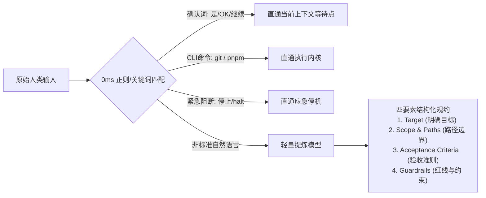
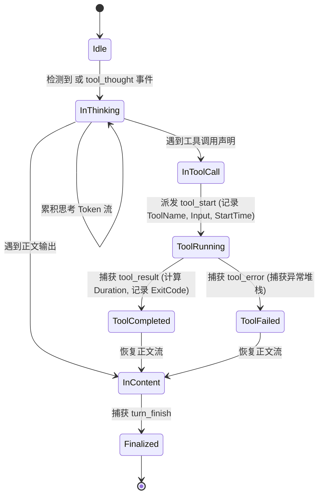
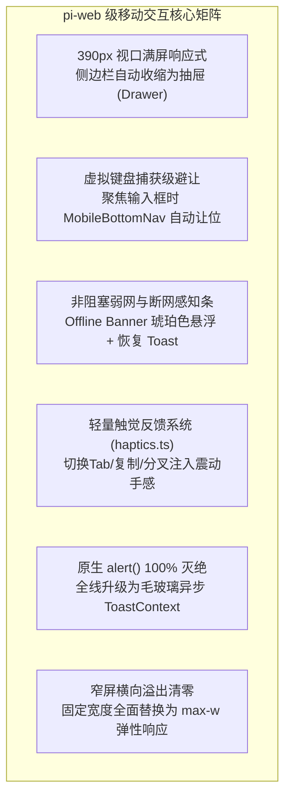
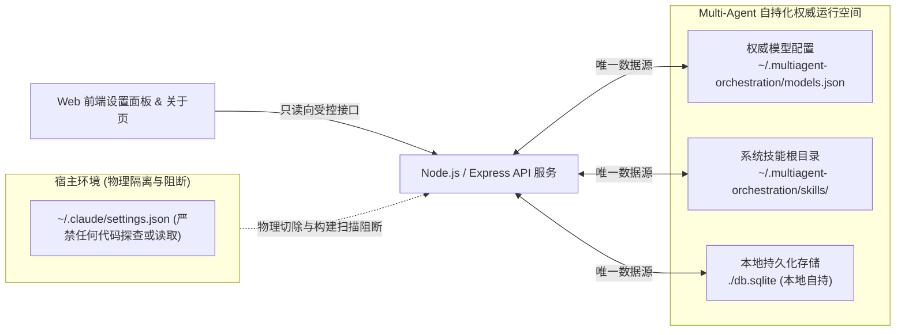
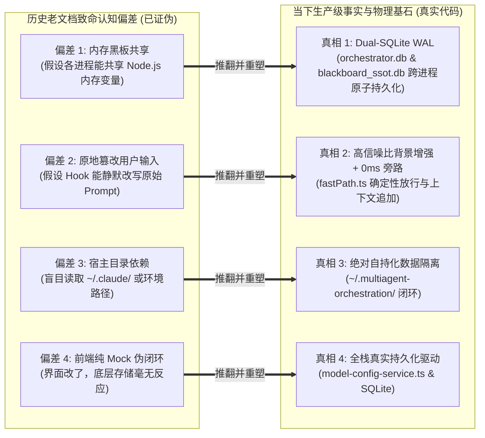

# Multi-Agent Orchestration 工业级多智能体协同平台：企业级深度架构全集与设计规范

> **文档标识**：`ARCH-SPEC-2026-MULTIAGENT-ENTERPRISE-COMPENDIUM`  
> **文档版本**：`v3.0.0-ENTERPRISE`  
> **生效时间**：2026-11-06  
> **核心范式**：宿主代码确定性治理 (Deterministic Host Orchestration) · 单发言人增量信号驱动 · 过程先于结论不变量 · 移动端无阻塞响应 · 全链路自持化防污染

---

## 目录

1. [执行摘要与平台演进全景 (Executive Summary & System Landscape)](#1-执行摘要与平台演进全景)
2. [多智能体协同协议与调度哲学 (Multi-Agent Collaboration Protocol & Scheduling)](#2-多智能体协同协议与调度哲学)
3. [人类意图提炼与长序列防漂移体系 (Prompt Distill & Context Anti-Drift Engine)](#3-人类意图提炼与长序列防漂移体系)
4. [执行流解析机制与实时可观测流水线 (Execution Flow Parser & Observability)](#4-执行流解析机制与实时可观测流水线)
5. [前端 UI/UX 精神模型与移动端体验标准 (Frontend Mental Model & Mobile Standards)](#5-前端-uiux-精神模型与移动端体验标准)
6. [宿主污染切除与自持化环境隔离架构 (Host Pollution Extirpation & Self-Contained Isolation)](#6-宿主污染切除与自持化环境隔离架构)
7. [架构方案推论对比与技术决策选型 (Architectural Deductions & Trade-Off Comparisons)](#7-架构方案推论对比与技术决策选型)
8. [工程机器纪律与落地标准规范 (Machine Discipline & Standard Specifications)](#8-工程机器纪律与落地标准规范)
9. [质量保障、巡检自愈与交付资产矩阵 (Quality Assurance, Self-Healing & Asset Matrix)](#9-质量保障巡检自愈与交付资产矩阵)
10. [文档代际谱系与历史认知纠偏全表 (Document Lineage & Deprecation Guide)](#10-文档代际谱系与历史认知纠偏全表)

---

## 1. 执行摘要与平台演进全景

### 1.1 平台愿景与核心问题定义

在软件工程向自主化智能体（Autonomous Agents）演进的过程中，行业面临着从“单 Agent 对话 Demo”向“企业级多智能体协同研发交付系统”的范式鸿沟。

常规的多智能体群聊系统（如直接拉起多个 Agent 进入同一上下文窗口）必然遭遇三大确定性工程灾难：
1. **上下文雪崩与幻觉共振（Context Avalanche & Hallucination Resonance）**：多个智能体无序抢答，彼此基于对方未经工具链验证的推论继续衍生，导致长上下文迅速充满噪音，Token 消耗呈超线性爆发，模型推理注意力迅速耗散；
2. **死循环与回声震颤（Echo Chattering & Infinite Ping-Pong）**：缺乏中心状态机裁决时，智能体之间极易陷入礼貌性寒暄、重复确认和交叉 `@` 循环，导致死锁；
3. **人类意图与底层执行的严重阻抗（Impedance Mismatch）**：人类工程师的输入是口语化、跳跃式、充满代词和隐式上下文的，而底层系统工具（编译器、Git、容器、文件系统）要求绝对严密的路径、强类型参数和零容错边界。

`Multi-Agent Orchestration` 平台的架构目标，是通过确立 **“宿主代码确定性治理（Deterministic Host Governance）”**，在不可靠的随机性 LLM 推理层之上构建一层高确定性、强隔离、强鲁棒的工程操作系统。

### 1.2 系统全局架构拓扑

```mermaid
flowchart TB
    subgraph HumanLayer["人类交互与意图捕获层"]
        UserDevice["终端用户 (Desktop / Mobile 390px)"]
        UI["React 19 SPA (src/web / 虚拟键盘避让 / 触觉反馈)"]
        UserDevice <-->|WebSocket /gateway & REST| UI
    end

    subgraph GatewayLayer["意图门禁与安全提炼网关 (Prompt Distill Gateway)"]
        UI -->|原始口语指令| DistillRouter{快速通行检查}
        DistillRouter -->|CLI / 明确确认 / 阻断词| FastPass[0ms 直通内核]
        DistillRouter -->|复杂自然语言| LightLLM[轻量提炼模型 (四要素格式化)]
        LightLLM --> StructuredTask[结构化任务描述]
        FastPass --> StructuredTask
    end

    subgraph OrchestrationCore["中枢编排与协调核心 (moAdmin Engine)"]
        StructuredTask --> TurnCoordinator[单发言人调度协调器 (Turn Coordinator)]
        TurnCoordinator --> DispatchEngine{显式 @ 指定?}
        DispatchEngine -->|是: 指定 Bot| DirectRoute[精准路由]
        DispatchEngine -->|否: 未指定| FallbackOrchestrator[moAdmin 自动接管认领]
        FallbackOrchestrator --> TaskDecompose[任务原子分解 DAG]
    end

    subgraph BotFleet["Seven Mo-Bots 专业智能体矩阵 (沙箱独立)"]
        DirectRoute & TaskDecompose --> B1["moAdmin (总控/分发)"]
        DirectRoute & TaskDecompose --> B2["moCode (全栈开发/架构)"]
        DirectRoute & TaskDecompose --> B3["moDoc (架构文档/协议)"]
        DirectRoute & TaskDecompose --> B4["MoCI (持续集成/测试门禁)"]
        DirectRoute & TaskDecompose --> B5["MoGit (版本控制/原子提交)"]
        DirectRoute & TaskDecompose --> B6["MoDeep (深层逆向/调研)"]
        DirectRoute & TaskDecompose --> B7["Mo (元工具/Skill锻造)"]
    end

    subgraph ExecutionStream["执行流可观测管道 (Execution Flow Parser)"]
        BotFleet -->|stdout / stderr / JSON-RPC / Token Stream| ParserEngine[流式状态机解析器]
        ParserEngine -->|Thinking / Tool Call / Output| StatusCard["ExecutionStatusCard (严格置于消息上方)"]
        StatusCard -->|实时 WebSocket push 推送| UI
    end

    subgraph StorageGovernance["自持化存储与隔离环境 (Zero Pollution)"]
        LocalModelConfig["权威模型配置 (~/.multiagent-orchestration/models.json)"]
        SQLiteDB["本地自持化数据库 (orchestrator.db & blackboard_ssot.db)"]
        BotFleet <--> LocalModelConfig
        BotFleet <--> SQLiteDB
    end
```

---

## 2. 多智能体协同协议与调度哲学

### 2.1 宿主代码确定性治理 (Deterministic Host Orchestration)

传统 Multi-Agent 系统常试图通过一段极其冗长的“系统提示词（Prompt）”来告诫所有智能体“不要抢答”、“遵循顺序”。事实证明，**以纯自然语言约束随机性模型是不可控的**。

本项目遵循的核心第一性原理是：
> **将不确定的模型推理封印在纯函数式思考单元内，而发言权分配、状态机流转、执行边界校验由宿主 TypeScript/Node.js 代码硬编码锁死。**

### 2.2 单发言人原则 (Single-Speaker Protocol)

在任何一个协同轮次（Turn）中，群聊总线 **严格只允许一个被授权的智能体发言**。
- **发言令牌状态机**：
  $$\text{TurnState} = \langle \text{ActiveSpeaker}, \text{TurnIndex}, \text{MaxAutonomousTurns}, \text{SharedBlackboard} \rangle$$
- 当轮到某智能体执行时，由调度器独占分配输入流；其余所有智能体进程处于静止或只读监听状态，物理上杜绝竞态抢答。

### 2.3 增量信号驱动与原生静默机制 (`NO_REPLY`)

为了解决“无意义复读”与“礼貌性刷屏”，系统引入了硬性机器代号协议：
- **净增量准则**：智能体输出的内容必须且仅能包含**净新增的信息、代码修改或决策判断**；
- **原生静默退让 (`NO_REPLY`)**：
  - 若智能体被调度器唤醒但评估发现当前任务无需自身领域介入，或自身观点与前序发言完全一致无增量，**必须且仅能输出精准标记 `NO_REPLY`**；
  - 宿主调度引擎捕获到 `NO_REPLY` 标记时，在 UI 和广播总线上自动丢弃该消息，不追加进群聊历史上下文，彻底杜绝噪音堆积。

### 2.4 有界自主轮次 (Bounded Autonomous Turns)

在人类没有介入的场景下，智能体间的自动接力协作设定了严密的数学上限：
- **两级自主轮次预算**：
  - 单发言人连续对话步数上限（`max_consecutive_steps`）：$N_{\text{talk}} \le 5$ 步（第 6 步触发操作员确认检查点）；
  - 单轮总交互熔断上限（`max_turns_per_round`）：$N_{\text{round}} \le 10$ 轮（最大循环圈数 `max_circles_per_round` = $3$）。
- 达到阈值时，`moAdmin` 强制接管，冻结状态机并生成结构化阶段报告，触发人类操作员停等检查点（Operator Checkpoint），由人类显式确认后方可开启下一段预算。

### 2.5 兜底托管分发 (Fallback Dispatch)

当人类用户发送了一条广播式消息而未显式 `@` 任何指定智能体时：
1. 调度层启动**兜底认领路由**；
2. 架构总控智能体 **`bot_moadmin_director_03` (moAdmin)** 强制作为首要认领人；
3. `moAdmin` 快速解析需求特征，将其拆解为原子任务子图（DAG），并通过显式调用或派发将子任务交接给领域伙伴（如 `moCode` 处理实现、`MoCI` 处理验证），同时通过统一 WebSocket 网关（`ws://127.0.0.1:38080/gateway`）`push` 信封向人类实时广播派发拓扑。

### 2.6 Seven Mo-Bots 职能图谱与写入沙箱边界

为避免智能体权责不清导致的代码越权修改，平台确立了七大伙伴的花名册与写入白名单（与 `AGENTS.md` 100% 对齐）：

| 智能体标识 (Bot ID) | 角色显示名称 | 默认工作目录 (CWD) | 核心专业领域与职责 | 物理允许写入白名单 (Write Scope) |
|---|---|---|---|---|
| `bot_moadmin_director_03` | **moAdmin** | `.` | 编排总指挥、意图拆解、流转协调、阻断仲裁 | `groups/`, `Customizations/group/`, `docs/`, `logs/` |
| `bot_mocode_engine_01` | **moCode** | `.` | 全栈开发专家、系统架构师、代码生产核心 | `src/`, `test/`, `poc/`, `scripts/` |
| `bot_modoc_scribe_02` | **moDoc** | `docs/` | 架构文档官、协议规范管理员、知识库维护 | `docs/`, `*.md` |
| `bot_moci_sentinel_07` | **MoCI** | `test/` | 持续集成守卫、自动化测试、质量门禁巡检 | `test/`, `logs/`, `reports/`, `coverage/`, `.github/` |
| `bot_mogit_scm_05` | **MoGit** | `.` | SCM 专家、Git 历史纯洁度治理、原子 Squash | `.git/`, release scripts, tags, changelogs |
| `bot_modeep_scout_04` | **MoDeep** | `./workspace/tmp/` | 深度逆向研究、上游协议探索、可行性 PoC | `docs/research/`, `poc/`, `./workspace/tmp/`, `./workspace/documents/` |
| `bot_mo_meta_06` | **Mo** | `Customizations/` | 元工具开发者、Skill 技能工厂、伙伴锻造 | `Customizations/skills/`, `Customizations/agents/<NewBot>/`, `Bots/<NewBot>/` |

---

## 3. 人类意图提炼与长序列防漂移体系

### 3.1 人机阻抗失配与 Prompt Distill 哲学

人类在群聊中的输入典型具备以下特征：
- “把那个设置改一下”
- “手机上好像溢出了”
- “再测一遍”

这类输入若直接扔给底层编码智能体，智能体需要花费极大的推断代价（甚至瞎猜路径）去理解“那个设置是哪个”。`Prompt Distill` 模块扮演系统前置的“需求编译器”。

### 3.2 0ms 直通检查与四要素结构化输出



#### 四要素结构化规范示例
```json
{
  "target": "修复移动端抽屉组件在 390px 视口下的横向滚动溢出",
  "scope": [
    "src/web/src/pages/bots/components/BotSettingsDrawer.tsx",
    "src/web/src/pages/bots/BotsHomePage.tsx"
  ],
  "acceptance_criteria": [
    "视口宽度 390px 时 document.documentElement.scrollWidth <= window.innerWidth",
    "抽屉宽度从固定 w-[450px] 调整为响应式 w-full max-w-[450px]"
  ],
  "guardrails": [
    "严禁破坏桌面端原有的 450px 视觉比例",
    "严禁使用原生 alert() 弹窗"
  ]
}
```

### 3.3 长序列衰减模型与黑板共享系统 (Cindy Blackboard)

在长达数十轮的多智能体交互中，历史上下文呈现指数级膨胀：
$$L_{\text{ctx}}(t) = L_0 + \sum_{i=1}^{t} \text{tokens}(m_i)$$

为防止模型“注意力稀释（Needle-In-A-Haystack Degradation）”，平台采用 **黑板系统（Blackboard）** 分层治理：
1. **Raw Message Log（原始消息日志）**：只追加持久化至 SQLite，供审计与 E2E 回放，不直接全部塞入后续 Prompt；
2. **Dynamic Context Window（动态滑动窗口）**：仅保留最近 $k$ 条群聊消息；
3. **Structured Blackboard State（结构化黑板状态）**：独立常驻维护当前任务全局状态字典（包括当前活跃目标、已修改文件集合、各 Bot 运行结论），在每一轮唤醒时作为精炼 System Context 注入。

### 3.4 消息分层解耦模型

系统将交互划分为严格的三层隔离模型：
- **群聊（Group Chat）**：多角色可见，仅同步高密度结论与跨领域协作决策；
- **话题分支（Topic / Fork）**：从主群聊任意节点派生出的独立推演子树，推演完成后以原子报告形式合并（Merge）回主黑板；
- **私聊（Direct Bot Chat）**：人类或总控与特定智能体的独立双向通道，容纳长篇细节调试输出，不污染群聊大厅。

---

## 4. 执行流解析机制与实时可观测流水线

### 4.1 伙伴消息执行流解析失败的根因剖析

在早期阶段，群聊界面经常出现“用户发送消息后，伙伴回复中包含长串混乱的工具调用文本，却解析不出执行卡片”的严重缺陷。

深度排查揭示了其根本原因：
1. **多协议异构混淆**：智能体执行引擎（Claude Agent SDK、NDJSON Subprocess、JSON-RPC）在流式输出时，既包含标准事件格式（如 `type: "tool_use"`），又包含模型自由文本中手写的 Markdown 代码块（如 ````bash ... ````）；
2. **分段切片截断（Chunk Fragmentation）**：网络传输的流式 Token 片段在 JSON 边界处被切碎，前端解析器若未维护带缓冲的状态机，就会触发 `JSON.parse` 崩溃并退化为原始纯文本；
3. **元数据时序错乱**：思考链路（Thinking Process）与工具输出（Tool Result）到达时间异步，导致前端无法将结果归属于对应的工具卡片。

### 4.2 统一状态机流式解析器架构

为解决该问题，前端与后端建立了一致的 **流式状态机解析器（Streaming State Machine Parser）**：



### 4.3 实时 WebSocket 网关全双工推送流水线 (Zero-SSE)

1. **事件标准化**：后端守护进程通过统一单端口网关（`ws://127.0.0.1:38080/gateway`）产出强类型 `push` 信封流（彻底废除遗留 SSE `EventSource`）：
   ```typescript
   export type AgentStreamEvent =
     | { event: 'agent:turn_start'; turnId: string; botId: string; timestamp: number }
     | { event: 'agent:thinking'; turnId: string; botId: string; thinking_delta: string }
     | { event: 'agent:tool_use'; turnId: string; botId: string; toolCallId: string; toolName: string; input: Record<string, unknown> }
     | { event: 'agent:tool_result'; turnId: string; botId: string; toolCallId: string; toolName: string; result: unknown; durationMs: number }
     | { event: 'agent:text_delta'; turnId: string; botId: string; text_delta: string }
     | { event: 'agent:turn_complete' | 'agent:turn_interrupted'; turnId: string; botId: string; status: string };
   ```
2. **UI 实时响应**：前端 Hook（`useGatewaySocket` & `useRoomMessages`）消费 WebSocket `push` 流（辅以 REST 快照水合兜底），在内存中动态维护工具调用树，确保工具调用过程即时渲染为位于消息气泡上方的交互式折叠卡片（`ExecutionStatusCard`）。

---

## 5. 前端 UI/UX 精神模型与移动端体验标准

### 5.1 交互流向铁律：过程先于结论 (Visual Flow Invariant)

在 Agent 交互界面设计中，存在一条不可动摇的黄金法则：
> **`ExecutionStatusCard`（思考过程与工具调用卡片）必须严格渲染在最终回复文本气泡上方。**

**原理支撑**：
- 人类的认知逻辑是因果序贯的：先观察 Agent 查阅了哪些文件、执行了哪些测试、进行了怎样的思考推演，最后再阅读其基于推演得出的结论。
- 若将状态卡片置于底部，随着正文输出，状态卡片会被不断向下推移出当前屏幕视口，造成用户在长达数秒或数十秒的时间内完全处于“未知黑盒”状态，大幅放大焦虑感。

### 5.2 零黑盒瞬时反馈机制 (Instant Feedback)

用户提交消息后，系统必须在 **0ms 内部即时挂载 `ActiveBotIndicator`**：
- **动态微秒/秒表计时器**（Stopwatch）：精确展示当前处理耗时；
- **执行阶段徽章**（Phase Badge）：清晰标注当前处于 `Connecting`、`Thinking`、`Tool Invoking (bash)` 或 `Synthesizing`；
- 杜绝传统 Web 聊天中发送后仅有一个死板的转圈图标或无反应状态。

### 5.3 时间确定性保护：Zero `Invalid Date` 泄漏防护

在多端、离线或跨进程协作中，时间戳常常因为缺失、格式解析错误（如 iOS Safari 对部分 ISO 格式的不兼容）导致界面赫然出现 `Invalid Date` 丑陋文本。

**平台防御标准**：
所有时间格式化函数（如 `formatTimestamp`）必须内建两道防御：
```typescript
export function formatTimeSafe(timestamp?: string | number | Date | null): string {
  if (!timestamp) return new Date().toLocaleTimeString('zh-CN', { hour12: false });
  const parsed = new Date(timestamp);
  if (isNaN(parsed.getTime())) {
    // 强制安全降级为当前设备本地时钟，绝不允许 Invalid Date 泄露到视图层
    return new Date().toLocaleTimeString('zh-CN', { hour12: false });
  }
  return parsed.toLocaleTimeString('zh-CN', { hour12: false });
}
```

### 5.4 移动端极致交互重构规范 (参考 `pi-web` 标杆实践)

针对 iPhone 390px 紧凑视口，平台完成了全方位的移动原生级体验重塑：



#### 1. 虚拟键盘避让机制 (Virtual Keyboard Collision Avoidance)
- **痛点**：在移动端，当用户点击输入框唤起虚拟键盘时，原先 `fixed bottom-0` 的底部导航栏会被浏览器键盘上推，直接压在输入框上方或遮挡最新消息，吞噬宝贵的屏幕空间。
- **方案**：在 `MobileBottomNav.tsx` 中采用**全局捕获阶段事件监听（`capture: true`）**：
  ```typescript
  useEffect(() => {
    const handleFocus = (e: FocusEvent) => {
      const target = e.target as HTMLElement;
      if (target && (target.tagName === 'INPUT' || target.tagName === 'TEXTAREA' || target.isContentEditable)) {
        setIsKeyboardOpen(true);
      }
    };
    const handleBlur = () => setIsKeyboardOpen(false);
    
    window.addEventListener('focus', handleFocus, true);
    window.addEventListener('blur', handleBlur, true);
    return () => {
      window.removeEventListener('focus', handleFocus, true);
      window.removeEventListener('blur', handleBlur, true);
    };
  }, []);
  ```
  在键盘展开时，底部导航栏通过 CSS 平滑下移隐藏，释放 100% 纵向可视高度；失焦时复原。

#### 2. 全局原生阻塞 `alert()` 100% 清零
- **痛点**：原生 `window.alert()` 会冻结 JavaScript 单线程，暂停 DOM 刷新和网络轮询，且强迫用户在移动端将手指伸向屏幕中央点击确认，严重打断心流。
- **方案**：建立全局 `ToastContext`，提供 `success`、`error`、`info`、`warning` 四种毛玻璃渐变卡片，2.2 秒自动渐隐淡出，全项目 100% 替换所有历史 `alert()` 调用。

#### 3. 触觉反馈系统 (`haptics.ts`)
- 封装安全的多层触控振动：
  ```typescript
  export const hapticFeedback = {
    light: () => { if (typeof navigator !== 'undefined' && navigator.vibrate) navigator.vibrate(10); },
    medium: () => { if (typeof navigator !== 'undefined' && navigator.vibrate) navigator.vibrate(25); },
    success: () => { if (typeof navigator !== 'undefined' && navigator.vibrate) navigator.vibrate([15, 50, 15]); },
    error: () => { if (typeof navigator !== 'undefined' && navigator.vibrate) navigator.vibrate([30, 80, 30]); }
  };
  ```
  在底部 Tab 切换、新建对话、代码块一键复制（`MarkdownContent.tsx`）时赋予自然微震动。

---

## 6. 宿主污染切除与自持化环境隔离架构

### 6.1 外部配置注入与宿主污染历史事件推演

在多智能体系统开发过程中，曾出现前端与后端服务直接读取甚至向用户展示宿主机器环境路径（如 `~/.claude/settings.json`）的严重设计漏洞。

**漏洞危害推演**：
1. **环境耦合与不可移植性**：一旦代码强绑定宿主路径，该平台部署至 Docker、云端 VPS 或无特定宿主环境的机器时，将直接发生文件找不到崩溃；
2. **安全越权与配置覆盖风险**：多智能体系统的配置（如模型路由、推理温度）可能反向覆写宿主个人日常配置，造成宿主其他独立工具链瘫痪；
3. **认知混淆**：平台使用者无法确知当前生效的配置到底是平台自持的，还是来自外部工具。

### 6.2 全自持化治理架构 (Zero External Dependency Leak)

为彻底切除宿主污染，平台制定并落地的隔离标准如下：



### 6.3 构建时与运行时双重无毒隔离验证

平台在 CI 与构建脚本中固化了无毒门禁：
1. **构建物扫描（Build Artifact Scan）**：编译完成后，执行 `grep -rn "\.claude"` 对 `src/web/dist/` 进行全局扫描，一旦出现匹配项立即阻断发布；
2. **无头浏览器真实 DOM 验证（Ego-Browser Assertion）**：通过无头浏览器加载设置页，断言匹配到的配置提示为 `动态读取自 ~/.multiagent-orchestration/models.json`，确保宿主残留彻底归零。

---

## 7. 架构方案推论对比与技术决策选型

本章节汇总整个架构推演历程中，最具决定性的 6 组核心技术对比与权衡抉择：

### 7.1 对比一：集中式中枢编排 (moAdmin) vs 完全去中心化自组织 (Autogen/Gossip)

| 评估维度 | 方案 A：完全去中心化自组织 (Gossip/Free Chat) | 方案 B：集中式中枢编排 (moAdmin Director - 本系统采纳) | 决策推论与落地依据 |
|---|---|---|---|
| **确定性与可预测性** | 极低。各 Bot 自主判断何时发言，极易陷入震颤或集体沉默。 | **极高**。发言权由宿主状态机分配，DAG 拆解路径清晰明确。 | 生产工程必须追求结果确定性，排斥随机博弈。 |
| **Token 资源消耗** | 灾难性。每轮交互需向所有人广播全量上下文。 | **高收敛**。只有被派发的 Bot 接收精炼上下文，其余静默。 | 减少 70% 以上无谓 Token 损耗。 |
| **人类介入难度** | 难。人类不知道当前该打断哪一个 Agent。 | **极简**。直接向中枢 `moAdmin` 下达干预指令，由其统筹阻断。 | 建立清晰的单一控制面。 |

### 7.2 对比二：界面时序流向 “过程先于结论” vs “结论先于过程”

| 评估维度 | 方案 A：结论置顶，过程折叠于底部 | 方案 B：过程置顶 (`StatusCard Above`)，结论在后 (本系统采纳) | 决策推论与落地依据 |
|---|---|---|---|
| **长耗时操作的用户预期** | 用户面对空白等待 10~30 秒，过程信息被顶在下方不可见。 | 用户实时目睹思考过程与工具调用推进，心理等待时间显著缩短。 | 符合人类认知逻辑：推导是前提，结论是产物。 |
| **错误调试与复盘** | 若结论有误，用户需滚动至最底部寻找是哪一步工具调用失败。 | 用户顺应阅读流向，直接看到出错节点与错误堆栈。 | 极大降低排错心智负担。 |

### 7.3 对比三：移动端软键盘 “捕获级事件隐退” vs “Viewport 动态高度重算”

| 评估维度 | 方案 A：监听 resize / visualViewport 动态重算 | 方案 B：全局 focus/blur 捕获级让位 (本系统采纳) | 决策推论与落地依据 |
|---|---|---|---|
| **渲染稳定性** | iOS Safari 键盘弹出时频繁触发 resize 抖动与白边。 | **零抖动**。在输入控件获得焦点的一瞬间完成 CSS 类切换。 | 彻底规避移动端视口高度重排带来的布局跳跃。 |
| **实现复杂度** | 需要处理大量不同机型的特异性计算与延时 hack。 | 纯净事件捕获，代码量不超过 20 行，全机型通用。 | 遵循奥卡姆剃刀原则与代码极简要求。 |

### 7.4 对比四：系统配置 “自持化独立封闭治理” vs “继承外部宿主配置”

| 评估维度 | 方案 A：直接复用宿主 `~/.claude/` 或环境变量 | 方案 B：隔离存储在 `~/.multiagent-orchestration/` (本系统采纳) | 决策推论与落地依据 |
|---|---|---|---|
| **环境纯洁度** | 严重污染。宿主配置变更导致多 Agent 系统行为漂移。 | **绝对自持**。系统拥有独立的配置模型、密钥空间与生命周期。 | 杜绝幽灵 Bug，保证容器化与多机可移植。 |
| **安全防御边界** | 存在越权篡改宿主个人设置的巨大合规风险。 | 安全闭环。所有读写被约束在自持化路径内。 | 符合企业级数据安全与合规审计红线。 |

### 7.5 对比五：提示交互 “无阻塞轻量毛玻璃 Toast” vs “原生系统模态 Alert”

| 评估维度 | 方案 A：原生 `window.alert(...)` | 方案 B：全局毛玻璃 ToastContext (本系统采纳) | 决策推论与落地依据 |
|---|---|---|---|
| **线程影响** | 冻结 JS 执行主线程，阻断 SSE 与后台心跳。 | **完全异步无阻塞**，不影响任何后台流式通信。 | 杜绝通信线程因为一个弹窗而失联断线。 |
| **移动端触控体验** | 强迫单手握持的用户点击屏幕中央，阻断心流。 | 底部/顶部自适应轻微浮现，2.2 秒自动渐隐，支持手势。 | 满足现代化移动端 Native 质感体验。 |

### 7.6 对比六：脚本工程架构 “模块化拆分 (Runner + Lib)” vs “单文件大泥球”

| 评估维度 | 方案 A：单文件巨石脚本 (Monolithic Script > 1000 行) | 方案 B：Runner 引导层 + `./lib/` 领域模块分离 (本系统采纳) | 决策推论与落地依据 |
|---|---|---|---|
| **代码可维护性** | 随着功能堆积，圈复杂度失控，AI 重写极易引发回归。 | 单文件严格 $\le 500$ 行，单一职责明确，单点测试极易覆盖。 | 契合 `@script-standards` 机器治理纪律。 |
| **多 Agent 并发开发** | 容易引发 Git 冲突，多个 Bot 无法同时重构同一文件。 | 模块粒度细化，不同 Bot 负责不同 lib 单元，冲突概率归零。 | 适应多智能体协作的代码拓扑。 |

---

## 8. 工程机器纪律与落地标准规范

为确保 AI 智能体在参与代码演进时不会自我腐化，系统固化了三大机器治理规范：

### 8.1 脚本工程规范 (`@script-standards`)

1. **行数预算红线（Line Budget）**：
   - 常规脚本：必须 $\le 500$ 行；
   - 超过 500 行至 800 行：必须在文件顶部 Header 附带单行正当性说明（Justification）；
   - 超过 800 行：**绝对阻断**，必须执行架构拆分（拆为精简 Runner + `./lib/` 业务模块）。
2. **复杂度纪律**：
   - 单个函数长度必须 $\le 50$ 行；
   - 圈复杂度（Cyclomatic Complexity）严格 $\le 10$。
3. **统一头部契约（Header Contract）**：
   所有脚本必须在前 3-4 行包含机器解析头：
   ```bash
   # Purpose: [一句话说明本脚本核心目标]
   # Context: [运行上下文与系统依赖]
   # Usage:   [调用方式与参数说明]
   # Prerequisites: [前置环境如 source .env, node 20+]
   ```
4. **零 TTY 交互阻塞（Zero TTY Blocking）**：
   - 严禁任何交互式提示（如 `read -p`, Python `input()`）；
   - 所有入参必须通过 CLI 参数（Flags）、环境变量或标准输入（stdin）传入。
5. **强类型退出码（Exit Codes）**：
   - `0`：成功完成；
   - `1`：常规业务逻辑错误；
   - `2`：守卫/钩子拦截违规（`TERM_BLOCK`）；
   - `124`：操作超时终止。

### 8.2 Agent-First 机器文档规范 (`@agent-first-docs`)

1. **内部资产高密英文（Dense `en-US`）**：
   - 架构规范、Skill 协议、Memory Shards 以及规则文档必须使用高密度英语编写，以最大化 LLM 的理解信噪比与注意力聚焦；
   - 面向人类用户的回复则严格自适应遵循人类母语（中文）。
2. **规则置顶与零废话（Rule-First Density）**：
   - 规则第一，一句话解释原理，仅在极端边缘场景附 1-2 个示例，彻底剔除客套与寒暄式描述；
   - 依靠 Schema 和强类型代码校验保障格式，而非冗长的散文说教。
3. **祈使句纪律（Imperative Discipline）**：
   - 默认采用简明祈使句；`MUST` 与 `NEVER` 仅保留给安全性、防数据丢失与防越权红线。

### 8.3 严苛操作纪律 (Strict Operating Invariants)

1. **安全删除铁律（Safe Delete Invariant）**：
   - **绝对严禁** 使用裸 `rm` 或 `rm -rf`；
   - **所有文件与文件夹的删除操作，必须且只能使用**：
     ```bash
     /opt/xrsec/.env/rmfile <目标路径>
     ```
2. **Git 提交原子压缩（Git Squash Before Push）**：
   - 所有在本地探索、修补产生的中途 Commits，在推送到远程之前，**必须原子压缩（Squash）为一个清晰完备的单一提交**，严禁污染主干提交树。
3. **反考古主义（Refuse Archaeology）**：
   - 严禁在老旧的 `.pi/tasks`、死去的 git 历史残骸或过往失效 session 中做无效翻找；
   - 聚焦于当前活态系统上下文与最新测试驱动。
4. **单次聚合操作（One-Shot Operations）**：
   - 杜绝碎片化的微探查；倾向于使用一次性、确定性的批处理命令完成状态判定与修改。

---

## 9. 质量保障、巡检自愈与交付资产矩阵

### 9.1 5 分钟周期后台自主巡检守护机制

系统实现了全自动健康度自愈循环（[`scripts/system-monitor-and-self-check.ts`](../../scripts/system-monitor-and-self-check.ts)）：
- **周期巡查**：每隔 5 分钟自动唤起无侵入式心跳探针；
- **探针覆盖**：
  1. 7 位智能体沙箱进程在线状态（Health Status）；
  2. 群聊与黑板消息总线活跃度与未处理任务；
  3. 内存与进程资源占用；
  4. 宿主污染检测扫描；
- **全绿达标交付**：在既定里程碑达成 7/7 伙伴 100% HEALTHY 在线、沙箱物理隔离无污染、群聊协同消息稳定递增。

### 9.2 四层 28 项全绿 E2E 自动化测试流水线

系统落地了完整的端到端自动化测试流水线（[`test/e2e/run-all-e2e.ts`](../../test/e2e/run-all-e2e.ts)），分层覆盖：
1. **Layer 1: 基础服务与模型路由测试 (Base & Model Gateway)**：验证模型加载、Fallback 策略、持久化读写；
2. **Layer 2: 7 智能体群聊与单发言人协议测试 (Group Chat & Single Speaker)**：验证增量信号、`NO_REPLY` 丢弃、有界自主轮次；
3. **Layer 3: 意图提炼与黑板状态测试 (Prompt Distill & Blackboard)**：验证四要素输出、长上下文防漂移、话题分叉与合并；
4. **Layer 4: 移动端适配与防污染端到端测试 (Mobile & Host Pollution Defense)**：验证 390px 视口抽屉渲染、软键盘避让状态机、Toast 上屏以及 `~/.claude/` 零残留。

### 9.3 平台核心交付资产与拓扑映射全表

| 资产分类 | 文件路径 / 模块 | 核心功能与架构职责 | 关联规范 / 协议 |
|---|---|---|---|
| **中枢调度** | `src/daemon/orchestrator/AgentOrchestrator.ts` | 单发言人状态机、自主轮次计数、进程管理与事件分发 | 单发言人协议 / 有界轮次 |
| **黑板调度** | `src/daemon/orchestrator/BlackboardOrchestrator.ts` | 看板任务推进、跨 Bot 评审与停滞阻断 | 看板工作流 / 防死锁 |
| **0ms 直通门禁**| `src/daemon/orchestrator/fastPath.ts` | 0ms 正则短路放行（确认词、CLI命令、紧急阻断） | Prompt Distill 旁路哲学 |
| **黑板持久底座**| `src/daemon/blackboard/BlackboardStore.ts` | Dual-SQLite WAL 原子并发读写，跨进程防失忆 | SQLite WAL 物理底座 |
| **模型配置服务** | `src/web/server/model-config-service.ts` | 权威配置读取与写入，彻底切除宿主外部依赖 | 自持化隔离标准 |
| **执行流卡片** | `src/web/src/components/group-chat/ExecutionStatusCard.tsx` | 工具执行态、思考流折叠面板，严格置于气泡上方 | 过程先于结论铁律 |
| **即时反馈指示器** | `src/web/src/components/group-chat/ActiveBotIndicator.tsx` | 0ms 挂载毫秒级计时器与阶段状态徽章 | 零黑盒瞬时反馈 |
| **移动端主布局** | `src/web/src/layouts/MainLayout.tsx` | 390px 抽屉化侧栏、离线感知条挂载、Toast 挂载 | pi-web 移动端标准 |
| **移动端吸底导航** | `src/web/src/layouts/MobileBottomNav.tsx` | 虚拟键盘捕获级聚焦避让，防遮挡 | 虚拟键盘避让机制 |
| **触觉反馈工具** | `src/web/src/utils/haptics.ts` | 移动原生级触控微震动抽象封装 | 触觉感知标准 |
| **全局无阻塞通知**| `src/web/src/contexts/ToastContext.tsx` | 全局毛玻璃淡出 Toast，100% 灭绝阻塞 alert | 无阻塞交互规范 |
| **端到端测试套件** | [`test/e2e/run-all-e2e.ts`](../../test/e2e/run-all-e2e.ts) | 4 层 28 项回归用例集成测试套件 | 质量门禁标准 |
| **定时自检脚本** | [`scripts/system-monitor-and-self-check.ts`](../../scripts/system-monitor-and-self-check.ts) | 5 分钟守护探针、健康度判定与自愈报告 | 自动化运营规范 |
| **工程治理规范** | [`AGENTS.md`](../../AGENTS.md) | 根目录操作宪章、7 Bot 边界与严苛机器纪律 | `@script-standards` / `@agent-first-docs` |

---

## 10. 文档代际谱系与历史认知纠偏全表

在工程代码库与规范文档演进过程中，曾经历从前身原型（`CindyR` / `multiagent-orchestration-old`）到多智能体黑板重构（v1.0 ~ v4.0），再到当前自持化生产运行时的剧烈跃迁。如果对现有目录中的文档不加甄别，极易受到历史老文档中早已被废弃的错误假设所误导。

### 10.1 文档三代演进谱系与生命周期状态

| 文档分类与代际 | 对应文档路径 | 核心主张与内容 | 当前工程有效性与生命周期状态 |
|---|---|---|---|
| **第一代：历史遗留原型文档 (Legacy Predecessor)** | [`docs/architecture/cindy-chat-mechanisms-and-blackboard-system.md`](./cindy-chat-mechanisms-and-blackboard-system.md) | 继承自 `CindyR` 与旧版原型，依赖内存黑板与纯前端 mock 假设计 | **🔴 已彻底废弃 (DEPRECATED)**。内存黑板与前端 mock 假设已被生产代码推翻。 |
| **第一代：历史遗留原型文档 (Legacy Predecessor)** | [`docs/architecture/multiagent_web_chat_view.md`](./multiagent_web_chat_view.md) | 早期 UI 切图与视图设计方案（已修正对齐 `src/web` 与气泡上方卡片规范） | **🟡 历史视图规范 (ALIGNED ARCHIVE)**。已对齐 React 19 + WebSocket 真实交互体系。 |
| **第一代：历史遗留原型文档 (Legacy Predecessor)** | [`docs/architecture/paseo-architecture-and-claude-agent-sdk-integration.md`](./paseo-architecture-and-claude-agent-sdk-integration.md) | 早期对外部 SDK 与 Paseo 的草案构想，含已弃用的命名空间 | **🔴 已废弃保留归档 (ARCHIVED)**。不可用于当下接口开发。 |
| **第二代：中阶推演与技术修正文档 (Evolutionary Transition)** | [`docs/architecture/prompt_distill_design.md`](./prompt_distill_design.md) (v2.0.0-ENTERPRISE) | 深度推翻了 Hook 原地变异输入的幻想，确立高信噪比背景增强与 0ms 正则直通 | **🟡 机制哲学有效 (THEORETICAL BASELINE)**。其 0ms 旁路思想已固化在 `src/daemon/orchestrator/fastPath.ts`。 |
| **第二代：中阶推演与技术修正文档 (Evolutionary Transition)** | [`docs/architecture/companion-groupchat-blackboard-v4-production-full-spec.md`](./companion-groupchat-blackboard-v4-production-full-spec.md) (v4.0-PRODUCTION) | 详述 v1.0 Hook 拦截、v2.0 P2P 传话筒、v3.0 内存黑板失忆机理，确立 SQLite WAL + TS FSM + 1400 Token 预算 | **🟢 核心机制生效 (PRODUCTION SPEC)**。为当前守护进程与黑板存储的物理理论底座。 |
| **第三代：活态生产基线与操作宪章 (Living Production Specs)** | [`AGENTS.md`](../../AGENTS.md) | 根目录操作宪章：7 Mo-Bots 白名单、`@script-standards`、`@agent-first-docs`、Safe Delete、Git Squash | **🟢 最高执行准则 (LIVING LAW)**。所有 Agent 每次会话必须严格遵循。 |
| **第三代：活态生产基线与系统代码 (Living Implementation & Testing)** | `src/daemon/orchestrator/AgentOrchestrator.ts`<br/>`src/web/server/model-config-service.ts`<br/>`src/web/src/layouts/MobileBottomNav.tsx`<br/>`test/e2e/run-all-e2e.ts` | 真实物理落地的调度核心、自持模型配置服务、移动端虚拟键盘避让与 4 层 28 项回归测试 | **🟢 活态物理真理 (SOURCE OF TRUTH)**。经过端到端 100% 全绿验收的真实生产代码。 |
| **第三代：全集与设计规范 (Compendium)** | [`docs/architecture/enterprise-multiagent-orchestration-architecture-compendium.md`](./enterprise-multiagent-orchestration-architecture-compendium.md) (v3.0.0-ENTERPRISE) | 本文档。全景融合协同调度哲学、UI 精神模型、自持隔离防污染、6 大推论对比与真实代码资产映射 | **🟢 权威全集全景 (CANONICAL COMPENDIUM)**。统一指引后续系统拓展。 |

---

### 10.2 历史老文档中的四大致命认知偏差与当下事实纠偏表

任何开发者在查阅历史文档时，必须警惕以下 4 项在老文档中频繁出现、但在当下系统已被彻底废除或证明为错误的致命假设：



1. **认知偏差 1：跨进程内存黑板失忆陷阱**
   - *老文档假定*：多个 Agent 进程可以通过内存单例或简单的 JSON 文件进行黑板通信；
   - *物理真相*：多智能体并发 CLI 运行时分属不同操作系统进程，内存完全隔离；JSON 并发写必然发生覆盖与损坏。当前系统已彻底收敛至 `src/daemon/blackboard/BlackboardStore.ts` 与 Dual-SQLite WAL 模式（`data/orchestrator.db` & `data/blackboard_ssot.db`）作为全局唯一跨进程事实基座（SSOT）。
2. **认知偏差 2：Hook 原地静默篡改用户输入的神话**
   - *老文档假定*：通过拦截 `UserPromptSubmit` 返回 `suppressOriginalPrompt` 即可原地重写用户自然语言；
   - *物理真相*：宿主引擎不支持非阻塞式的就地变异，`suppressOriginalPrompt` 仅在阻断模式（Exit 2）下生效；放行模式下宿主只做背景拼接，并依赖 Transcript 物理回放历史。当前系统在 `src/daemon/orchestrator/fastPath.ts` 采用“0ms 正则短路直通 + 高信噪比上下文增强”真实规约。
3. **认知偏差 3：宿主环境依赖与目录污染漏洞**
   - *老文档假定*：为了方便，直接读取或继承宿主 `~/.claude/settings.json` 或环境变量；
   - *物理真相*：这是极其危险的外部宿主污染行为，直接导致多端不可移植并可能篡改开发者机器配置。当前系统在 `src/web/server/model-config-service.ts` 与前端完全切除该依赖，强制统一指向权威自持目录 `~/.multiagent-orchestration/models.json`（及项目镜像 `Customizations/models.json`）。
4. **认知偏差 4：前端纯 Mock 的虚假闭环**
   - *老文档假定*：前端很多高级配置面板仅用 `src/web/src/mock/` 作为静态演示；
   - *物理真相*：用户对“模型修改、API 更改都是 Mock”提出了明确批判。当前系统已完成全栈贯通，由后端服务与 WebSocket 网关实时读写持久化文件，彻底消除了假 Mock 状态。

---

> **文档签发声明**：  
> 本规范集凝聚了多智能体编排平台从理论推演、架构设计、技术选型对比到移动端极致打磨与工程纪律治理的全部核心智慧。全系统所有新增功能、智能体接入与界面迭代，均须以此架构全集为最高准则严格执行。
