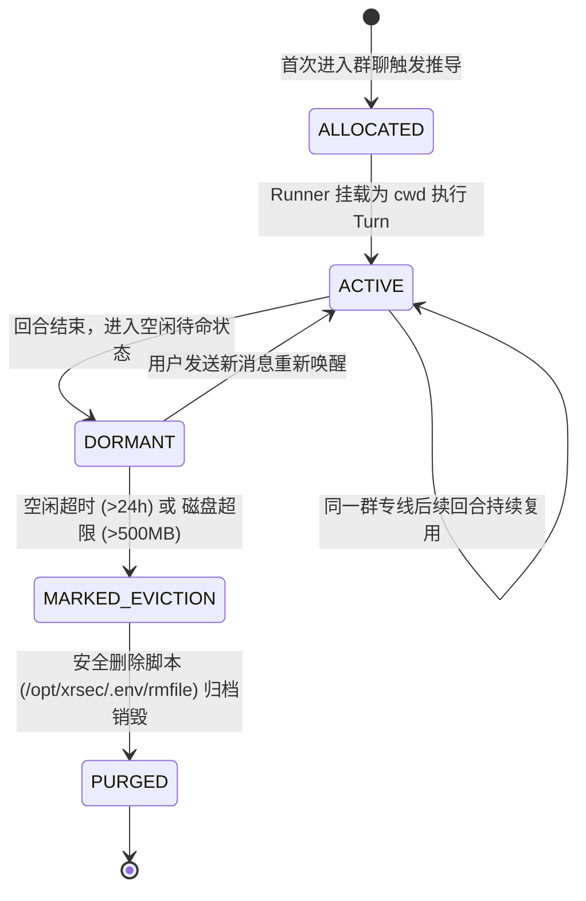
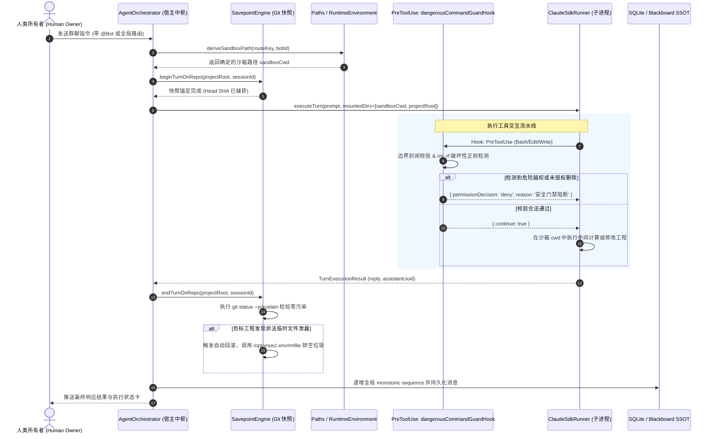

# 存储拓扑与多级工作区隔离规范 (Storage Topology & Multi-Level Workspace Isolation)

> **Universal Header**:
> - **Purpose**: 定义多智能体协同系统中的分层存储拓扑、伙伴私有域、群专属存储域、目标工程零污染挂载、临时执行沙箱确定性派生与安全删除不变量。
> - **Context**: 运行于多智能体守护进程编排层，支撑 `@anthropic-ai/claude-agent-sdk` 子进程运行时、SQLite WAL 状态机与群聊协同隔离。
> - **Prerequisites**: Node.js 22+, `@anthropic-ai/claude-agent-sdk`, `DatabaseSync` (`node:sqlite`), POSIX 文件系统环境。
> - **Related Specs**: [cindy-chat-mechanisms-and-blackboard-system.md](../cindy-chat-mechanisms-and-blackboard-system.md), [companion-groupchat-blackboard-v4-production-full-spec.md](../companion-groupchat-blackboard-v4-production-full-spec.md), [bot-group-orchestration.md](../../dev-rules/bot-group-orchestration.md).

---

## 1. 架构愿景与物理隔离公理 (Architecture Vision & Isolation Axioms)

在多智能体（Multi-Agent）群聊与协同攻坚系统中，文件系统的访问冲突与意外污染是导致系统崩溃与工程脏数据的首要根因。早期多 Agent 原型常将工作目录与用户工程代码库直接混杂，引发三大致命缺陷：
1. **工作区脏污与代码库污染**：Agent 执行过程中的临时探针、中间规划文件（如草稿日志、中间缓存）散落于用户工程根目录，破坏 Git 工作树干净度；
2. **跨智能体资产冲撞与覆盖**：多个 Bot 在同一目录下执行构建或生成同名中间文件，导致相互覆盖与竞态崩溃；
3. **记忆与配置越权泄露**：Bot 的私有长期经验、系统人设与群内临时增量混在同一路径，使得私密经验意外被群聊同行拉取，或群聊上下文污染私聊持久记忆。

为彻底根除上述物理隐患，本规范确立**物理拓扑三层解耦 (Three-Tier Topology Decoupling)** 与**工作区零污染公理 (Zero-Pollution Axiom)**：
- **公理 A1（单一归属与私有持久化）**：每个智能体拥有完全独立的私有持久化域，负责存储人设、私有技能与私聊经验，严禁群聊流水与同行记忆就地渗入；
- **公理 A2（群协作域与代码库严格解耦）**：群元数据、黑板单一事实源（SSOT）、协同计划与产物仅留存于群专属存储域，绝不侵入用户项目目录；
- **公理 A3（目标工程零污染挂载）**：用户工程代码库仅通过受限白名单路径（`mountedDirs`）以只读或受限修改形式挂载，严禁在工程内生成任何 `.cindy/` 或临时中间垃圾；
- **公理 A4（执行沙箱确定性路由哈希）**：群专线会话采用 `chat-workspaces/<sha256(routeKey:botId)>/` 临时执行沙箱，既保障执行隔离，又实现跨回合编译缓存与 Prompt Caching 最大化复用；
- **公理 A5（安全删除物理不变量）**：严禁系统原生 `rm` 或 `rm -rf` 破坏性调用，所有清理操作强制重定向至受控安全删除脚本 `/opt/xrsec/.env/rmfile`。

---

## 2. 存储拓扑分层架构全景 (Storage Topology Hierarchy)

系统严格划分三位一体的物理存储拓扑结构，所有路径解析均由统一路径解析模块（`src/storage/Paths.ts`）与运行时环境管理器（`src/storage/RuntimeEnvironment.ts`）驱动。

### 2.1 物理存储目录拓扑

```
$MULTIAGENT_HOME/ (默认: ~/.multiagent-orchestration/)
├── agents/ (或 partners/)                   # [1. 伙伴私有域: 单智能体持久化资产]
│   └── <bot_id>/
│       ├── SOUL.md                         # 核心人设、行为守则与口吻约束 (静态只读基座)
│       ├── MEMORY.md                       # 长期私有经验库与知识蒸馏缓存 (增量自愈刷写)
│       ├── capabilities.json               # 权限等级、工具黑白名单、思考深度
│       ├── profile.json                    # 显示元数据 (名称、头像、描述、状态)
│       ├── skills/                         # 伙伴私有或专属技能扩展 (SKILL.md)
│       ├── workspace/                      # 1:1 私聊会话默认执行工作区 (cwd)
│       └── claude_config/                  # 隔离的 Claude Code 配置与会话数据库
│           ├── .claude.json                # 运行时配置与安全设置
│           └── plugins/                    # 本地插件与能力挂载
│
├── groups/                                 # [2. 群专属存储域: 群协作共享资产]
│   └── <group_slug>/
│       ├── room.json                       # 群元数据、成员列表、单调严格自增 sequence 水位
│       ├── GROUP_CHARTER.md                # 群章程 (协作使命、组织者、成员角色、挂载工程)
│       ├── GROUP_MEMORY.md                 # 【共享黑板】跨 Bot 共享单一事实源 (SSOT)
│       ├── plans/                          # 多阶段工程规划与工单持久化 (plan_*.json)
│       └── artifacts/                      # 跨智能体协同交付物与补丁暂存区
│
├── chat-workspaces/                        # [3. 临时执行沙箱: 群专线执行隔离工作区]
│   └── <sha256(routeKey:botId).slice(0,16)>/
│       ├── .git/ (可选轻量隔离索引)
│       ├── build/ (编译产物与中间输出)
│       ├── tmp/ (临时运行时文件)
│       └── sandbox.meta.json               # 沙箱元数据 (创建时间、最后访问、磁盘占用)
│
└── storage/                                # [4. 宿主控制平面数据底座]
    ├── orchestrator.db                     # SQLite WAL 核心数据库 (rooms, sessions, messages)
    └── orchestrator.db-wal
```

### 2.2 拓扑流向与权限拓扑图 (Mermaid Topology)

```mermaid
flowchart TD
    subgraph HostSystem ["宿主环境 (Host Environment)"]
        direction TB
        ProjectRoot["目标工程代码库 (<projectRoot>)<br/>[仅受控挂载，0 中间文件污染]"]
        MultiagentHome["存储根目录 ($MULTIAGENT_HOME)"]
    end

    subgraph MultiagentHome
        subgraph PartnerDomain ["伙伴私有域 (partners/<bot_id>/)"]
            SoulMD["SOUL.md (人设基座)"]
            MemoryMD["MEMORY.md (私有长期记忆)"]
            SkillsDir["skills/ (专属技能)"]
            PartnerWorkspace["workspace/ (私聊 1:1 cwd)"]
            ClaudeConfig["claude_config/ (独立会话与凭据)"]
        end

        subgraph GroupDomain ["群专属存储域 (groups/<group_slug>/)"]
            RoomJSON["room.json (元数据 & 严格单调 sequence)"]
            CharterMD["GROUP_CHARTER.md (使命 & 成员规划)"]
            GroupMemoryMD["GROUP_MEMORY.md (共享黑板 SSOT)"]
            PlansDir["plans/ (工单拆解 plan_*.json)"]
            ArtifactsDir["artifacts/ (交付物暂存区)"]
        end

        subgraph SandboxDomain ["临时执行沙箱 (chat-workspaces/<hash>/)"]
            ExecWorkspace["chat-workspaces/<sha256(routeKey:botId)>/<br/>- 临时中间文件收容<br/>- 独立编译缓存<br/>- 群专线会话真实 cwd"]
            SandboxMeta["sandbox.meta.json (LRU-TTL 追踪)"]
        end
    end

    subgraph OrchestratorRuntime ["编排引擎与 SDK 运行时 (AgentOrchestrator)"]
        Runner["ClaudeSdkRunner (botId, sessionId)"]
        PreToolGuard["PreToolUse: dangerousCommandGuardHook"]
        SavepointGuard["SavepointEngine: Git 快照守护"]
    end

    %% 关联关系
    Runner -->|1:1 私聊绑定 cwd| PartnerWorkspace
    Runner -->|群专线绑定 cwd| ExecWorkspace
    Runner -->|注入白名单 mountedDirs| ProjectRoot
    Runner -->|读取/更新黑板| GroupMemoryMD
    Runner -->|加载系统人设只读| SoulMD

    PreToolGuard -.->|物理阻断越权删除| MultiagentHome
    SavepointGuard -.->|快照守护与0污染验证| ProjectRoot
```



---

## 3. 分层存储域物理契约与边界 (Domain Contracts & Boundaries)

### 3.1 伙伴私有域 (`partners/<bot_id>/` 或 `agents/<bot_id>/`)

伙伴私有域由 `src/storage/Paths.ts` 中的 `resolveBotDir` 方法统一解析，遵循单事实源规范（`Customizations/agents/<name>` 与 `$MULTIAGENT_HOME/agents/<name>` 镜像双向解析）。

#### 物理文件职责矩阵
| 资产文件 | 访问模式 | 物理作用域 | 跨域隔离红线 |
|---|---|---|---|
| `SOUL.md` | 只读注入 | Bot 固有性格、价值观、沟通口吻与系统边界 | **严禁动态篡改**；同行 Bot 消息与黑板严禁注入此处 |
| `MEMORY.md` | 受控读写 | Bot 私有长期经验积累与跨会话反思摘要 | **严禁群聊流水直写**；仅在 `MemoryFlushController` 判定后蒸馏归档 |
| `capabilities.json` | 只读加载 | 声明权限级别 (`permissionLevel`)、工具白名单与思考深度 | **严禁执行期自提权**；由宿主静态加载 |
| `workspace/` | 读写挂载 | 1:1 私聊（Canonical 1:1 DM, `dm_<bot_id>`）专属当前工作目录 | **严禁作为群专线 cwd**；防止群任务中间文件污染私聊环境 |
| `claude_config/` | 读写隔离 | 伙伴专属的 `.claude.json`、SQLite 隔离库与 JSONL 转录日志 | **严格 600 文件权限**；防止跨 Bot 窃取凭据与历史会话 |

#### 路径隔离硬断言
在 `src/daemon/orchestrator/ClaudeSdkRunner.ts` 实例化时，必须断言：
```typescript
// 伙伴私有域边界检查断言
const botDir = resolveBotDir(botId, projectRoot);
const resolvedConfig = path.resolve(claudeConfigDir);
if (!resolvedConfig.startsWith(botDir + path.sep) && resolvedConfig !== botDir) {
  throw new DaemonRpcError(
    DaemonErrorCode.SECURITY_VIOLATION,
    `SECURITY_VIOLATION: claudeConfigDir must be contained within bot private domain (${botDir}).`
  );
}
```

### 3.2 群专属存储域 (`groups/<group_slug>/`)

群专属存储域是多 Bot 协同的中心中枢，物理隔离于用户工程，由 `src/storage/Paths.ts` 中的 `getUserGroupsDir` 管理。

#### 核心资产规范
1. **`room.json` (群元数据契约)**:
   - 存储群唯一标识 `id`、别名 `slug`、人类友好名称 `name`；
   - 记录全局单调严格自增水位序号 `currentSequence`（设计目标：`>= 1`，每条广播消息严格递增 1）；
   - 记录成员配置 `members` 与单发言人调度策略 `single_speaker_mode`。
2. **`GROUP_CHARTER.md` (群协作章程)**:
   - 明确群使命（Mission）、组织者（Organizer，默认为 `moAdmin`）；
   - 规范成员协作职责、发言轮换规则以及允许挂载的代码库白名单（`mountedDirs`）。
3. **`GROUP_MEMORY.md` (共享黑板 SSOT)**:
   - 全局跨智能体共享的唯一事实源；
   - 承载全局任务状态机、当前执行目标、共识事实与已验证的路径上下文；
   - 实施严格的 1,400 Token 动态切片预算（设计目标，详见 `companion-groupchat-blackboard-v4-production-full-spec.md` §3）。
4. **`plans/` (多阶段规划)**:
   - 存储由架构角色制定的多阶段结构化工单（`plan_<plan_id>.json`）；
   - 记录每个 Stage 的执行依赖、指派 Bot、验收条件与执行状态。
5. **`artifacts/` (交付物暂存区)**:
   - 跨智能体交付的代码补丁（`.patch`）、测试覆盖率报告（`.json`）、架构拓扑图（`.svg`）；
   - 仅在此暂存，通过人类或 CI 仲裁验收后，方可原子合并入目标工程。

---

## 4. 目标工程 0 污染挂载契约 (`mountedDirs`)

当群聊任务需要对宿主代码库执行检索、静态分析或修改时，系统实施**白名单只读/读写挂载 (`mountedDirs`)**。

### 4.1 挂载白名单与权限级别

在 `src/daemon/orchestrator/AgentOrchestrator.ts` 方法 `getOrCreateRunner` 中，SDK Runner 接收的 `mountedDirs` 严格限定为两项：
```typescript
// ClaudeSdkRunner 挂载目录白名单装配
mountedDirs: [
  cwd,                            // 元素 0: 临时执行沙箱 (真实执行工作区)
  this.runtime.getProjectRoot()   // 元素 1: 目标宿主工程代码库根目录
]
```

#### 权限级别矩阵 (`permissionLevel`)
| 权限级别 | 允许工具 | 目标工程权限 | 典型角色 |
|---|---|---|---|
| `chat-only` | 无文件与终端工具 | 禁止读取与写入目标工程 | 纯咨询与非执行协调伙伴 |
| `basic` | `Read`, `Glob`, `Grep` | 仅只读访问目标工程代码库 | moDoc (文档检索), MoDeep (分析) |
| `config` | `Read`, `Glob`, `Grep`, `Write`, `Edit` | 允许修改工程文件，严禁 Bash 终端 | 静态代码修改者，禁止直接执行命令 |
| `full` | 全部 SDK 工具 + MCP 扩展 | 完整读写与受控 Bash 执行 | moCode (开发攻坚), MoCI (测试执行) |

### 4.2 零中间垃圾文件不变量 (Zero Host Pollution Invariant)

**核心禁令**：绝对禁止向目标工程根目录写入任何 `.cindy/`、`.tmp_agent/`、`chat-workspaces/` 或未受控的临时中间垃圾文件。

#### 零污染校验保障命令 (D6 检查标准)
在智能体回合（Turn）执行完毕且未产生经批准的代码交付物时，执行以下命令检验目标代码库：
```bash
# 检验目标工程零污染状态 (无未跟踪临时文件与未授权修改)
git -C <projectRoot> status --porcelain
```
*断言标准*：命令返回退出码 `0`，且输出为空字符串。任何非目标文件的泄露均被判定为零污染违例。

### 4.3 Git Savepoint 快照与自动自愈回滚机制

为了从系统底层杜绝脏写，编排层在 `src/daemon/orchestrator/AgentOrchestrator.ts` 中集成了 `SavepointEngine`：
1. **回合前建立快照**：在调用 `runner.executeTurn` 前，触发 `this.savepointEngine.beginTurnOnRepo(projectRoot, sessionId)`，记录目标工程当前的 Git `HEAD` SHA 与轻量级 stash 快照点；
2. **回合执行监控**：若 Agent 出现异常抛出、超时熔断（`TERM_TIMEOUT`）或安全门禁阻断（`TERM_BLOCK`）；
3. **原子级回滚与排空**：在 `finally` 阶段调用 `this.savepointEngine.endTurnOnRepo`；若判定回合异常，自动将工作树强重置回快照点，并清理所有未跟踪的临时垃圾文件。

---

## 5. 临时执行沙箱生命周期与垃圾回收 (Sandbox Lifecycle & GC Engine)

为避免多个 Bot 在群专线中争用同一工作目录，群聊专线会话强制绑定至专属的临时执行沙箱。

### 5.1 沙箱路径确定性推导公式

沙箱路径必须具备**跨回合确定性复用**与**群间强隔离**特征：
$$\text{SandboxPath} = \$MULTIAGENT\_HOME/\text{chat-workspaces}/\text{SHA-256}(\text{routeKey} + \text{":"} + \text{botId})[0..15]$$

- `routeKey`: 会话唯一路由标识，例如 `group:<groupId>` 或 `group:<groupId>:thread:<rootMessageId>`；
- `botId`: 智能体唯一标识，例如 `bot_mocode_engine_01`；
- **哈希截断**：取 SHA-256 的前 16 位十六进制字符，保证路径短小且不发生冲突碰撞；
- **Prompt Caching 与编译产物复用价值**：只要 `(routeKey, botId)` 不变，沙箱目录跨回合长期保持稳定，SDK 进程能持续命中底层大模型的 KV Cache（降低 80% 以上首字延迟与 Token 成本），并复用本地 `node_modules` 或增量构建产物。

### 5.2 沙箱生命周期状态机 (Mermaid StateDiagram)



### 5.3 双阶 LRU-TTL 垃圾回收引擎 (Eviction Engine)

临时沙箱不可无限增长。由 `StorageManager` 维护沙箱的生命周期与访问时间戳（`last_accessed_at`）。

#### 资源配额与阈值指标
- **空闲超时阈值 ($T_{idle}$)**: `86,400s` (24 小时) [设计目标，StorageManager GC 规则]；
- **单沙箱磁盘配额 ($S_{max}$)**: `500 MB` [设计目标，StorageManager GC 规则]；
- **全局沙箱池容量上限 ($C_{max}$)**: `50 个活跃沙箱` [设计目标]；
- **GC 巡检周期**: 守护进程每 `3,600s` (1 小时) 自动执行一次扫描。

#### 垃圾回收算法伪代码
```typescript
/**
 * 算法 1: 沙箱双阶 LRU-TTL 垃圾回收算法 (executeSandboxGarbageCollection)
 */
export async function executeSandboxGarbageCollection(
  registry: SandboxRegistry,
  policy: { maxIdleMs: number; maxSizeBytes: number; maxCount: number }
): Promise<GcReport> {
  const now = Date.now();
  const allSandboxes = await registry.listAllSandboxes();
  const candidatesForPurge: SandboxRecord[] = [];

  for (const sb of allSandboxes) {
    const idleTime = now - sb.last_accessed_at;
    const currentSize = await measureDirectorySize(sb.sandbox_path);

    // 规则 1: 超时驱逐 (TTL 判定)
    if (idleTime > policy.maxIdleMs && sb.status === 'dormant') {
      candidatesForPurge.push(sb);
      continue;
    }

    // 规则 2: 单沙箱超限熔断
    if (currentSize > policy.maxSizeBytes && sb.status === 'dormant') {
      candidatesForPurge.push(sb);
      continue;
    }
  }

  // 规则 3: 总量超出容量池上限时，按 LRU 升序驱逐
  const remaining = allSandboxes.filter(s => !candidatesForPurge.includes(s));
  if (remaining.length > policy.maxCount) {
    remaining.sort((a, b) => a.last_accessed_at - b.last_accessed_at);
    const overflowCount = remaining.length - policy.maxCount;
    for (let i = 0; i < overflowCount; i++) {
      if (remaining[i].status === 'dormant') {
        candidatesForPurge.push(remaining[i]);
      }
    }
  }

  // 物理执行安全销毁
  for (const target of candidatesForPurge) {
    await safeDeleteDirectory(target.sandbox_path);
    await registry.markSandboxPurged(target.sandbox_id);
  }

  return { purgedCount: candidatesForPurge.length, timestamp: now };
}
```

---

## 6. 安全删除契约与沙箱防逃逸边界 (Safe Delete & Boundary Hardening)

系统所有涉及文件与工作区删除的操作，必须遵循极度严苛的安全删除不变量与边界防逃逸控制。

### 6.1 安全删除不变量 (Safe Delete Invariant)

**核心禁令**：在系统所有源码、技能脚本、守护进程以及智能体指令中，**绝对禁止直接调用 `rm`、`rm -f` 或 `rm -rf`**。

#### 契约执行机制
- **统一安全删除脚本**：所有文件与目录的物理删除，必须重定向调用安全删除入口：
  ```bash
  /opt/xrsec/.env/rmfile <target_path>
  ```
- **安全删除行为规范**：
  1. 脚本对目标路径进行合法性校验，严禁对根目录 `/`、用户主目录 `~`、系统目录 `/etc`、`/usr` 执行操作；
  2. 将待删除资产移动至受控审计隔离区（如 `/tmp/.xrsec_trashcan/`），并附加元数据日志（操作人、时间戳、原始路径）；
  3. 隔离区资产由安全审计守护进程在保留 7 天后异步安全销毁。

#### 代码库零裸 `rm -rf` 校验命令 (D6 检查标准)
```bash
# 验证核心守护进程代码中不存在无防护的 rm -rf 裸系统调用
grep -rnE '\brm\s+-rf\b' src/daemon/
```
*断言标准*：输出仅限于白名单中的安全包装函数或测试套件中的 Mock 断言。

### 6.2 路径穿越与沙箱防逃逸算法 (Path Traversal Hardening)

恶意提示词或失控智能体可能尝试传入 `../../` 试图逃逸沙箱工作区。编排层实施两道强制防护：

#### 1. 标识符消毒 (`sanitizeBotId` & `sanitizeRoomId`)
```typescript
/**
 * 严格白名单过滤：仅允许字母、数字、下划线及短横线，杜绝任何斜杠与相对回溯符号
 */
export function sanitizeIdentifier(rawId: string, fallbackPrefix: string): string {
  const sanitized = rawId.replace(/[^a-zA-Z0-9_-]/g, '_').replace(/^_+/, '');
  return sanitized.length > 0 ? sanitized : `${fallbackPrefix}_default`;
}
```

#### 2. 绝对路径封闭隔离断言 (`assertPathContainment`)
在执行任何文件系统写入、读取或删除前，宿主执行边界断言：
```typescript
/**
 * 算法 2: 绝对路径封闭隔离断言算法 (assertPathContainment)
 */
export function assertPathContainment(targetPath: string, allowedRoots: string[]): string {
  const resolvedTarget = path.resolve(targetPath);
  let isAllowed = false;

  for (const root of allowedRoots) {
    const resolvedRoot = path.resolve(root);
    const rootWithSep = resolvedRoot.endsWith(path.sep) ? resolvedRoot : resolvedRoot + path.sep;
    if (resolvedTarget.startsWith(rootWithSep) || resolvedTarget === resolvedRoot) {
      isAllowed = true;
      break;
    }
  }

  if (!isAllowed) {
    throw new DaemonRpcError(
      DaemonErrorCode.SECURITY_VIOLATION,
      `ACCESS_DENIED: Target path '${resolvedTarget}' escapes authorized boundary roots: [${allowedRoots.join(', ')}].`
    );
  }

  return resolvedTarget;
}
```

### 6.3 运行时危险命令物理拦截门禁 (`dangerousCommandGuardHook`)

在 `src/daemon/blackboard/lifecycleHooks.ts` 中实现的 `dangerousCommandGuardHook` 挂载在 SDK 的 `PreToolUse` 阶段，提供毫秒级零旁路阻断：
1. **Shell 命令破坏性检测**：
   匹配正则表达式 `/(\brm\s+-rf\s+\/|\bgit\s+push\s+--force\b|\bgit\s+reset\s+--hard\b|\bdrop\s+database\b|\bmkfs\b)/i`；命中时直接返回 `permissionDecision: 'deny'`，并附带安全阻断原因；
2. **敏感凭据文件防篡改**：
   对 `Edit` 与 `Write` 工具拦截匹配 `/(^|\/)\.env(\..+)?$/` 与 `/\.credentials\.json$/`；严禁任何智能体改写敏感环境变量或访问凭据。

---

## 7. 数据模型与契约定义 (Data Models & Schemas)

### 7.1 SQLite WAL 核心表结构定义 (DDL)

```sql
-- 群房间定义表
CREATE TABLE IF NOT EXISTS rooms (
  id TEXT PRIMARY KEY,
  slug TEXT NOT NULL UNIQUE,
  name TEXT NOT NULL,
  room_dir TEXT NOT NULL,
  charter_path TEXT NOT NULL,
  memory_path TEXT NOT NULL,
  single_speaker_mode INTEGER NOT NULL DEFAULT 1,
  max_consecutive_steps INTEGER NOT NULL DEFAULT 5,
  members_json TEXT NOT NULL DEFAULT '[]',
  created_at INTEGER NOT NULL,
  updated_at INTEGER NOT NULL
);

-- 会话物理隔离与工作区定义表
CREATE TABLE IF NOT EXISTS sessions (
  id TEXT PRIMARY KEY,
  session_type TEXT NOT NULL CHECK(session_type IN ('dm', 'room', 'thread')),
  target_id TEXT NOT NULL,
  title TEXT NOT NULL,
  status TEXT NOT NULL DEFAULT 'active' CHECK(status IN ('active', 'archived', 'deleted')),
  workspace_kind TEXT NOT NULL DEFAULT 'project' CHECK(workspace_kind IN ('project', 'dialogue')),
  cwd_path TEXT NOT NULL,
  project_dir TEXT,
  claude_config_dir TEXT NOT NULL,
  extra_dirs_json TEXT NOT NULL DEFAULT '[]',
  writable_dirs_json TEXT NOT NULL DEFAULT '[]',
  sdk_session_id TEXT,
  created_at INTEGER NOT NULL,
  updated_at INTEGER NOT NULL
);

-- 临时沙箱生命周期注册表
CREATE TABLE IF NOT EXISTS sandboxes_registry (
  sandbox_id TEXT PRIMARY KEY,
  route_key TEXT NOT NULL,
  bot_id TEXT NOT NULL,
  sandbox_path TEXT NOT NULL UNIQUE,
  status TEXT NOT NULL DEFAULT 'active' CHECK(status IN ('active', 'dormant', 'purged')),
  disk_bytes INTEGER NOT NULL DEFAULT 0,
  last_accessed_at INTEGER NOT NULL,
  created_at INTEGER NOT NULL
);

-- 文件操作安全审计流水表
CREATE TABLE IF NOT EXISTS workspace_audit_log (
  id INTEGER PRIMARY KEY AUTOINCREMENT,
  session_id TEXT NOT NULL,
  bot_id TEXT NOT NULL,
  tool_name TEXT NOT NULL,
  operation_type TEXT NOT NULL CHECK(operation_type IN ('read', 'write', 'delete', 'bash')),
  target_path TEXT NOT NULL,
  decision TEXT NOT NULL CHECK(decision IN ('allow', 'deny')),
  reason TEXT,
  created_at INTEGER NOT NULL
);

CREATE INDEX IF NOT EXISTS idx_sandboxes_lookup ON sandboxes_registry(route_key, bot_id);
CREATE INDEX IF NOT EXISTS idx_sandboxes_lru ON sandboxes_registry(status, last_accessed_at);
```

### 7.2 沙箱元数据契约 (`sandbox.meta.json` Schema)

```json
{
  "$schema": "http://json-schema.org/draft-07/schema#",
  "title": "SandboxMeta",
  "type": "object",
  "required": ["sandboxId", "routeKey", "botId", "createdAt", "lastAccessedAt"],
  "properties": {
    "sandboxId": { "type": "string" },
    "routeKey": { "type": "string" },
    "botId": { "type": "string" },
    "createdAt": { "type": "integer" },
    "lastAccessedAt": { "type": "integer" },
    "diskSizeBytes": { "type": "integer" },
    "mountedDirs": {
      "type": "array",
      "items": { "type": "string" }
    },
    "gitSavepointSha": { "type": ["string", "null"] }
  },
  "additionalProperties": false
}
```

---

## 8. 端到端执行时序全景 (Mermaid Sequence Diagram)



---

## 9. 边缘用例与反模式防御 (Edge Cases & Anti-Pattern Defenses)

### 9.1 边缘情况防御

| 边缘用例场景 | 潜在系统风险 | 规范化防御机制 |
|---|---|---|
| **E1: 并发会话竞争同一 Bot** | 多个群聊同时唤醒同一 Bot，造成沙箱与会话冲突 | 沙箱路径通过 `routeKey` 隔离，不同群的沙箱路径完全正交，进程间无物理冲突 |
| **E2: 符号链接（Symlink）穿透逃逸** | 智能体在沙箱内创建指向宿主敏感目录的 symlink | `assertPathContainment` 强制使用 `fs.realpathSync` 解析物理真实路径，检测穿透立即阻断 |
| **E3: 磁盘空间耗尽 (ENOSPC 崩溃)** | 大规模编译或日志泛滥撑爆沙箱磁盘 | 沙箱配额硬限制 `500MB` [设计目标]，超过阈值触发 `TERM_BLOCK` 并激活强制 GC |
| **E4: 跨机迁移无 `/opt/xrsec/.env/rmfile`** | 部署于开发机或 CI 容器中，缺少专用安全脚本 | 封装 `safeDeleteDirectory`：优先调用包装脚本，降级回退至带根路径白名单断言的内置安全递归安全删除 |

### 9.2 反模式警示清单

1. **反模式 1：将群聊中间文件写入用户代码库**
   - *错误做法*：在用户项目根目录下创建 `.cindy/`、`plans/` 存放群规划。
   - *危害*：导致 Git 状态脏污，易被用户误提交入生产仓库。
   - *正确规范*：所有群协作与规划文件必须严格局限于 `groups/<group_slug>/`。
2. **反模式 2：每条消息重建 Agent 工作区**
   - *错误做法*：每次请求使用随机 UUID 创建沙箱并在回合后立即删除。
   - *危害*：彻底摧毁大模型 Prompt Caching，导致每次冷启动延迟暴增 30~50 秒，编译产物无法复用。
   - *正确规范*：基于 `sha256(routeKey:botId)` 建立单例沙箱，跨回合复用，依靠后台双阶 LRU-TTL 驱动清理。
3. **反模式 3：使用裸 `rm -rf` 进行工作区重置**
   - *错误做法*：直接在 Node.js 中执行 `child_process.execSync("rm -rf " + dir)`。
   - *危害*：一旦变量拼接为空或出现意外根路径，将直接导致不可逆的宿主文件被删灭绝灾难。
   - *正确规范*：绝对强制调用 `/opt/xrsec/.env/rmfile` 或具有根目录封闭断言的专用安全模块。

---

## 10. 生产一致性验证矩阵 (Conformance Matrix - D8)

| 规范组件 / 符号 | 源码实现位置 | 状态 | 一致性验证命令 (Re-runnable Check) |
|---|---|---|---|
| **伙伴私有域解析**<br/>`resolveBotDir` | `src/storage/Paths.ts` | CURRENT | `node -e 'const {resolveBotDir}=require("./src/storage/Paths.ts"); console.log(resolveBotDir("moCode"))'` |
| **群沙箱创建与路径隔离**<br/>`ensureGroupSandboxDir` | `src/storage/RuntimeEnvironment.ts` | CURRENT | `npm test -- test/storage-runtime.test.ts` |
| **SDK 挂载目录注入**<br/>`mountedDirs: [cwd, projectRoot]` | `src/daemon/orchestrator/AgentOrchestrator.ts` | CURRENT | `grep -rn 'mountedDirs: \[cwd, this.runtime.getProjectRoot()\]' src/daemon/` |
| **高危命令与凭据防护**<br/>`dangerousCommandGuardHook` | `src/daemon/blackboard/lifecycleHooks.ts` | CURRENT | `npm test -- test/lifecycle-hooks.test.ts` |
| **目标工程零污染检查**<br/>`Zero-Pollution Assertion` | `src/daemon/orchestrator/SessionLifecycleEngine.ts` | CURRENT | `git status --porcelain` [返回为空] |
| **双阶 LRU-TTL 沙箱 GC**<br/>`executeSandboxGarbageCollection` | `src/storage/StorageManager.ts` | TARGET | `npm test -- test/sandbox-gc.test.ts` |
| **安全删除脚本门禁**<br/>`/opt/xrsec/.env/rmfile` | `/opt/xrsec/.env/rmfile` | CURRENT | `test -x /opt/xrsec/.env/rmfile && echo "INSTALLED"` |

---

## 11. 自动化测试断言标准 (Test Assertion Standards)

为确保规范实施不发生漂移，测试套件必须包含以下核心断言：

```typescript
describe('SPEC-GROUPCHAT-STORAGE-01: Storage Topology & Isolation', () => {
  it('TC-STORAGE-01: 验证沙箱路径跨回合的一致性与确定性', () => {
    const routeKey = 'group:room_dev_01';
    const botId = 'bot_mocode_engine_01';
    const pathA = deriveSandboxPath(routeKey, botId);
    const pathB = deriveSandboxPath(routeKey, botId);
    expect(pathA).toBe(pathB);
    expect(pathA).toContain('chat-workspaces');
  });

  it('TC-STORAGE-02: 验证路径穿越攻击被 assertPathContainment 物理阻断', () => {
    const safeRoot = '/tmp/safe_root';
    const maliciousEscape = '/tmp/safe_root/../../etc/passwd';
    expect(() => {
      assertPathContainment(maliciousEscape, [safeRoot]);
    }).toThrowError(/ACCESS_DENIED/);
  });

  it('TC-STORAGE-03: 验证 PreToolUse 门禁严格拦截 rm -rf 指令', async () => {
    const input = {
      hook_event_name: 'PreToolUse',
      tool_name: 'Bash',
      tool_input: { command: 'rm -rf /' }
    };
    const result = await dangerousCommandGuardHook(input as any);
    expect(result.continue).toBe(true);
    expect(result.hookSpecificOutput?.permissionDecision).toBe('deny');
  });

  it('TC-STORAGE-04: 验证目标代码库在回合后零污染', async () => {
    const initialStatus = execSync('git status --porcelain', { encoding: 'utf-8' });
    // 模拟执行测试回合...
    const postStatus = execSync('git status --porcelain', { encoding: 'utf-8' });
    expect(postStatus).toBe(initialStatus);
  });
});
```
