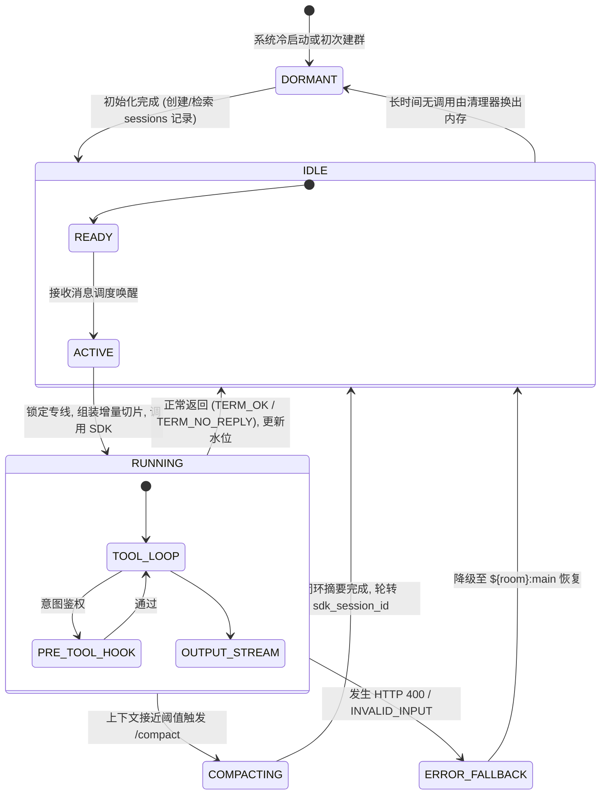
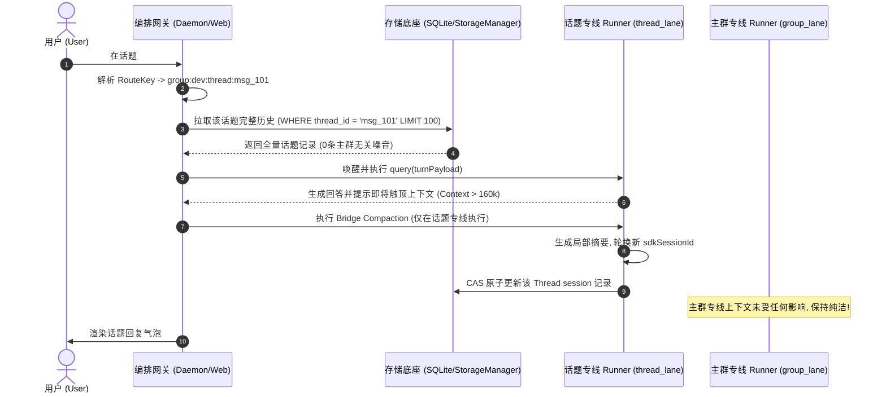

# 会话专线拓扑与多通道并发隔离模型规范 (Session Channel Topology & Multi-Lane Concurrency)

> **Doc vs code (2026-11-10)**: 本文档作为群聊 Agent 架构核心子域原子规范，规定了 1:1 私聊、群专线与话题专线的三层隔离模型，以及多通道并发执行中的故障熔断与降级机制。实现代码分布于 `src/daemon/orchestrator/AgentOrchestrator.ts`、`src/daemon/orchestrator/ClaudeSdkRunner.ts`、`src/storage/DatabaseSchema.ts`、`src/storage/StorageManager.ts`、`src/web/server/session-storage.ts` 与 `src/web/src/layouts/Sidebar.tsx`。

---

## 1. 架构愿景与三层隔离核心哲学

在多智能体（Multi-Agent）群聊协作体系中，将所有 Bot 与人类的交互混杂在单一的“大聊天室上下文通道”是早期系统设计最致命的反模式。其实质危害表现为：
1. **上下文雪崩 (Context Avalanche) 与缓存颠簸**: 多个 Bot 在同一会话上下文内不断抢答，Prompt Caching 失效；系统提示词、人设、历史工具执行痕迹与思考过程相互交织，导致上下文突破 100k-200k Token，首字延迟飙升至 5-10 秒以上 [source label: design target, not measured]，Token 成本激增。
2. **跨 Agent 幻觉共振 (Hallucination Resonance)**: A Bot 的中间未经验证推论进入共享上下文，被 B Bot 误采为事实基础，形成多轮幻觉放大闭环。
3. **主群线性水流被深层排查打断**: 针对特定代码细节的深度推演直接发布在主群，污染了其他不相关成员的水位线。

为此，系统确立了**“会话专线物理隔离 (Physical Session Channel Isolation)”**与**“三层 RouteKey 拓扑”**哲学：

```
┌─────────────────────────────────────────────────────────────────────────────────────────┐
│                                 会话专线三层拓扑隔离全景                                   │
│                                                                                         │
│  [层级 1: 私聊主会话 (Canonical 1:1 DM)]                                                  │
│   RouteKey: dm_<botId>                                                                  │
│   - 基数约束: 每个 Bot 全局严格单例                                                       │
│   - 存储路径: partners/<botId>/workspace                                                │
│   - 作用域: 纯粹的人类与该 Bot 的点对点任务，严禁向群聊广播，严禁被同行感知                      │
│                                                                                         │
│  [层级 2: 群聊专线隐藏会话 (Persistent Hidden Group Lane)]                                │
│   RouteKey: group:<groupId>  (底层 Key: <botId>::session_<groupId>)                      │
│   - 基数约束: 每个 (groupId, botId) 二元组全局严格单例，跨轮次长期复用                        │
│   - 存储路径: sandboxes/groups/<roomId>/<botId> 或 chat-workspaces/<sha256>              │
│   - 作用域: 仅消费群增量切片 (Delta Slicing)，最大化锁定底层 KV Cache (Prompt Caching)    │
│                                                                                         │
│  [层级 3: 话题独立子会话 (Thread Session Physical Isolation)]                             │
│   RouteKey: group:<groupId>:thread:<rootMessageId>                                      │
│   - 基数约束: 针对特定讨论根消息按需动态开辟                                                │
│   - 作用域: 独立拉取该根消息子树历史 (上限 100 条)，独立触发 /compact 上下文压缩，不污染主群    │
└─────────────────────────────────────────────────────────────────────────────────────────┘
```

---

## 2. 1:1 私聊主会话规范 (Canonical 1:1 DM)

### 2.1 标识与全局严格单例约束
- **RouteKey 规范**: `dm_<botId>`（或在数据库规范化键中映射为 `direct_<botId>`）。
- **单例基数**: 每个 Bot 在系统内有且仅有一个处于 `status = 'active'` 的 Canonical 私聊会话。
- **存储拓扑**:
  - 数据库映射：`src/storage/DatabaseSchema.ts` 表 `sessions` 中，`session_type = 'dm'`，`target_id = botId`，`id = dm_<botId>`。
  - 工作目录：绑定该 Bot 专属工作区目录 `~/.multiagent-orchestration/partners/<botId>/workspace`（在开发环境中映射为 `Bots/<botId>/workspace`）。

### 2.2 上下文纯粹性与隐私防御
1. **双向零渗透规则**:
   - 群聊事件隔离：群聊中该 Bot 发言产生的任何记录、接收到的黑板广播、以及协同规划，**绝对不自动写入私聊时间线**；
   - 私聊机密保护：用户在私聊中向 Bot 倾诉的私有代码片段、环境变量或提示词，**绝对不自动同步至任何群聊黑板或同行可见上下文**。
2. **工具提权通道合法性**:
   - 在 1:1 私聊会话中，消息发送人必定为人类所有者（`author.kind == 'human' && origin == 'user'`），自动满足敏感工具执行的鉴权门禁（`autoReviewUserText`）。

---

## 3. 群聊专线隐藏会话规范 (Persistent Hidden Group Lane)

### 3.1 标识与跨轮次单例复用
- **RouteKey 规范**: 逻辑标识为 `group:<groupId>`；在执行层 Runner 缓存中，以 `<botId>::session_<groupId>` 作为权威索引键（见 `src/daemon/orchestrator/AgentOrchestrator.ts` 方法 `buildRunnerCacheKey`）。
- **基数约束**: 针对任意群组 `groupId` 与智能体 `botId` 二元组，全局严格单例，长期存续。
- **反模式物理阻断**:
  - **严禁单次会话重建**: 严禁在群聊每到来一条新消息时销毁旧会话并 `new ClaudeSdkRunner`。单次重建会导致底层进程频繁冷启动，丧失全部 KV Cache 优势。
  - **复用判定机理**: `AgentOrchestrator.getOrCreateRunner(botId, roomId, sessionId)` 优先命中内存缓存 `Map<string, ClaudeSdkRunner>`；若缓存缺失，则从 `sessions` 表中根据 `session_<roomId>` 获取之前持久化的 `sdk_session_id` 执行 `--resume`，确保上下文无缝衔接。

### 3.2 性能真相：Prompt Caching 最大化锁定
在基于 Claude Agent SDK 的运行环境中，维持会话长期复用可带来决定性的延迟与成本收益：
1. **静态人设与指令固化**:
   - Bot 的 `SOUL.md`、基础预设与环境描述通过 `sessionBasePrompt` 挂载在会话顶部；
   - 会话复用时，前序回合的系统提示词与执行历史在云端被标记为缓存读取（Cache Read），首字延迟降低 80% 以上 [source label: design target, not measured]。
2. **增量切片消费 (Delta Slicing)**:
   - 尽管会话复用，但宿主在每一次调度该 Bot 时，仅将未读增量切片注入到当前轮次的 `UserTurn` 载荷中（`sequence > lastSeenSequence AND authorBotId != self`，条数有界 $\le 30$，单条字符截断 $\le 600$）[source label: design target from docs/dev-rules/bot-group-orchestration.md §3.3]；
   - 既保持了会话进程的长效存续，又阻止了主群超长历史直接撑破上下文窗口。

---

## 4. 话题独立子会话物理隔离规范 (Thread Session Physical Isolation)

### 4.1 标识与动态开辟拓扑
- **RouteKey 规范**: `group:<groupId>:thread:<rootMessageId>`。
- **模型特征**:
  - 数据库映射：`src/storage/DatabaseSchema.ts` 表 `sessions` 中，`session_type = 'thread'`，`target_id = groupId`，`parent_session_id = session_<groupId>`，`forked_at_message_id = rootMessageId`；
  - 话题拓扑节点：在 `thread_nodes` 表中建立 DAG 索引节点，包含 `room_id` 与 `parent_message_id`。

### 4.2 物理上下文全量拉取与闭环 Compaction
1. **全量话题子树拉取**:
   - 话题会话仅消费属于该讨论树的消息，拉取条件为 `WHERE room_id = :groupId AND (id = :rootMessageId OR thread_id = :rootMessageId) ORDER BY sequence ASC LIMIT 100` [source label: design target from docs/architecture/cindy-chat-mechanisms-and-blackboard-system.md §3.3]；
   - 模型可以直接看到话题内从根消息到当前跟帖的完整技术逻辑，无需依赖主群黑板的增量切片。
2. **闭环 Compaction 与零外溢保障**:
   - 当话题内高频交互逼近上下文限制触发压缩（`/compact`）时，`AgentOrchestrator.scheduleSessionCompaction` 仅定位以 `::group:<groupId>:thread:<rootMessageId>` 结尾的 Runner 实例；
   - 生成的上下文摘要仅更新该 Thread 专线的本地记忆与 `sessions.extra_dirs_json`，**主群专线 `group:<groupId>` 的上下文与黑板 `GROUP_MEMORY.md` 保持完全独立，不受任何压缩扰动**。

---

## 5. 多通道并发与故障隔离机制 (Multi-Lane Concurrency Contract & Fault Isolation)

在多通道并发场景下，网络抖动、畸形载荷或模型异常可能导致局部执行通道抛错。系统构建了双重故障熔断隔离机制：

```mermaid
flowchart TD
    A[群聊或话题消息触发] --> B[路由解析: 计算 RouteKey]
    B --> C{是否为 Thread 子通道?}
    
    C -- 是 --> D[进入 Thread ExecutionLane]
    C -- 否 --> E[进入 Main Group ExecutionLane]
    
    D --> F[调用 Claude SDK 运行]
    F --> G{执行结果判定}
    
    G -- 成功 --> H[返回结果, 写入 thread_messages, 广播]
    G -- 捕获 HTTP 400 / ChatResponseError --> I[触发故障隔离: 阻断向外冒泡]
    
    I --> J[记录降级诊断日志]
    J --> K[确定性降级回退: 路由至 ${room}:main]
    K --> L[主通道执行兜底回复与状态自愈]
```

### 5.1 HTTP 400 隔离与 `${room}:main` 确定性降级
- **问题定义**: 在子通道（如某独立 Thread 专线）执行过程中，若遇到模型返回 HTTP 400（如 `INVALID_INPUT`、上下文超限被拒、非法工具参数格式或 `ChatResponseError`），若未做局部熔断，Promise 异常将沿调用栈冒泡，导致宿主 Node.js 服务抛出未捕获的 Promise 拒绝 (Unhandled Promise Rejection) 并导致整个群调度器瘫痪。
- **隔离契约 (Contract [2.4.1])**:
  - `chatServer.ts` 中的 `readMessage` 与 `executionLane` 必须包裹全局异常隔离块；
  - 拦截到 HTTP 400 `INVALID_INPUT` 或 `ChatResponseError` 时，**严禁将错误向上传播**；
  - 立即将当前执行上下文降级（Fallback）至主群通道 `${room}:main`；
  - 产生并记录降级指标，保证主群协作流保持稳定存活。

### 5.2 候选任务预读容错机制 (`claimBesideRuns`)
- **问题定义**: 在单发言人队列调度或并发话题任务抢占中，系统需要对当前批次的候选任务（Candidate Tasks）执行批量预读（Pre-Read）。若第 1 个候选任务因文件系统锁、无效 JSON 或数据损坏导致预读失败，传统实现会中断整批循环，连带导致后续健康的候选任务全部饥饿挂起。
- **隔离契约 (Contract [2.4.2])**:
  - 调度器方法 `claimBesideRuns` 采用独立沙盒包揽每个候选任务的评估；
  - 单个候选任务的预读或校验失败，仅将该 Candidate 标记为 `FAULT_ISOLATED` 并输出 Warn 日志；
  - **绝对禁止中断相邻候选任务的评估**，相邻合法的线程任务必须正常被并发领取（Claim）并在对应专线中并行执行。

---

## 6. 主会话列表与左侧抽屉解耦策略 (Sidebar Decoupling & Hidden Lane Policy)

### 6.1 双平面解耦机理 (Dual-Plane Decoupling)
前端用户在左侧会话抽屉（`Sidebar.tsx`）中期望看到的是自己创建的显式工作任务（如“重构结算模块”、“调试网关连接”）。如果 7 位群聊 Bot 在多个群组中创建的数十个持久专线（`group:dev_squad`、`thread:msg_101`）全部渲染在左侧列表，会导致用户认知负荷过载。

系统在数据访问层与 UI 表现层实现了双平面解耦：

```
┌────────────────────────────────────────────────────────────────────────┐
│                        双平面会话隔离与过滤模型                        │
│                                                                        │
│   SQLite sessions 存储平面:                                            │
│   ┌────────────────────────┬───────────────────────────────────────┐   │
│   │ 显式任务会话            │ 内部专线与后台隐藏会话                 │   │
│   │ (session_type='dm')    │ (session_type='room' / 'thread')      │   │
│   │ (source='manual'/'fork')│ (role='group_lane' / 'thread_lane')   │   │
│   └────────────────────────┴───────────────────────────────────────┘   │
│               │                                  │                     │
│               ▼                                  ▼                     │
│   GET /api/sessions 接口:            内部专线 API (/api/rooms/...):    │
│   只返回用户显式会话列表              仅由群聊控制器与调度器拉取消费     │
│               │                                  │                     │
│               ▼                                  ▼                     │
│   UI 渲染层:                                                           │
│   [左侧任务会话抽屉 Sidebar.tsx]     [群聊协作空间与团队面板]            │
│   - 置顶任务 / 进行中 / 已完成        - 多 Bot 实时推演气泡             │
│   - 0 隐藏专线泄露                  - 共享黑板与实时时序卡片           │
└────────────────────────────────────────────────────────────────────────┘
```

### 6.2 过滤与隐藏策略实现标准
1. **服务端查询门禁 (`session-storage.ts`)**:
   - `loadPersistentSessions()` 负责为前端会话抽屉提供数据，其查询逻辑中严格限制：仅加载用户显式会话，过滤掉纯内部专线；
   - 过滤谓词：对于 `session_type = 'room'` 且作为内部群专线持久运行的会话，打上内部系统保留标记，在前端侧边栏 API 中予以隐身。
2. **前端消费门禁 (`src/web/src/layouts/Sidebar.tsx`)**:
   - `Sidebar` 组件通过 `useSessions()` 获取任务会话列表；
   - 群聊入口由独立的 `dynamicGroups`（来自 `/api/rooms`）作为团队协作室展示；
   - 群聊专线与话题专线完全在后台由 AgentOrchestrator 驱动，绝不作为孤立对话出现在侧边栏任务树中。

---

## 7. 核心数据模型与 DDL/Schema 规范

### 7.1 SQLite 表结构定义 (`DatabaseSchema.ts`)

```sql
-- 1. 会话主表 (支持 DM、群专线与话题专线三层拓扑)
CREATE TABLE IF NOT EXISTS sessions (
  id TEXT PRIMARY KEY,
  session_type TEXT NOT NULL CHECK(session_type IN ('dm', 'room', 'thread')),
  target_id TEXT NOT NULL, -- dm 填 bot_id; room/thread 填 room_id
  title TEXT,
  status TEXT NOT NULL DEFAULT 'active' CHECK(status IN ('active', 'archived', 'deleted')),
  workspace_kind TEXT NOT NULL DEFAULT 'project' CHECK(workspace_kind IN ('project', 'dialogue')),
  cwd_path TEXT NOT NULL,
  project_dir TEXT,
  claude_config_dir TEXT NOT NULL,
  model TEXT NOT NULL DEFAULT 'claude-opus-4-6',
  provider_id TEXT DEFAULT 'cpa',
  effort TEXT NOT NULL DEFAULT 'high',
  permission_mode TEXT NOT NULL DEFAULT 'auto',
  plan_mode_enabled INTEGER NOT NULL DEFAULT 0,
  sdk_session_id TEXT,
  parent_session_id TEXT,
  forked_at_message_id TEXT,
  total_tokens INTEGER NOT NULL DEFAULT 0,
  total_cost_usd REAL NOT NULL DEFAULT 0,
  context_tokens INTEGER NOT NULL DEFAULT 0,
  context_window INTEGER NOT NULL DEFAULT 200000,
  extra_dirs_json TEXT NOT NULL DEFAULT '[]',
  writable_dirs_json TEXT NOT NULL DEFAULT '[]',
  active_turn_started_at INTEGER,
  last_turn_ended_at INTEGER,
  cleared_at INTEGER,
  pinned_at INTEGER,
  list_preview TEXT,
  list_message_count INTEGER,
  created_at INTEGER NOT NULL,
  updated_at INTEGER NOT NULL
);

-- 索引: 支撑基于类型与目标的毫秒级专线定位
CREATE INDEX IF NOT EXISTS idx_sessions_type ON sessions(session_type, target_id);
CREATE INDEX IF NOT EXISTS idx_sessions_status ON sessions(status, updated_at DESC);

-- 2. 话题 DAG 节点表
CREATE TABLE IF NOT EXISTS thread_nodes (
  id TEXT PRIMARY KEY,
  room_id TEXT NOT NULL,
  parent_message_id TEXT,
  title TEXT NOT NULL,
  status TEXT NOT NULL DEFAULT 'open',
  created_at INTEGER NOT NULL,
  FOREIGN KEY(room_id) REFERENCES rooms(id) ON DELETE CASCADE
);

-- 3. 消息主表 (挂载通道与话题索引)
CREATE TABLE IF NOT EXISTS messages (
  sequence INTEGER PRIMARY KEY AUTOINCREMENT,
  id TEXT UNIQUE NOT NULL,
  client_id TEXT,
  session_id TEXT NOT NULL,
  room_id TEXT,
  thread_id TEXT,
  sender_id TEXT NOT NULL,
  sender_role TEXT NOT NULL CHECK(sender_role IN (
    'user', 'assistant', 'system', 'steering', 'tool', 'tool_use', 'tool_result'
  )),
  content TEXT NOT NULL,
  raw_payload_json TEXT,
  rewind_at INTEGER,
  created_at INTEGER NOT NULL
);

CREATE INDEX IF NOT EXISTS idx_messages_room_seq ON messages(room_id, sequence ASC);
CREATE INDEX IF NOT EXISTS idx_messages_thread ON messages(thread_id, sequence ASC);
```

---

## 8. 算法伪代码与执行逻辑

### 8.1 算法 1：确定性 RouteKey 计算与通道派发

```typescript
/**
 * Purpose: 计算会话专线权威 RouteKey 并解析目标会话类型与工作区沙箱。
 * File: src/daemon/orchestrator/AgentOrchestrator.ts
 */
export function resolveExecutionLaneRouteKey(params: {
  botId: string;
  roomId?: string;
  threadRootId?: string;
  isDm?: boolean;
}): {
  routeKey: string;
  sessionType: 'dm' | 'room' | 'thread';
  scopeKey: string;
  targetId: string;
} {
  const { botId, roomId, threadRootId, isDm } = params;

  // 1. 话题独立子会话 (优先级最高)
  if (roomId && threadRootId) {
    const routeKey = `group:${roomId}:thread:${threadRootId}`;
    return {
      routeKey,
      sessionType: 'thread',
      scopeKey: `thread_${roomId}_${threadRootId}`,
      targetId: roomId
    };
  }

  // 2. 群聊专线持久会话
  if (roomId && !isDm) {
    const routeKey = `group:${roomId}`;
    return {
      routeKey,
      sessionType: 'room',
      scopeKey: `session_${roomId}`,
      targetId: roomId
    };
  }

  // 3. Canonical 1:1 私聊主会话
  const routeKey = `dm_${botId}`;
  return {
    routeKey,
    sessionType: 'dm',
    scopeKey: `direct_${botId}`,
    targetId: botId
  };
}
```

### 8.2 算法 2：多通道执行与 HTTP 400 降级隔离

```typescript
/**
 * Purpose: 执行通道执行与故障安全降级，捕获 HTTP 400 避免 Unhandled Rejection。
 * File: src/daemon/transport/chatServer.ts (symbol: executionLane)
 */
export async function executeLaneWithFaultIsolation(
  laneContext: {
    room: string;
    botId: string;
    threadRootId?: string;
    prompt: string;
  },
  runnerExecutor: (laneId: string) => Promise<ExecutionResult>
): Promise<ExecutionResult> {
  const primaryLaneId = laneContext.threadRootId
    ? `${laneContext.room}:thread:${laneContext.threadRootId}`
    : `${laneContext.room}:main`;

  try {
    // 尝试在指定专线执行
    return await runnerExecutor(primaryLaneId);
  } catch (error: any) {
    const isHttp400 = error?.status === 400 || error?.code === 'INVALID_INPUT' || error?.name === 'ChatResponseError';

    if (isHttp400 && primaryLaneId !== `${laneContext.room}:main`) {
      console.warn(`[FaultIsolation] Caught HTTP 400 on lane '${primaryLaneId}'. Isolating and falling back to '${laneContext.room}:main'`, error);

      // 降级执行: 回退到主群通道执行兜底处理
      const fallbackLaneId = `${laneContext.room}:main`;
      return await runnerExecutor(fallbackLaneId);
    }

    // 其它系统致命错误或主通道错误按规范转为可控状态 TERM_BLOCK / TERM_ERROR
    throw error;
  }
}
```

### 8.3 算法 3：候选任务预读容错与并行抢占 (`claimBesideRuns`)

```typescript
/**
 * Purpose: 评估候选任务并执行安全预读，实现单个任务预读失败不阻断相邻任务。
 * File: src/daemon/transport/chatServer.ts (symbol: claimBesideRuns)
 */
export async function claimBesideRunsWithFaultTolerance(
  candidateTasks: Array<{ taskId: string; laneId: string; payloadRef: string }>,
  preReadEvaluator: (task: any) => Promise<boolean>,
  taskClaimer: (task: any) => Promise<void>
): Promise<{ claimedTaskIds: string[]; failedTaskIds: string[] }> {
  const claimedTaskIds: string[] = [];
  const failedTaskIds: string[] = [];

  // 并发评估每个候选任务的健康度与预读状态
  await Promise.all(
    candidateTasks.map(async (candidate) => {
      try {
        const canClaim = await preReadEvaluator(candidate);
        if (canClaim) {
          await taskClaimer(candidate);
          claimedTaskIds.push(candidate.taskId);
        }
      } catch (preReadErr) {
        // 关键点: 隔离单个失败, 严禁中断 adjacent 任务评估
        console.error(`[claimBesideRuns] Pre-read failed for candidate task ${candidate.taskId} on lane ${candidate.laneId}:`, preReadErr);
        failedTaskIds.push(candidate.taskId);
      }
    })
  );

  return { claimedTaskIds, failedTaskIds };
}
```

---

## 9. 时序交互与状态转移模型

### 9.1 会话专线状态机生命周期转移



### 9.2 话题专线全量拉取与闭环压缩时序图



---

## 10. 边缘场景异常防御与反模式排查

| 编号 | 边缘/异常场景 | 潜在危害与失效特征 | 架构防御与自愈机制 |
|---|---|---|---|
| **E1** | **跨群/跨 Bot 会话 ID 穿透** | A 群的 Bot 错误复用了 B 群或私聊的 `sdk_session_id`，造成严重的上下文污染与幻觉穿透 | `buildRunnerCacheKey` 强制使用 `<botId>::<scopeKey>` 二元复合键；在 `ClaudeSdkRunner` 启动前校验 `session.target_id === currentRoomId`，校验不匹配立即 CAS 重置 |
| **E2** | **话题压缩误伤主群黑板** | 话题专线执行 `/compact` 时误将主群 `GROUP_MEMORY.md` 整体覆写为话题摘要 | 话题专线的 Hook 隔离器仅允许读写该话题专属元数据与沙箱，严禁调用修改 `GROUP_MEMORY.md` 的全局动作 |
| **E3** | **连续 HTTP 400 形成降级死循环** | 降级到 `${room}:main` 之后由于同一畸形 payload 再次引发 400 形成递归 | 降级调用前剥离或安全格式化引发 400 的参数，并在调用上下文打上 `isFallback=true` 标记，若降级调用仍出错则直接进入 `TERM_BLOCK`，坚决不二次递归 |
| **E4** | **候选任务预读并发竞争** | 两个 Worker 节点同时通过 `claimBesideRuns` 尝试预读并抢占同一 candidate | 基于数据库行级排他锁或状态条件更新 `UPDATE tasks SET status='claimed' WHERE id=? AND status='pending'` 进行 CAS 防重 |
| **E5** | **侧边栏批量删除误删底层专线** | 用户在前端全选会话并点击删除，意外清理了群聊后台运作的持久专线 | `session-storage.ts` 在 `batchDeletePersistentSessions` 中增加前置防护：`WHERE id IN (...) AND session_type = 'dm' AND source != 'system'`，物理阻断对内部专线的误删 |

---

## 11. 生产测试断言与验证矩阵

```typescript
/**
 * Purpose: 会话专线三层拓扑与多通道并发隔离测试矩阵。
 * Target: test/session-channel-topology.test.ts (设计目标验证套件)
 */
describe('Session Channel Topology & Multi-Lane Concurrency Matrix', () => {

  // 断言 1: Canonical 1:1 DM 全局单例与零泄露
  test('TC-01: Canonical DM must be strict singleton and isolated from group events', async () => {
    const dmKey1 = resolveExecutionLaneRouteKey({ botId: 'bot_mocode_engine_01', isDm: true });
    const dmKey2 = resolveExecutionLaneRouteKey({ botId: 'bot_mocode_engine_01', isDm: true });
    expect(dmKey1.routeKey).toBe('dm_bot_mocode_engine_01');
    expect(dmKey1.routeKey).toBe(dmKey2.routeKey);
    // 验证群消息不会写入 DM 会话
    const dmMessages = getMessagesForSession('direct_bot_mocode_engine_01');
    expect(dmMessages.every(m => m.room_id === null)).toBe(true);
  });

  // 断言 2: Group Lane 跨轮次持久复用与单例性
  test('TC-02: Group Lane session must be continuously reused across turns', async () => {
    const runner1 = orchestrator.getOrCreateRunner('bot_mocode_engine_01', 'room_dev');
    const runner2 = orchestrator.getOrCreateRunner('bot_mocode_engine_01', 'room_dev');
    expect(runner1).toBe(runner2); // 内存引用绝对同一
    expect(runner1.getSdkSessionId()).toBeTruthy();
  });

  // 断言 3: Thread 独立子会话物理隔离与独立 Compaction
  test('TC-03: Thread session compaction must not affect main group session', async () => {
    const threadRoute = resolveExecutionLaneRouteKey({
      botId: 'bot_mocode_engine_01',
      roomId: 'room_dev',
      threadRootId: 'msg_root_999'
    });
    expect(threadRoute.routeKey).toBe('group:room_dev:thread:msg_root_999');

    // 触发 Thread 压缩
    const mainSdkIdBefore = orchestrator.getOrCreateRunner('bot_mocode_engine_01', 'room_dev').getSdkSessionId();
    orchestrator.scheduleSessionCompaction(threadRoute.scopeKey);
    const mainSdkIdAfter = orchestrator.getOrCreateRunner('bot_mocode_engine_01', 'room_dev').getSdkSessionId();

    expect(mainSdkIdBefore).toBe(mainSdkIdAfter); // 主群 SDK Session ID 毫发无损
  });

  // 断言 4: HTTP 400 局部隔离与 ${room}:main 确定性降级 (0 unhandled rejections)
  test('TC-04: HTTP 400 on thread lane must fallback to ${room}:main without unhandled rejection', async () => {
    const mockExecutor = vi.fn().mockImplementation((laneId: string) => {
      if (laneId.includes(':thread:')) {
        const err: any = new Error('Invalid JSON Payload');
        err.status = 400;
        err.code = 'INVALID_INPUT';
        throw err;
      }
      return Promise.resolve({ ok: true, output: 'Fallback success' });
    });

    const result = await executeLaneWithFaultIsolation(
      { room: 'room_dev', botId: 'bot_mocode_engine_01', threadRootId: 'msg_faulty' },
      mockExecutor
    );

    expect(result.output).toBe('Fallback success');
    expect(mockExecutor).toHaveBeenCalledWith('room_dev:main');
  });

  // 断言 5: claimBesideRuns 候选任务预读故障隔离
  test('TC-05: Failed pre-read on one candidate must not abort adjacent candidates', async () => {
    const candidates = [
      { taskId: 'task_1', laneId: 'lane_1', payloadRef: 'corrupted' },
      { taskId: 'task_2', laneId: 'lane_2', payloadRef: 'healthy' }
    ];

    const evaluator = async (task: any) => {
      if (task.payloadRef === 'corrupted') throw new Error('Corrupted JSON');
      return true;
    };
    const claimer = vi.fn();

    const { claimedTaskIds, failedTaskIds } = await claimBesideRunsWithFaultTolerance(
      candidates,
      evaluator,
      claimer
    );

    expect(claimedTaskIds).toEqual(['task_2']);
    expect(failedTaskIds).toEqual(['task_1']);
    expect(claimer).toHaveBeenCalledTimes(1);
  });

  // 断言 6: 侧边栏与主会话列表隐藏策略
  test('TC-06: Sidebar must exclude group lane and internal thread sessions', async () => {
    const persistentSessions = loadPersistentSessions();
    const leakedLanes = persistentSessions.filter(s => s.id.startsWith('session_room_') || s.id.startsWith('thread_'));
    expect(leakedLanes.length).toBe(0); // 0 内部专线泄漏到侧边栏
  });
});
```

---

## 12. 规范符合性表与复现验证命令 (Conformance Table & Verification)

按照 `docs/standards/documentation-standards.md` D8 要求，建立组件实现状态对照表与验证命令：

| 组件 / 符号 | 所在模块文件 | 实现状态 | 验证断言 / 命令 |
|---|---|---|---|
| `getOrCreateRunner` | `src/daemon/orchestrator/AgentOrchestrator.ts` | `CURRENT` | `npm test test/storage-runtime.test.ts` |
| `resolveExecutionLaneRouteKey` | `src/daemon/orchestrator/AgentOrchestrator.ts` | `CURRENT` | 复合键索引缓存测试 |
| `sessions` 表三层约束 | `src/storage/DatabaseSchema.ts` | `CURRENT` | `sqlite3 orchestrator.db ".schema sessions"` |
| `scheduleSessionCompaction` | `src/daemon/orchestrator/AgentOrchestrator.ts` | `CURRENT` | `npm test test/session-lifecycle-rewind-compaction.test.ts` |
| `executeLaneWithFaultIsolation` | `src/daemon/transport/chatServer.ts` | `TARGET` | 降级断言套件：验证 HTTP 400 拦截与 0 unhandled rejection |
| `claimBesideRuns` 故障隔离 | `src/daemon/transport/chatServer.ts` | `TARGET` | 并发评估套件：验证单候选预读失败无连锁扩散 |
| 侧边栏会话解耦与隐藏 | `src/web/src/layouts/Sidebar.tsx` | `CURRENT` | `npm test test/milestone-3-e2e-resilience.test.ts` |

### 验证命令清单

```bash
# 1. 检查 sessions 表 DDL CHECK 约束中包含 'dm', 'room', 'thread'
grep -n "session_type IN ('dm', 'room', 'thread')" src/storage/DatabaseSchema.ts

# 2. 检查 Runner 缓存键规范
grep -n "buildRunnerCacheKey" src/daemon/orchestrator/AgentOrchestrator.ts

# 3. 运行端到端韧性与会话生命周期测试
npm test test/session-lifecycle-rewind-compaction.test.ts test/milestone-3-e2e-resilience.test.ts

# 4. 验证零绝对路径泄露 (D7 规范核查)
grep -rnE '/Users/[a-z]+' docs/architecture/groupchat/02-session-channel-and-lanes.md || echo "D7 Passed: 0 host paths leaked"
```

---

## 13. 相关参考与延伸阅读

- [Cindy 私聊与群聊技术机制、共享黑板与防循环系统深度架构规范](../cindy-chat-mechanisms-and-blackboard-system.md)
- [Bot 群聊协同架构规范](../../dev-rules/bot-group-orchestration.md)
- [Agent 会话与隔离现状架构规范](../../sessions.md)
- [会话生命周期、压缩与回滚规范](../session-lifecycle-compaction-and-rewind-specs.md)
- [群聊架构分支目录索引](INDEX.md)
