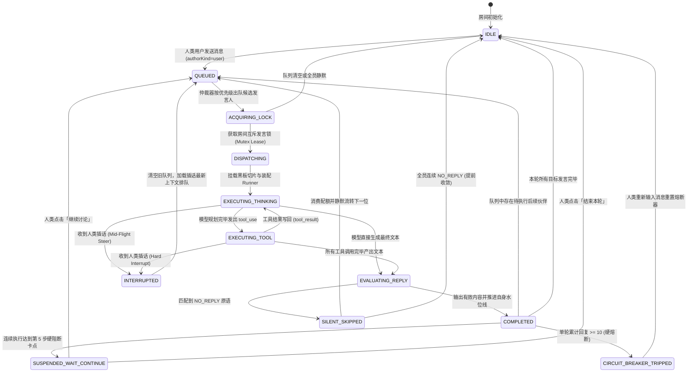
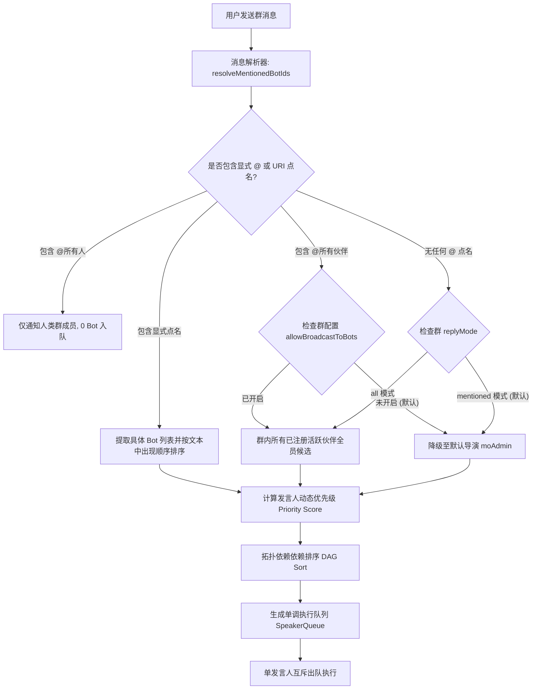
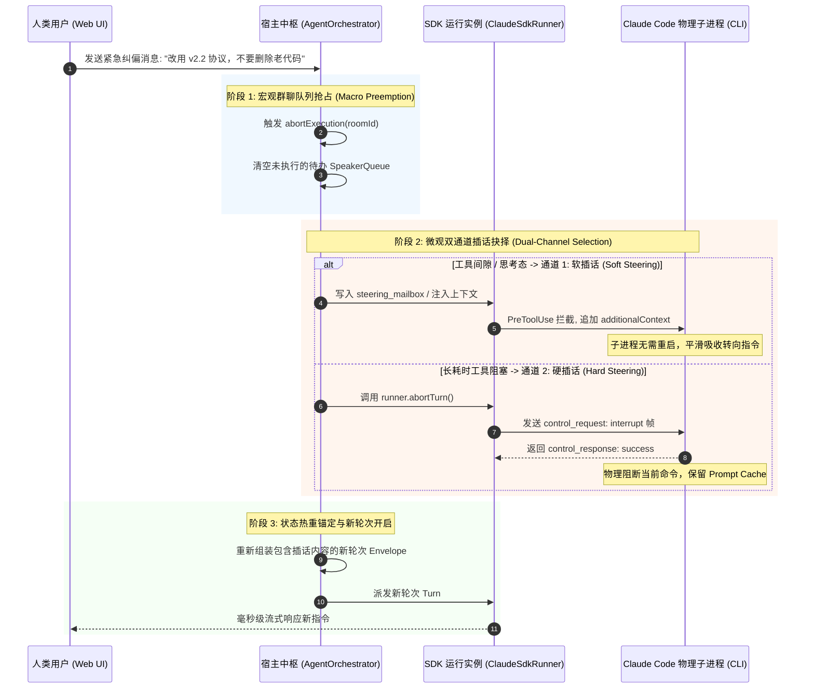

# 群聊单发言人确定性调度与插话状态机架构规范 (SPEC-GROUPCHAT-SPEAKER-03)

本规范定义了多智能体协同系统中群聊单发言人确定性调度中枢（Deterministic Single Speaker Orchestrator）、仲裁队列算法以及双通道插话转向状态机（Dual-Channel Mid-Flight Steering FSM）的物理运行契约。

---

## 1. 架构演进与核心设计哲学 (Evolution & Core Philosophy)

在工业级多智能体软件研发系统的演进中，群聊调度经历了“无中心抢答”到“LLM Facilitator 串联调度”，最终收敛于**“原生 TypeScript 状态机驱动 (Native TS FSM)”**的生产级范式。

```
+----------------------------------------------------------------------------------------------------+
|                                    调度中枢两代演进架构对比                                          |
+--------------------+------------------------------------------+------------------------------------+
| 评估维度           | 早期架构 (LLM Facilitator 概率调度)        | 生产级规范 (Native TS FSM 确定性)   |
+--------------------+------------------------------------------+------------------------------------+
| 调度决策机构       | 依赖 Haiku/Sonnet 生成文本判定发言人     | TypeScript 宿主确定性有限状态机    |
| 单轮调度延迟       | 30 ~ 50 秒 (累加 5~7 次大模型网络往返)    | < 100 毫秒 [设计目标，非模型推理]   |
| 调度 Token 消耗    | 12,000 ~ 20,000 Tokens 浪费于协议协商    | 0 Token [设计目标，纯代码逻辑驱动] |
| 状态转移可靠性     | 存在概率性乱序、死循环与逆向状态转移     | 状态转移矩阵强校验，非法跃迁物理阻断|
| 执行并发度控制     | 多个 Bot 容易在同轮次中抢答引发脑裂      | 全局严格单发言人互斥租约锁         |
| 人类插话介入       | 必须等待当前 Bot 执行完毕后排队处理      | 双通道毫秒级抢占中断 (Soft / Hard) |
+--------------------+------------------------------------------+------------------------------------+
```

### 1.1 LLM Facilitator 模式的工程失效机理
1. **注意力与 Token 双重耗尽**：让大模型充当“群聊主持人”是昂贵的反模式。大模型本质是概率生成器，每次任务流转均调用一次 LLM 判断“谁该接话”，不仅消耗数千 Tokens，且输出包含大量“收到，现在交由 Coder 编写”等无效问候语；
2. **状态单向性失序**：LLM 在长会话中极易遗忘工程约束，产生将 `VERIFIED` 篡改回 `TODO`，或绕过 `IN_REVIEW` 直接进入 `COMPLETED` 的幻觉转移；
3. **死锁与乒乓效应**：当测试因环境偶发波动失败时，LLM 缺乏全局重试计数与阶梯熔断能力，导致 Coder 与 QA 无脑来回打回，形成无限死循环。

### 1.2 三大核心运行铁律 (Core Operating Tenets)
- **铁律一：确定性单发言人不变性 (Deterministic Single-Speaker Invariant)**  
  在任意群聊房间（Room）的物理时间线上，同一时刻**全局严格只允许存在 1 个处于活跃执行态的 Bot**。所有消息按单调自然数序列（`sequence >= 1`）顺序提交；
- **铁律二：人类所有者权威触发 (Owner-Only Trigger Law)**  
  群聊协作的唯一起点必须是人类群成员（`author.kind === 'user'`）。Bot 输出完毕后宿主立即进入结算状态，**Bot 绝对无权代理人类开启新轮次，亦无权通过 `@` 唤醒其他 Bot**；
- **铁律三：用户插话最高抢占权 (Preemptive Interjection Priority)**  
  人类用户在执行流中追加的消息享有最高优先级，瞬时触发插话状态机，作废旧队列并重置当前 Bot 执行上下文。

---

## 2. 确定性单发言人状态机模型 (Single-Speaker FSM Specification)

群聊调度器在内存中维护每个房间的独占状态机实例，绑定于 `AgentOrchestrator.ts` 中的 `roomSpeakerState` 映射表。

### 2.1 状态集合与定义 (State Universe)



### 2.2 状态转移方程与合法性约束 (Transition Matrix)

状态转移遵循严格的有向无环约束（除受控的人工接力恢复外）。转移函数定义为：

$$S_{t+1} = \delta(S_t, E, C)$$

其中 $S$ 为当前状态，$E$ 为触发事件，$C$ 为守护条件（Guard Conditions）。

```typescript
// 位于 src/daemon/orchestrator/AgentOrchestrator.ts 中的状态合法性转移矩阵
export type SingleSpeakerState =
  | 'IDLE'
  | 'QUEUED'
  | 'ACQUIRING_LOCK'
  | 'DISPATCHING'
  | 'EXECUTING_THINKING'
  | 'EXECUTING_TOOL'
  | 'EVALUATING_REPLY'
  | 'SUSPENDED_WAIT_CONTINUE'
  | 'CIRCUIT_BREAKER_TRIPPED'
  | 'INTERRUPTED'
  | 'COMPLETED'
  | 'SILENT_SKIPPED';

export const LEGAL_SPEAKER_TRANSITIONS: Record<SingleSpeakerState, SingleSpeakerState[]> = {
  IDLE: ['QUEUED'],
  QUEUED: ['ACQUIRING_LOCK', 'IDLE'],
  ACQUIRING_LOCK: ['DISPATCHING', 'IDLE'],
  DISPATCHING: ['EXECUTING_THINKING', 'INTERRUPTED'],
  EXECUTING_THINKING: ['EXECUTING_TOOL', 'EVALUATING_REPLY', 'INTERRUPTED'],
  EXECUTING_TOOL: ['EXECUTING_THINKING', 'EVALUATING_REPLY', 'INTERRUPTED'],
  EVALUATING_REPLY: ['COMPLETED', 'SILENT_SKIPPED', 'INTERRUPTED'],
  COMPLETED: ['QUEUED', 'SUSPENDED_WAIT_CONTINUE', 'CIRCUIT_BREAKER_TRIPPED', 'IDLE'],
  SILENT_SKIPPED: ['QUEUED', 'IDLE'],
  SUSPENDED_WAIT_CONTINUE: ['QUEUED', 'IDLE'],
  CIRCUIT_BREAKER_TRIPPED: ['IDLE'],
  INTERRUPTED: ['QUEUED', 'IDLE']
};
```

---

## 3. 双轨编排机制与五步硬阻断 (Dual-Track Orchestration & 5-Step Circuit Breaker)

为了适应不同复杂度的研发场景，系统确立了**讨论卡 (`talk`)** 与 **分工卡 (`work`)** 双轨编排模式，并植入**第 5 步硬阻断卡点**。

### 3.1 讨论卡与分工卡双轨对比

| 编排轨道 | 核心承载场景 | 调度执行模型 | 人工接力与卡点策略 |
| :--- | :--- | :--- | :--- |
| **讨论卡 (`talk`)** | 需求发散、架构方案权衡、头脑风暴、联合答疑 | 一步对应一位 Bot 串行调用；Bot 依次在群时间线发表讨论气泡 | **前 5 位自动顺延；第 6 位起强制挂起 (`SUSPENDED_WAIT_CONTINUE`)，必须等待人类点击「继续」** |
| **分工卡 (`work`)** | 多阶段工程攻坚、代码重构、测试流水线集成 | 由 moAdmin 制定结构化工单，拆解为有序 Step 序列；Bot 接力修改目标代码库 | **每一步执行完毕自动停下，向群内汇报阶段产物，等待人类验收或交付下一阶段** |

### 3.2 五步硬阻断与人工接力卡点 (5-Step Invariant)
在讨论卡模式下，当消息显式点名或隐式包含大于 5 位候选伙伴时：
1. 调度器顺序拉起第 1 至第 5 位伙伴；
2. 当第 5 位伙伴执行完成（`turnsCount === 5`）时，宿主调度器强制将状态机置为 `SUSPENDED_WAIT_CONTINUE`；
3. 调度器向前端推送包含「继续讨论」与「结束本轮」交互卡片的事件；
4. **强断言保护**：在人类显式点击「继续讨论」之前，第 6 位 Bot 绝不自发拉起，子进程进程池与调度队列处于完全冻结状态。

### 3.3 防循环三级配额与硬熔断阈值 (Anti-Loop Circuit Breaker)
- **单轮最大圈数**：`MAX_CIRCLES_PER_ROUND = 3`（同一轮次内所有候选 Bot 遍历的最大循环上限）；
- **单轮最大消息数**：`MAX_BOT_MESSAGES_PER_ROUND = 10`；
- **硬熔断跳闸**：若 `turnsCount >= MAX_BOT_MESSAGES_PER_ROUND`，调度器立即抛出 `DaemonErrorCode.CIRCUIT_BREAKER_TRIPPED`，标记 `circuitBreakerTripped: true`，彻底阻断自激循环。

---

## 4. 发言人优先级队列仲裁算法 (Speaker Priority Queue Arbitration Algorithm)

当人类发送一条包含多处 `@` 或需要多角色接力处理的消息时，系统绝不采用并发抢答，而是通过确定性仲裁算法生成单一有序执行队列 `SpeakerQueue`。



### 4.1 消息解析与意图提取
1. **显式点名匹配**：支持匹配 `@BotName`、别名（如 `@moAdmin`、`@moCode`）以及富文本 URI `[Name](cindy://bot/<botId>)`；
2. **广播对象严格拆分**：
   - `@所有人`：产品规则严格限制**仅面向人类成员发送系统通知与未读标记**，禁止唤醒任何 AI 伙伴；
   - `@所有伙伴`：作为受限开关，默认全群关闭。仅当群管理员在 `group.json` 中显式开启时，方可将群内合资格伙伴全员入队；
3. **导演默认保底原则 (Rule 4.5 Fallback)**：若人类发送消息且未 `@` 任何 Bot，系统默认由 `bot_moadmin_director_03`（moAdmin）接管。

### 4.2 优先级权重评分公式 (Priority Score Formulation)

队列中每个候选 Bot 的综合优先级评分由显式点名位次、角色专责权重、任务拓扑依赖及历史疲劳度共同决定：

$$Priority(Bot_i) = W_{mention}(Bot_i) + W_{role}(Bot_i) + W_{dep}(Bot_i) - W_{fatigue}(Bot_i)$$

权重项定义：
- **$W_{mention}$ (显式点名位次)**：
  若在用户输入中第 $k$ 位被点名（$k \ge 1$），则 $W_{mention} = \max(0, 1000 - (k - 1) \times 100)$；未被显式点名则为 $0$；
- **$W_{role}$ (阶段角色专责权重)**：
  根据当前黑板所处阶段分配：
  - 需求与提炼阶段 (`PENDING_INTENT`)：`moAdmin` 赋 $300$ 分；
  - 代码实现阶段 (`IN_PROGRESS`)：`moCode` 赋 $300$ 分；
  - 质检验收阶段 (`IN_REVIEW`)：`MoCI` 赋 $300$ 分；
  - 架构沉淀阶段 (`VERIFIED`)：`moDoc` 赋 $300$ 分；
- **$W_{dep}$ (前置依赖就绪权重)**：
  若黑板计划（`plan.json`）中该 Bot 依赖的前置产物均已就绪，赋 $200$ 分；若前置依赖尚未交付，直接置为负无穷（挂起直至依赖就绪）；
- **$W_{fatigue}$ (防霸权惩罚)**：
  $W_{fatigue} = \text{turnsInCurrentRound} \times 150$，防止单一 Bot 垄断发言权。

### 4.3 优先级队列仲裁算法伪代码实现

```typescript
export interface QueuedSpeakerCandidate {
  botId: string;
  mentionOrder: number; // 0 表示未点名, 1 表示首位点名...
  roleWeight: number;
  dependencies: string[];
  turnsSpoken: number;
}

export class SpeakerQueueArbitrator {
  /**
   * 确定性计算候选人优先级并执行拓扑出队
   */
  public arbitrate(
    candidates: QueuedSpeakerCandidate[],
    completedBotIds: Set<string>
  ): string[] {
    // 1. 过滤掉前置依赖尚未完成的候选人
    const eligible = candidates.filter((c) =>
      c.dependencies.every((dep) => completedBotIds.has(dep))
    );

    // 2. 计算综合得分
    const scored = eligible.map((c) => {
      const wMention = c.mentionOrder > 0 ? Math.max(0, 1000 - (c.mentionOrder - 1) * 100) : 0;
      const wRole = c.roleWeight;
      const wFatigue = c.turnsSpoken * 150;
      const totalScore = wMention + wRole - wFatigue;
      return { botId: c.botId, score: totalScore };
    });

    // 3. 稳定降序排序 (得分相同时按 BotId 字典序保证确定性)
    scored.sort((a, b) => {
      if (b.score !== a.score) return b.score - a.score;
      return a.botId.localeCompare(b.botId);
    });

    return scored.map((s) => s.botId);
  }
}
```

---

## 5. 人类所有者权威触发铁律与静默跳过 (Owner-Only Trigger Law & Silent Skip)

多智能体协作最易失控的根源在于 Bot 之间的互相调用。本规范在系统底层设立物理阻断。

### 5.1 人类所有者铁律 (Owner-Only Trigger Law)
1. **触发源物理鉴权**：  
   `AgentOrchestrator.handleChat()` 在处理每一轮初始请求时，必须校验 `params.role === 'user'`。若上一轮执行产物来自 `role === 'bot'`，该次返回仅作为时间线数据沉淀，**宿主绝不自发以此消息为 Trigger 拉起下一轮执行**；
2. **禁止扫描 Bot 输出的 `@` 字符**：  
   Bot 生成的内容中可能出现文本形式的 `@moCode` 或 `@MoCI`。消息路由器**严格将 Bot 产生的内容视为纯文本载荷，绝对不提取其中的 `@` 符号用于向执行队列追加任务**。

### 5.2 静默退出原语 (`NO_REPLY`) 的底层闭环
在系统提示词与增量切片提示词中，注入强约束指令：
> *"If you have nothing useful to add or current task is out of your domain, reply with exactly `NO_REPLY`."*

当调度器捕获到 Bot 返回去除首尾字符后严格等于 `NO_REPLY` 或 ` ```NO_REPLY``` ` 时，执行以下物理动作：
1. **时间线上 0 气泡渲染**：不向群内持久化该空消息，不生成任何废话气泡打扰人类用户；
2. **正常推进自身水位线**：通过 `storage.updateMemberCursor(roomId, bot.id, currentSeq)` 推进水位，确保该 Bot 下次不会再次消费到相同的上下文；
3. **消费当轮配额**：计入 `turnsCount`，状态机标记为 `SILENT_SKIPPED`，静默切换至队列中的下一个候选发言人；
4. **全员静默熔断机制 (Consensus Early Exit)**：在一整圈调度中，若队列中所有候选 Bot 均输出 `NO_REPLY`，状态机判定全员达成共识且无增量信息，**立即提前终止当前轮次进入 `IDLE`**，杜绝空转。

### 5.3 用户直接点名下的 `NO_REPLY` 优雅降级 (AC-306 契约)
若人类用户**显式 `@` 某 Bot**，而该 Bot 经模型评估后返回了 `NO_REPLY`：
- 若直接静默，用户会产生“系统卡死 / 请求丢失”的严重负向体验；
- **AC-306 降级规范**：宿主自动回退并渲染系统友好提示：  
  *“已接收您的指令。当前伙伴（${bot.name}）已完成协同上下文评估，暂无需执行的增量代码或任务。如需深入协助，请提供更具体的操作指引。”*  
- 触发 `turn.complete` 终态事件，清除前端 `isThinking` 状态。

---

## 6. 用户插话与实时紧急转向机制 (Mid-Flight Steering & Preemptive Interjection)

在漫长的代码编写或长耗时工具调用中，人类用户随时可能改变需求或纠偏。系统通过双通道插话协议（Dual-Channel Steering Protocol）实现毫秒级响应。



### 6.1 宏观群聊队列抢占 (Macro Queue Preemption)
当人类在 Bot 执行途中发送新消息时：
1. 宿主收到 HTTP/WS 请求，立即判定存在活跃会话；
2. 调度器调用 `AgentOrchestrator.abortExecution(roomId)`，废除当前轮次；
3. 清空后续所有等待中的 `SpeakerQueue` 候选人；
4. 将当前执行状态标记为 `INTERRUPTED`，向前端广播 `turn.interrupted` 事件，重置 UI 状态。

### 6.2 微观双通道插话协议 (Dual-Channel Protocol)

#### 6.2.1 通道一：软插话 (Soft Steering via PreToolUse Hook)
- **适用场景**：Bot 处于普通多步工具循环（如连续代码检索、逐文件编辑），尚未陷入耗时死锁；
- **底层机制**：
  1. 宿主将插话指令暂存于内存信箱；
  2. 当底层 Claude 引擎触发下一个 `PreToolUse` 生命周期钩子时，拦截当前工具调用；
  3. 钩子返回包含用户纠偏指令的 `hookSpecificOutput.additionalContext`：
     ```json
     {
       "hook": "PreToolUse",
       "additionalContext": "[CRITICAL_USER_STEER]: 用户已追加紧急修正案：请立即停止当前重构，保留老接口，转向适配 v2.2 协议。"
     }
     ```
  4. 模型在物理进程不重启、KV 缓存（Prompt Cache）不失效的前提下，平滑修正下一步行动。

#### 6.2.2 通道二：硬插话 (Hard Steering via Control Request)
- **适用场景**：Bot 阻塞在长时间运行的大型命令（如大型项目全量编译、大规模反编译或长时间网络请求）；
- **底层机制**：
  1. 宿主直接向子进程 `stdin` 发送 NDJSON 紧急控制帧：
     ```json
     {
       "type": "control_request",
       "request_id": "steer_ctrl_1731234567",
       "request": {
         "subtype": "interrupt",
         "session_id": "session_moCode_1",
         "reason": "Host user issued preemptive mid-flight interjection"
       }
     }
     ```
  2. Claude CLI 捕获中断信号，安全终止子工具并回显 `control_response: success`；
  3. `ClaudeSdkRunner.abortTurn()` 将 `turnInFlight` 置为 `false`，压制重复的错误日志横幅；
  4. 宿主无缝追加新的一轮用户 Turn，最大程度保护 Prompt Cache，耗时控制在 500ms 内 [设计目标，非网络耗时]。

### 6.3 快照保存点安全防御 (Git Savepoint Integration)
为防止插话时留下半截残缺代码或脏文件：
- 在每个 Turn 开始时，`GitSnapshotSavepointEngine.beginTurnOnRepo()` 记录工作树快照；
- 发生硬插话打断时，检查当前目录变更；
- 若存在未闭合的语法截断文件，根据配置安全回滚至 Turn 开始时的稳定快照点，保障目标工程代码库绝对纯洁。

---

## 7. 运行时数据模型与持久化契约 (Runtime Data Contracts & Storage DDL)

### 7.1 单发言人运行时状态接口 (`SingleSpeakerStatus`)

```typescript
export interface SingleSpeakerStatus {
  roomId: string;
  currentSpeakerId: string | null; // 当前持有锁的 Bot ID
  mode: 'talk' | 'work';           // 当前轨道: 讨论卡 vs 分工卡
  turnsCount: number;              // 当前轮次内已连续执行的步数
  maxTurns: number;                // 连续执行硬阻断阈值 (默认 5, 上限 10)
  circuitBreakerTripped: boolean;  // 防死循环熔断器跳闸标记
  suspendedForHuman: boolean;      // 第 5 步硬阻断人工卡点挂起标记
  activeTurnId?: string;           // 当前正在执行的微观 Turn ID
  queueSnapshot?: string[];        // 当前剩余排队候选 Bot 列表
  historySummary: Array<{
    botId: string;
    action: string;
    timestamp: number;
  }>;
}
```

### 7.2 SQLite 物理持久化表结构 (DDL)

为了保障多进程并发访问下的数据安全性与单调一致性，系统采用 `node:sqlite` 并开启 WAL 模式。

```sql
-- 1. 单发言人房间租约互斥锁表
CREATE TABLE IF NOT EXISTS speaker_leases (
  room_id TEXT PRIMARY KEY,
  current_speaker_id TEXT,
  lease_owner_token TEXT NOT NULL,
  mode TEXT NOT NULL DEFAULT 'talk',
  turns_count INTEGER NOT NULL DEFAULT 0,
  max_turns INTEGER NOT NULL DEFAULT 10,
  suspended_for_human INTEGER NOT NULL DEFAULT 0,
  circuit_breaker_tripped INTEGER NOT NULL DEFAULT 0,
  acquired_at INTEGER NOT NULL,
  heartbeat_at INTEGER NOT NULL,
  ttl_ms INTEGER NOT NULL DEFAULT 60000
);

-- 2. 发言人优先级待办队列持久化表
CREATE TABLE IF NOT EXISTS speaker_queue (
  id TEXT PRIMARY KEY,
  room_id TEXT NOT NULL,
  bot_id TEXT NOT NULL,
  priority_score INTEGER NOT NULL,
  dependencies_json TEXT, -- JSON 数组: ['dep_bot_1']
  status TEXT NOT NULL DEFAULT 'PENDING', -- PENDING, DISPATCHED, SKIPPED, CANCELLED
  created_at INTEGER NOT NULL,
  FOREIGN KEY (room_id) REFERENCES rooms(id) ON DELETE CASCADE
);

CREATE INDEX IF NOT EXISTS idx_speaker_queue_room_priority 
ON speaker_queue(room_id, status, priority_score DESC);

-- 3. 插话与转向审计日志流水表
CREATE TABLE IF NOT EXISTS steering_audit_log (
  id TEXT PRIMARY KEY,
  room_id TEXT NOT NULL,
  interrupted_bot_id TEXT NOT NULL,
  interrupted_turn_id TEXT NOT NULL,
  trigger_user_id TEXT NOT NULL,
  steer_channel TEXT NOT NULL, -- 'SOFT_PRE_TOOL' | 'HARD_INTERRUPT'
  user_amendment TEXT NOT NULL,
  created_at INTEGER NOT NULL
);
```

### 7.3 全双工事件总线广播信封 (Event Envelopes)

调度器在状态转移时向 WebSocket / SSE 广播强类型事件：

```typescript
// 1. 发言人切换广播事件
export interface SpeakerSwitchedEvent {
  type: 'speaker.switched';
  roomId: string;
  previousSpeakerId: string | null;
  currentSpeakerId: string;
  turnsCount: number;
  mode: 'talk' | 'work';
  timestamp: number;
}

// 2. 五步硬阻断卡点事件
export interface SpeakerSuspendedEvent {
  type: 'speaker.suspended';
  roomId: string;
  suspendedAtTurn: number; // 5
  message: '已达到连续 5 步讨论上限，请点击「继续讨论」或「结束本轮」';
  remainingQueue: string[];
  timestamp: number;
}

// 3. 用户插话打断事件
export interface TurnInterruptedEvent {
  type: 'turn.interrupted';
  roomId: string;
  botId: string;
  turnId: string;
  reason: string;
  steerMode: 'soft' | 'hard';
  timestamp: number;
}
```

---

## 8. 边缘用例防护与反模式戒律 (Edge Cases & Anti-Patterns)

### 8.1 生产级边缘场景深度防御

#### 边缘用例 1：Bot 进程崩溃或宿主异常退出后的锁自愈
- **隐患**：若 Bot 子进程遭遇 OOM 或宿主异常崩溃，`currentSpeakerId` 锁未显式释放，导致房间永久死锁；
- **防御**：`speaker_leases` 表引入 `ttl_ms`（默认 60,000ms）与 `heartbeat_at`。每次微任务流式吐字或工具调用自动推进心跳。调度器在 `ACQUIRING_LOCK` 阶段检测到锁心跳超时（`Date.now() - heartbeat_at > ttl_ms`），自动触发 `CAS` 锁强制接管并记录告警。

#### 边缘用例 2：高频并发插话抖动 (Debounce & CAS Message Version)
- **隐患**：人类用户在 200ms 内连续快速敲入 2 条消息，导致两次插话信号并发竞态；
- **防御**：前端与网关层引入 300ms 确定性防抖，服务端基于 `client_id` 与单调自增 `sequence` 执行原子检查，第二条消息自动作为对第一条消息的追加合并输入（Coalescing），合并为一个原子 Turn 派发。

#### 边缘用例 3：软插话后模型置若罔闻的兜底升级
- **隐患**：通过 `PreToolUse` 注入 `additionalContext` 后，模型产生幻觉仍执意执行老工具调用；
- **防御**：若注入后模型返回的下一工具与被废弃任务强相关，`PreToolUse` 钩子直接抛出 Exit Code 2（`decision: "block"`），强制中断当前命令并降级为通道二（硬插话），彻底阻断错误执行。

### 8.2 架构反模式黑名单 (Anti-Pattern Blacklist)
- **绝对禁止反模式 A (LLM Facilitator)**：严禁在运行时引入任何 LLM 来做“由谁发言”的语义裁决；
- **绝对禁止反模式 B (Bot 自主唤醒链)**：严禁代码将 Bot 输出解析为 `@` 派发事件，彻底阻断 Agent 间自治死循环；
- **绝对禁止反模式 C (无脑 Kill 物理进程)**：插话时必须优先使用 SDK 的 `control_request: interrupt`，严禁直接使用操作系统 `kill -9` 强杀子进程，避免 Prompt Caching 全部蒸发与磁盘临时文件泄漏；
- **绝对禁止反模式 D (并发多写黑板)**：严禁绕过单发言人互斥排他锁直接向 `GROUP_MEMORY.md` 写入事实。

---

## 9. 测试断言标准与验证矩阵 (Test Assertion Standards)

本规范所声明的各项物理特性，受代码库中多套自动化测试套件的刚性保障。

| 测试编号 | 断言核心与测试名称 | 覆盖模块与符号 | 预期物理结果 | 验证执行命令 |
| :--- | :--- | :--- | :--- | :--- |
| **T-SPK-01** | 单发言人互斥与状态机流转 | `AgentOrchestrator.ts`, `getSingleSpeakerStatus` | 任意时刻只有一个 Bot 处于发言态，连续步数精准递增 | `npx tsx test/milestone-3-e2e-resilience.test.ts` |
| **T-SPK-02** | 5 步硬阻断人工接力卡点 | `AgentOrchestrator.ts`, `handleChat` | 执行至第 5 步自动置为 `SUSPENDED_WAIT_CONTINUE`，第 6 步绝不自发拉起 | `pnpm test test/cindy-groupchat-session-specs.test.ts` |
| **T-SPK-03** | 优先级队列仲裁排序 | `messages-controller.ts`, `resolveTargetBots` | 显式 `@Bot` 严格按出现先后入队，无点名默认回退 `moAdmin` | `npx tsx test/milestone-3-e2e-resilience.test.ts` |
| **T-SPK-04** | 双通道插话与中断拦截 | `ClaudeSdkRunner.ts`, `abortTurn` | 触发插话时毫秒级停止当前轮次，流式输出无重复报错横幅 | `npx tsx test/session-lifecycle-rewind-compaction.test.ts` |
| **T-SPK-05** | 静默跳过与全员共识提前收敛 | `AgentOrchestrator.ts`, `normalizedReply === 'NO_REPLY'` | `NO_REPLY` 产物 0 气泡渲染，全员 `NO_REPLY` 立即收敛到 `IDLE` | `npx tsx test/milestone-3-e2e-resilience.test.ts` |
| **T-SPK-06** | 人类直接点名 `NO_REPLY` 降级 | `AgentOrchestrator.ts`, `AC-306 fallback` | 人类显式点名遇到 `NO_REPLY` 时自动吐出友好提示气泡 | `npx tsx test/milestone-3-e2e-resilience.test.ts` |

---

## 10. 规范符合性矩阵 (Conformance Matrix)

按照 `docs/standards/documentation-standards.md` D8 规则建立符号与状态符合性审计表：

| 模块符号 / 规则项 | 状态 | 物理实现载体 | 验证命令 |
| :--- | :--- | :--- | :--- |
| `SingleSpeakerStatus` 状态机 | `CURRENT` | `src/daemon/orchestrator/AgentOrchestrator.ts` | `npx tsx test/milestone-3-e2e-resilience.test.ts` |
| `resolveMentionedBotIds` 仲裁 | `CURRENT` | `src/daemon/orchestrator/AgentOrchestrator.ts` | `pnpm test test/date-and-status-verification.test.ts` |
| 5 步连续执行配额与熔断守卫 | `CURRENT` | `src/daemon/orchestrator/AgentOrchestrator.ts` | `npx tsx test/milestone-3-e2e-resilience.test.ts` |
| 双通道硬插话打断 `abortTurn` | `CURRENT` | `src/daemon/orchestrator/ClaudeSdkRunner.ts` | `npx tsx test/session-lifecycle-rewind-compaction.test.ts` |
| `NO_REPLY` 0 气泡与 AC-306 回退 | `CURRENT` | `src/daemon/orchestrator/AgentOrchestrator.ts` | `npx tsx test/milestone-3-e2e-resilience.test.ts` |
| 全局互斥排他写入 SQLite 校验 | `CURRENT` | `src/storage/StorageManager.ts` | `pnpm test test/storage-runtime.test.ts` |
