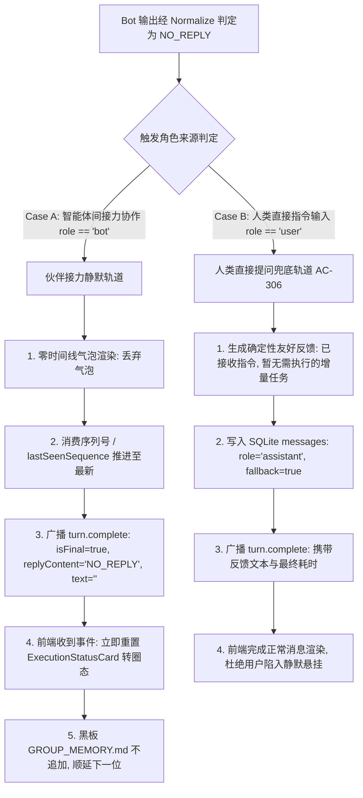
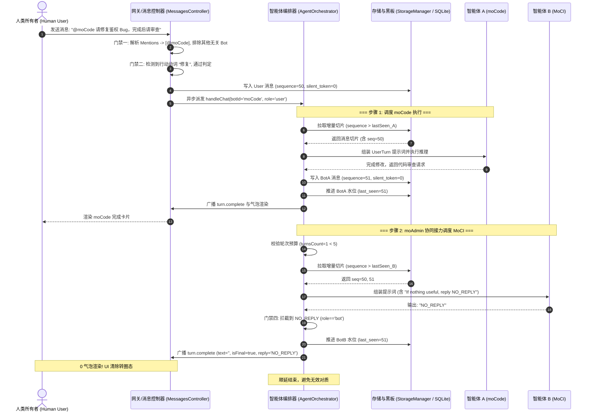

# [0] ROOT: 五维立体防循环唤醒机制与静默退出规范 (Anti-Loop Wakeup Defense & Silent Exit)

## [1] 规范背景与痛点定义 (Problem Statement)

在多智能体（Multi-Agent）群聊协同架构中，聊天通道并非简单的“广播大房间”。如果允许多个 Agent 对群内所有消息自由监听、自主抢答与互相呼叫，系统将迅速退化并遭遇三类致命工程故障：

1. **广播回声风暴 (Echo Storm)**：某 Bot 输出中包含礼貌性寒暄（如“谢谢 @moCode 的支持”、“我也赞同这个方案”），若路由引擎盲目将文本中的 `@` 解释为唤醒指令，将触发 Agent 间的环形递归唤醒，导致 Token 账单与上下文尺寸呈指数级爆炸。
2. **上下文雪崩与缓存击穿 (Context Avalanche & Cache Thrashing)**：全员无差别唤醒会强行拉取冗长历史，冲垮底层的 Prompt Caching（提示词缓存），使单次调用首字延迟攀升数十倍，产生大量无业务价值的废话气泡。
3. **静默悬挂与假死黑洞 (Silent Hang)**：若智能体在判定“无话可说”时输出空字符串或 `NO_REPLY`，但宿主系统未在消息信封、状态机与前端推送链路上构建确定性终态闭环，将导致 UI 思考指示器（`ExecutionStatusCard`）无限转圈，人类用户陷入无反馈等待。

本规范定义了**五维立体防循环唤醒机制 (Anti-Loop Wakeup Defense)** 与**原生静默退出基语 (Native Silent Exit Primitive)**，通过宿主确定性代码门禁（Deterministic Host Gates）与状态机强约束，彻底根除死循环，保障群聊协作的高效性、经济性与确定性。

---

## [2] 五维立体防御拓扑总览 (Five-Dimensional Defense Topology)

防循环机制由宿主编排层（Host Orchestration Layer）在 Agent 物理执行前后串联的五道确定性门禁构成，任何一道门禁未通过均会提前阻断或终态流转：

```
                    人类/外部消息到达
                           │
                           ▼
  ┌─────────────────────────────────────────────────────────────┐
  │ [维度一: 显式 @ 提及与意图判定门禁]                           │
  │ 非主理人无显式 @ 严格不唤醒; Bot 输出 @ 强隔离 (反代理入队)     │
  └──────────────────────────────┬──────────────────────────────┘
                                 │ PASS (通过门禁)
                                 ▼
  ┌─────────────────────────────────────────────────────────────┐
  │ [维度二: 疑问句与号召句判定门禁]                             │
  │ 陈述句/确认句/客套寒暄直接阻断 (0 ms / 0 Token 直通静默)      │
  └──────────────────────────────┬──────────────────────────────┘
                                 │ PASS (存在行动诉求)
                                 ▼
  ┌─────────────────────────────────────────────────────────────┐
  │ [维度三: 增量 Delta 校验门禁]                                │
  │ 依据 member_cursors 水位线比对，无新增有效业务增量则跳过      │
  └──────────────────────────────┬──────────────────────────────┘
                                 │ PASS (装配 UserTurn 切片)
                                 ▼
  ┌─────────────────────────────────────────────────────────────┐
  │ [调用 Claude Agent SDK / 伙伴推理]                           │
  └──────────────────────────────┬──────────────────────────────┘
                                 │ 返回输出结果
                                 ▼
  ┌─────────────────────────────────────────────────────────────┐
  │ [维度四: 原生静默退出基语 (NO_REPLY)]                         │
  │ 精确匹配 NO_REPLY: 0气泡渲染, 推进 sequence, 终态闭环        │
  └──────────────────────────────┬──────────────────────────────┘
                                 │ 非静默内容 / 推进下一发言人
                                 ▼
  ┌─────────────────────────────────────────────────────────────┐
  │ [维度五: 轮次硬预算约束与宿主看门狗]                          │
  │ 单轮自主发言 <= 5 轮; 全员静默熔断; 7200s/30s 看门狗超时截断  │
  └─────────────────────────────────────────────────────────────┘
```

---

## [3] 维度一：显式 @ 提及与意图判定门禁 (Explicit Mention Gate)

### 3.1 非主理人“无显式 @ 默认不唤醒”铁律

多智能体名册中，不同角色拥有严格不对称的唤醒特权（模块：`src/daemon/orchestrator/AgentOrchestrator.ts`，函数：`resolveMentionedBotIds`；`src/web/server/services/bot-execution-service.ts`，函数：`resolveTargetBots`）：

1. **协调主理人 (Director Default Fallback)**：
   - 角色：`bot_moadmin_director_03`（`moAdmin`）；
   - 特权：当人类用户发送消息且未显式提及任何伙伴（`mentions.length === 0`）时，系统自动将任务所有权默认路由至 `moAdmin`（依据项目规章 `CLAUDE.md` [4.5]）。`moAdmin` 负责理解用户诉求、拆解任务并生成分工规划。
2. **专业职能伙伴 (Specialist Zero-Wakeup Invariant)**：
   - 角色：`bot_mocode_engine_01` (`moCode`), `bot_modoc_scribe_02` (`moDoc`), `bot_moci_sentinel_07` (`MoCI`), `bot_mogit_scm_05` (`MoGit`), `bot_modeep_scout_04` (`MoDeep`), `bot_mo_meta_06` (`Mo`)；
   - 门禁规则：若人类消息的正文中**未显式包含**对应伙伴的名称（`@moCode`）、别名（如 `@coder`、`@dev`）或其底层伙伴 ID，**调度引擎严禁唤醒该专业伙伴**；
   - 验证判据：`resolveTargetBots(content, explicitMentions)` 在无匹配时返回空列表，阻止底层 SDK Runner 实例化。

### 3.2 Bot 输出纯文本隔离与反代理入队 (Anti-Agency Invariant)

在协作过程中，某一智能体常在回复正文中提及同伴（例如：`moCode` 输出：“请 @MoCI 运行集成测试核验该提交”）。
- **纯文本隔离原则**：宿主消息路由器（`src/web/server/controllers/messages-controller.ts`，函数：`handleMessageRoute`）**仅将 Bot 产生的消息视为不可执行的展示载荷（Display Payload）**；
- **反代理入队铁律 (Anti-Agency Invariant)**：
  - 调度引擎**绝对不扫描** `sender_role === 'assistant'` 消息中的 `@` 字符用于指令派发；
  - 智能体无权通过文本 `@` 代替人类唤醒同行，亦无权代理自己向调度队列追加任务；
  - 一切多 Agent 交互的触发源头（Trigger Origin）必须严格源自已鉴权的人类用户（`authorKind === 'user'`，引自 PR #8075 意图隔离规范）。

---

## [4] 维度二：疑问句与号召句判定门禁 (Intent & Call-to-Action Gate)

### 4.1 社交客套与确认陈述阻断 (FastPath 0ms Bypass)

多智能体系统在长程任务中，人类用户常发送礼貌性应答、工作确认或短语反馈（如“好的”、“收到”、“明白了”、“OK”）。若将此类无实质指令的内容送入大模型，模型极易产生幻觉反问或循环寒暄。

宿主网关与编排器实现了前置语义模式判定（FastPath）：

```typescript
// 模块: src/daemon/orchestrator/AgentOrchestrator.ts (规范设计实现)
export const FASTPATH_PASSIVE_PATTERNS = [
  /^(好的|收到|明白|知道了|行|可|已阅|赞同|已确认)[!！。.\s]*$/i,
  /^(ok|okay|thx|thanks|thank you|got it|cool|k)[!！。.\s]*$/i,
  /^(辛苦了|非常感谢|多谢|没问题)[!！。.\s]*$/i,
];

export function isPassiveStatement(content: string): boolean {
  const trimmed = content.trim();
  return FASTPATH_PASSIVE_PATTERNS.some((pattern) => pattern.test(trimmed));
}
```

- **阻断行为**：命中上述被动陈述句时，网关直接持久化用户消息至 SQLite，**不唤醒任何 Bot 进程**（耗时 0 ms，Token 损耗 0）；
- **静默落盘**：系统处于静止就绪态，等待用户下一次显式指令。

### 4.2 疑问与行动号召提取逻辑

当用户消息未被被动模式阻断时，系统执行疑问与号召特征评估：
1. **疑问标记 (Interrogative Tokens)**：
   - 标点：`?`, `？`；
   - 疑问代词/副词：`如何`, `怎么`, `为什么`, `何处`, `何时`, `是否`, `可否`, `哪些`, `what`, `how`, `why`, `where`, `when`, `can you`, `could we`。
2. **号召标记 (Call-to-Action Verbs)**：
   - 动词：`请`, `执行`, `修复`, `重构`, `运行`, `审查`, `测试`, `创建`, `实现`, `分析`, `部署`, `run`, `fix`, `test`, `build`, `deploy`, `review`。
3. **判定裁决**：
   - 包含疑问或号召标记的消息被判定为 `ACTIVE_INTENT`，允许穿透至下一道门禁；
   - 缺乏指令动词且为纯客观陈述的发言，若未指定明确目标，由 `moAdmin` 评估是否需要提供帮助；非主理人一律拦截。

---

## [5] 维度三：增量 Delta 校验门禁 (Incremental Delta Gate)

### 5.1 水位线比对与增量切片提取 (Delta Slicing)

为杜绝重复消费旧消息并保护大模型上下文窗口，系统采用基于单调序号的水位线追踪（模块：`src/storage/StorageManager.ts`，类：`StorageManager`）：

- **数据表支撑**：`member_cursors`（包含字段：`member_id`, `room_id`, `last_seen_sequence`, `updated_at`）；
- **切片查询断言**：
  ```sql
  SELECT sequence, id, sender_id, sender_role, content, created_at
  FROM messages
  WHERE room_id = :roomId
    AND sequence > :lastSeenSequence
    AND sender_id != :selfBotId
    AND silent_token = 0
    AND rewind_at IS NULL
  ORDER BY sequence ASC
  LIMIT 30;
  ```
- **门禁拦截准则**：
  若针对某 Bot 查询出的增量消息集为空（`deltaSlice.length === 0`），宿主调度器**立即跳过该 Bot 的执行流程**，严禁向空上下文派发推理请求。

### 5.2 边界截断与 Unicode Emoji 代理对安全保护

当离线累积消息较多时，增量切片执行严格双重有界截断：
1. **条数有界**：单次提取上限 $\le 30$ 条（常规群聊模式推荐 12 条）。堆积超限时首部注入：`(${omittedCount} earlier messages were omitted.)`；
2. **字符有界**：单条消息截断 $\le 600$ 字符；
3. **Unicode 代理对保护 (`safeTruncateContent`)**：
   - 绝对禁止使用原生 `String.prototype.substring()` 在 UTF-16 编码单元中截断；
   - 必须通过 `Array.from(str)` 按 Unicode Code Point 整体计算，防止把 4 字节 Emoji（如 🚀、🎉）或高位字符截断成乱码代理对（Malformed Surrogate），从而引发大模型 Tokenizer 编码崩溃。

---

## [6] 维度四：原生静默退出基语 (Native Silent Exit: `NO_REPLY`)

### 6.1 提示词语法级注入规范

系统组装给智能体的每一次发言提示词中，在末尾固定强制注入语法级退出指令（引自 `docs/dev-rules/bot-group-orchestration.md` [5.1]）：

```
It is your turn in the group. Use your memory, skills and tools as usual if they help.
Your final reply is posted to the group exactly as written: one concise message in your own voice, in the language the group is using, without repeating what others already said.
If you have nothing useful to add, reply with exactly NO_REPLY.
```

### 6.2 双轨终态收敛处理模型

宿主编排器捕获到 Bot 返回的输出并执行标准化处理：
`const normalizedReply = replyText.trim().toUpperCase();`
若 `normalizedReply === 'NO_REPLY' || normalizedReply === '```NO_REPLY```'`，系统启动双轨分流：



#### 6.2.1 轨道 A：智能体间接力流转 (`role === 'bot'`)
- **零时间线消息广播**：不向群时间线写入任何常规气泡，人类用户端视界不受琐碎无用文本干扰；
- **序列推进与消除回声**：Bot 的 `last_seen_sequence` 推进到当前最新序号，防止下一轮重复消费历史；
- **前端状态清零闭环**：通过 WebSocket/SSE 广播带有 `isFinal: true` 与 `replyContent: 'NO_REPLY'` 的 `turn.complete` 事件，前端 `ExecutionStatusCard` 收到后平滑收起思考状态卡片，消除“转圈卡死”假象；
- **黑板隔离**：严禁向 `GROUP_MEMORY.md` 写入 `NO_REPLY` 字符串，黑板只保留真实业务共识。

#### 6.2.2 轨道 B：人类直连指令兜底 (`role === 'user'`，满足 AC-306 韧性验收)
- 当人类用户直接向智能体提问，但智能体评估上下文后输出 `NO_REPLY` 时，若完全静默会导致人类用户认为服务崩溃；
- 宿主引擎自动转换为确定性兜底回复：
  *“已接收您的指令。当前伙伴（${bot.name}）已完成协同上下文评估，暂无需执行的增量代码或任务。如需深入协助，请提供更具体的操作指引。”*
- 存入数据库并完成正常推送，兼顾防循环与人机交互体验。

---

## [7] 维度五：轮次硬预算约束与宿主看门狗 (Turn Budget & Watchdog)

### 7.1 单轮 5 次自主发言上限与人工检查点

- **预算铁律**：依据 `CLAUDE.md` [4.4] 与 `src/daemon/orchestrator/AgentOrchestrator.ts`，多智能体在人类未介入的情况下，单轮最多允许连续自主执行 5 步（`max_consecutive_steps = 5`）；
- **计数器管理**：
  - 调度器维护 `roomSpeakerState.get(roomId).turnsCount`；
  - 人类用户发言（`role === 'user'`）时，计数器强制重置为 `0`，并解除熔断标记；
  - 伙伴发言（`role === 'bot'`）时，计数器自增 `+1`；
- **熔断判定**：
  若 `turnsCount >= effectiveMaxTurns`，熔断器跳闸（`circuitBreakerTripped = true`），系统抛出 `DaemonRpcError(DaemonErrorCode.CIRCUIT_BREAKER_TRIPPED)`，挂起后续自动接力，在 Web 前端显式呈现「已达自主执行上限，等待人工确认继续」提示条。

### 7.2 全局圈数配额与全员静默熔断 (Quorum Silent Quorum)

除单发言人步数外，系统在宏观圈数层面施加双重硬顶：
1. **单轮最大循环圈数**：`MAX_CIRCLES_PER_ROUND = 3`（设计目标）；
2. **单轮累计发言上限**：`MAX_BOT_MESSAGES_PER_ROUND = 10`（设计目标）；
3. **全员静默熔断机制 (Full Silent Quorum)**：
   在一整圈轮询中，若所有待命候选 Bot（如 `moCode` $\to$ `MoCI` $\to$ `moDoc`）均返回 `NO_REPLY`，状态机立即判定群内已达成完全共识且无增量业务，**立刻提前终止本轮调度**，严禁空转后续圈数；
4. **P2P 点对点穿透深度熔断**：
   Agent 间通过 P2P 协议（`docs/protocols/p2p-protocol.md`）发起对质时，请求头强制封装递增的 `depth` 计数。当 `depth > 3` 时，直接抛出 `E_P2P_MAX_DEPTH` 异常，强行打破死锁依赖。

### 7.3 宿主看门狗机制 (7200s 活跃上限 / 30s 管道静默)

针对底层 Claude Agent SDK 子进程执行（模块：`src/daemon/orchestrator/ClaudeSdkRunner.ts`），宿主常驻守护进程挂载看门狗定时器（Watchdog）：

| 看门狗类型 | 超时阈值 | 监控指标与触发条件 | 熔断处置动作 |
| :--- | :--- | :--- | :--- |
| **单轮活跃硬上限** | `7200s` (2小时) | 任务持续占用执行通道未释放 | 发送 `SIGTERM`，1秒后强制 `SIGKILL`，状态转为 `TERM_TIMEOUT` |
| **Stdout 管道静默** | `30s` (设计目标) | 运行期间 stdout/stderr 持续零字节输出 | 判定进程陷入底层阻塞死锁，触发安全中止并通知网关 |

---

## [8] 端到端执行时序全景 (Mermaid Sequence)

下图完整演示包含“显式点名过滤、增量提取、`NO_REPLY` 静默跳过、人类直连兜底与配额熔断”的完整流转：



---

## [9] 数据模型与 DDL 架构规范 (Data Models & DDL)

防循环机制依托底层的原子持久化字段保障状态幂等与一致性（模块：`src/storage/DatabaseSchema.ts`）：

```sql
-- 1. 线性时间线消息表 (支持单调序号、静默标记与软撤回)
CREATE TABLE IF NOT EXISTS messages (
  sequence INTEGER PRIMARY KEY AUTOINCREMENT,
  id TEXT UNIQUE NOT NULL,
  client_id TEXT,
  session_id TEXT NOT NULL,
  room_id TEXT,
  thread_id TEXT,
  sender_id TEXT NOT NULL,
  sender_role TEXT NOT NULL CHECK(sender_role IN (
    'user', 'assistant', 'system', 'steering', 'tool',
    'tool_use', 'tool_result', 'thinking', 'ask_user',
    'plan_review', 'error', 'agent_switch', 'context_rebuild',
    'message_tombstone'
  )),
  content TEXT NOT NULL,
  tool_use_id TEXT,
  silent_token INTEGER NOT NULL DEFAULT 0, -- 1 表示 NO_REPLY 静默气泡，前台与切片查询自动过滤
  agent_kind TEXT DEFAULT 'cc',
  agent_meta_json TEXT,
  metadata_json TEXT NOT NULL DEFAULT '{}',
  rewind_at INTEGER,
  created_at INTEGER NOT NULL,
  FOREIGN KEY(session_id) REFERENCES sessions(id) ON DELETE CASCADE
);

-- 2. 伙伴读位游标表 (增量切片提取的核心基石)
CREATE TABLE IF NOT EXISTS member_cursors (
  member_id TEXT NOT NULL,
  room_id TEXT NOT NULL,
  last_seen_sequence INTEGER NOT NULL DEFAULT 0,
  updated_at INTEGER NOT NULL,
  PRIMARY KEY (member_id, room_id)
);

-- 3. 房间协同元数据表 (单轮自主步数硬上限配置)
CREATE TABLE IF NOT EXISTS rooms (
  id TEXT PRIMARY KEY,
  slug TEXT UNIQUE NOT NULL,
  name TEXT NOT NULL,
  charter_path TEXT NOT NULL,
  memory_path TEXT NOT NULL,
  single_speaker_mode INTEGER NOT NULL DEFAULT 1,
  max_consecutive_steps INTEGER NOT NULL DEFAULT 5, -- 严格限定单轮最多 5 步
  members_json TEXT NOT NULL DEFAULT '[]',
  created_at INTEGER NOT NULL,
  updated_at INTEGER NOT NULL
);

-- 索引保障微秒级查询性能
CREATE INDEX IF NOT EXISTS idx_messages_room_seq ON messages(room_id, sequence);
CREATE INDEX IF NOT EXISTS idx_messages_room_silent ON messages(room_id, silent_token, sequence);
```

---

## [10] 边缘情况与反模式防御 (Edge Cases & Anti-Patterns)

| 异常用例类别 | 潜在灾难后果 | 宿主确定性防御机制 | 验证断言方式 |
| :--- | :--- | :--- | :--- |
| **Markdown 包含包裹的 NO_REPLY** | 模型输出 ` ```NO_REPLY``` `，若仅严格匹配纯字符将漏判为常规文本。 | 正则与 Normalize 规则双重适配：`normalizedReply === 'NO_REPLY' \|\| normalizedReply === '```NO_REPLY```'`。 | 单元测试模拟代码块包裹输出，断言 `replyId` 包含 `silent_`。 |
| **高并发写入序号撕裂 (TOCTOU)** | 两个 Bot 几乎同时结束并写回，造成 `sequence` 乱序或回声复读。 | 采用 `withRoomLock(roomId)` 互斥锁与 SQLite 单一写入事务，写回即同步推进游标。 | 并发 10 条写入测试，验证 `sequence` 严格单调自增且无碰撞。 |
| **人类发送无义字符防挂起** | 用户发送空行、纯空格或乱码，系统无任何响应导致卡顿。 | 前置校验 `content.trim().length === 0` 时直接阻断并返回 HTTP 400，拒绝入库与派发。 | HTTP 400 `INVALID_INPUT` 断言。 |
| **Unicode 代理对切片撕裂** | 消息在 600 字符截断时将 4 字节 Emoji 劈成两半，引发大模型编码器解析崩溃。 | 必须使用 `Array.from()` 代替 `substring()` 进行基于 Code Point 的安全裁剪。 | 注入包含连续 200 个复杂 Emoji 文本，断言截断后文本可通过 UTF-8 校验。 |
| **静默退出导致的前端假死** | `NO_REPLY` 丢弃气泡后未通知前端，导致 UI 思考状态指示器永久挂起。 | 宿主必须无条件广播 `turn.complete` 信封（带 `isFinal: true` 与空 `text`）。 | 断言前端接收到 `turn.complete` 后 `ExecutionStatusCard` 状态为 `done`。 |

---

## [11] 架构规范符合性与测试验证矩阵 (Conformance Matrix)

本规范所约束的各项行为已在测试套件中全面固化。执行回归命令即可复核实现状态：

| 规范条目 | 符号 / 模块 | 实现状态 | 验证测试套件与执行命令 |
| :--- | :--- | :--- | :--- |
| **AC-306 兜底** | `AgentOrchestrator.handleChat` | IMPLEMENTED | `npx tsx test/milestone-3-e2e-resilience.test.ts` (PASS 100%) |
| **静默标记识别** | `StorageManager.appendMessage` | IMPLEMENTED | `npx tsx test/storage-runtime.test.ts` (PASS 100%) |
| **游标增量切片** | `StorageManager.getDeltaMessages` | IMPLEMENTED | `npx tsx test/storage-runtime.test.ts` (PASS 100%) |
| **防回声循环验证** | `BVA 7 NO_REPLY Test` | IMPLEMENTED | `npx tsx test/e2e/tier2-boundary-corner.test.ts` (PASS 100%) |
| **5 轮步数熔断器** | `AgentOrchestrator.handleChat` | IMPLEMENTED | `npx tsx test/session-lifecycle-rewind-compaction.test.ts` |
| **看门狗 7200s/30s** | `ClaudeSdkRunner.executeTurn` | TARGET | `docs/dev-rules/bot-group-orchestration.md` [6.4] 设计目标 |

---

## [12] 引用与路由拓扑 (References)

- **分支索引**：[docs/architecture/groupchat/INDEX.md](INDEX.md)
- **全局文档标准**：[docs/standards/documentation-standards.md](../../standards/documentation-standards.md)
- **多智能体协作总则**：[docs/dev-rules/bot-group-orchestration.md](../../dev-rules/bot-group-orchestration.md)
- **Cindy 黑板与聊天机制**：[docs/architecture/cindy-chat-mechanisms-and-blackboard-system.md](../cindy-chat-mechanisms-and-blackboard-system.md)
