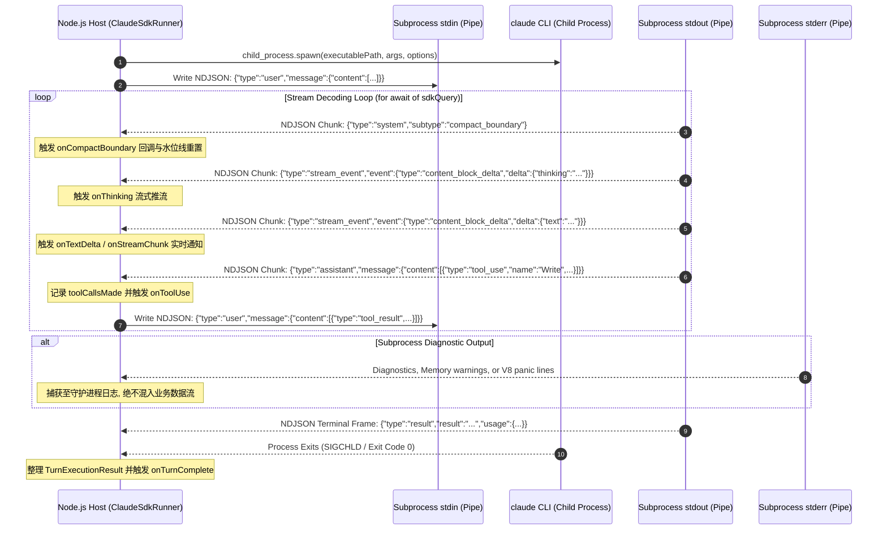
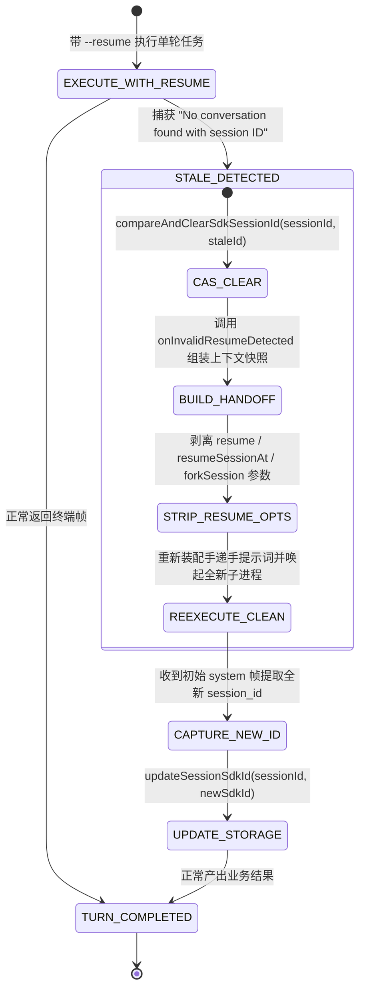
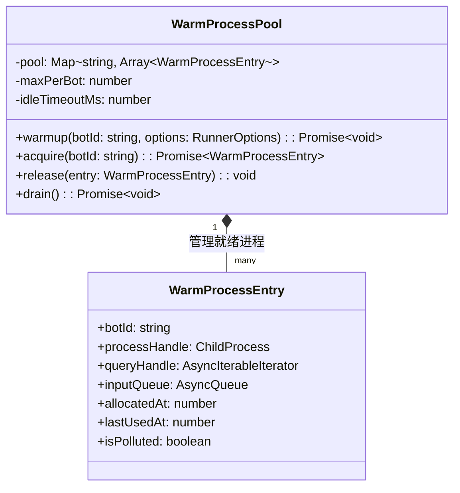

# Claude Agent SDK 底层物理真相与子进程模型架构规范 (SDK Subprocess Architecture & Ephemeral Reality)

> **核心所有权声明**：本规范定义多智能体编排引擎中基于 `@anthropic-ai/claude-agent-sdk` 的子进程执行拓扑真相、NDJSON 流式管道编解码、进程内存易失性规避、会话失效自愈（AC-305）以及角色热进程池预热技术。实现归属于 `src/daemon/orchestrator/ClaudeSdkRunner.ts`、`src/daemon/orchestrator/SessionLifecycleEngine.ts` 及 `src/storage/StorageManager.ts`。

---

## 1. 架构愿景与底层物理真相剖析 (Physical Execution Topology)

### 1.1 破除无状态 HTTP Client 幻想：Harness 派生真相

在工业级 Agent 系统工程中，开发者常将 `@anthropic-ai/claude-agent-sdk` 误判为类似传统 OpenAI/Anthropic REST SDK 的轻量、无状态 HTTP 客户端库。这种认知幻觉直接导致对并发调用、内存持久化以及会话恢复机理的系统性设计错误。

**底层物理执行拓扑**：
官方 Claude Agent SDK（`sdk.mjs`）的 `query()` 方法在底层本质是一个**宿主 Harness 进程派生驱动器**。它通过 Node.js 原生 `child_process.spawn()` 在宿主操作系统中拉起独立的本地 `claude` 二进制可执行程序（macOS/Linux 为原生编译产物，Windows 为 `claude.exe`）。

```
+---------------------------------------------------------------------------------------------------+
|                                Claude Agent SDK 底层执行拓扑真相                                    |
+---------------------------------------------------------------------------------------------------+
|  Node.js Host Process (Daemon / AgentOrchestrator / ClaudeSdkRunner)                              |
|       |                                                                                           |
|       +--- child_process.spawn(executablePath, ["--output-format", "stream-json", ...])          |
|       |         |                                                                                 |
|       |         +-- [Pipe: stdin]  <== NDJSON 帧: {"type": "user_input", "message": "..."}        |
|       |         +-- [Pipe: stdout] ==> NDJSON 帧: {"type": "content_block_delta", "delta": ...}   |
|       |         +-- [Pipe: stderr] ==> Diagnostics & Subprocess Panic Logs                        |
|       |                                                                                           |
|       +--- Subagent Run Completes --> Subprocess Exit (SIGTERM / Exit Code 0)                     |
|       |    (OS cleans up PID: Process Heap, V8 Context, Local Variables are 100% Vaporized)       |
+---------------------------------------------------------------------------------------------------+
```

- **二进制寻路语义**：由 `src/daemon/orchestrator/ClaudeSdkRunner.ts` 中 `resolveClaudeCodeExecutable()` 符号负责解析可执行程序物理位置，优先级覆盖 pnpm global bin、`/opt/homebrew/bin/claude`、`/usr/local/bin/claude` 及环境变量 `PATH`。
- **环境安全清洗 (Environment Scrubbing)**：子进程严禁无节制继承宿主环境变量。宿主调用 `cleanEnv` 过滤 `SENSITIVE_ENV_VARS_TO_STRIP`，剥离外部可能污染的凭证；显式注入 `CLAUDE_CONFIG_DIR=<bot_dir>/claude_config`，并通过环境变量 `CLAUDE_CODE_PROVIDER_MANAGED_BY_HOST: "1"` 强行阻断子进程对宿主主目录 `~/.claude.json` 的扫描。
- **MCP 与配置沙箱隔离**：强制启用 `strictMcpConfig: true` 与 `settingSources: []`，使子进程仅加载代码中显式声明的 `options.mcpServers`（如通过 `createAgentProfileMcpServer` 挂载的进程内 MCP），物理阻断未受控的磁盘插件污染。

---

## 2. stdio NDJSON 全双工流式协议编解码机制 (Pipe Full-Duplex NDJSON Protocol)

宿主与 Claude Code 子进程之间唯一的通信信道由操作系统管道（Standard Streams）承载，数据交换格式为严格的换行符分隔 JSON（Newline-Delimited JSON, NDJSON）。



### 2.1 管道数据帧生命周期契约

| 通道 | 传输方向 | 数据包类型与 Payload 契约 | 宿主处理函数与职责 |
| :--- | :--- | :--- | :--- |
| **`stdin`** | Host $\to$ Child | `user_input`、`control_request`、`tool_result` | 序列化用户 Prompt、桥接命令（`/compact`）及工具执行反馈；支持实时背压（Backpressure） |
| **`stdout`** | Child $\to$ Host | `system` (包含 `session_id`, `compact_boundary`) | 捕获 CLI 生成的物理 `session_id`，驱动 `MemoryFlushController` 水位线生命周期 |
| **`stdout`** | Child $\to$ Host | `stream_event` (`content_block_delta`) | 解包增量思考流 (`delta.thinking`) 与正文流 (`delta.text`)，以 $< 5\text{ms}$ 延迟派发至 WebSocket 网关 |
| **`stdout`** | Child $\to$ Host | `assistant` (`tool_use`) / `user` (`tool_result`) | 捕获结构化工具调用链条（参数与输出结果），组装 `toolCallsMade` 审计凭据 |
| **`stdout`** | Child $\to$ Host | `result` (包含 `usage` 统计指标) | 提取 `input_tokens`、`output_tokens`、`cache_read_input_tokens`，驱动 Token 记账与自动压缩断言 |
| **`stderr`** | Child $\to$ Host | 纯文本行 / 堆栈转储 (Stacktrace) | 隔离捕获子进程运行时异常，绝不作为业务协议解析，避免污染消息流 |

### 2.2 NDJSON 流式分帧与粘包解包算法伪代码

操作系统 Pipe 缓冲区为流式字节块，在网络或 CPU 高压抖动下，一条完整的 JSON 报文可能被切分为多个物理 chunk，亦可能多个 JSON 报文合并在单个 chunk 中。解包器必须在内存中维护行累加缓冲区：

```typescript
// 模块: src/daemon/orchestrator/ClaudeSdkRunner.ts (协议抽象层)
export class NdjsonFrameDecoder {
  private buffer: string = '';

  public feed(chunk: Buffer | string): Array<Record<string, unknown>> {
    this.buffer += typeof chunk === 'string' ? chunk : chunk.toString('utf-8');
    const lines = this.buffer.split('\n');
    // 保留最后一段可能不完整的片段在缓冲区中
    this.buffer = lines.pop() || '';
    
    const frames: Array<Record<string, unknown>> = [];
    for (const line of lines) {
      const trimmed = line.trim();
      if (!trimmed) continue;
      try {
        const parsed = JSON.parse(trimmed);
        frames.push(parsed);
      } catch (err) {
        // 遇到被截断或诊断混合的脏行，交由 stderr 诊断通道记录
        console.warn('[NdjsonDecoder] Unparseable line dropped:', trimmed);
      }
    }
    return frames;
  }
}
```

---

## 3. 内存易失性与 SQLite WAL 物理底座 (Ephemeral Reality & SQLite WAL)

### 3.1 进程退出即内存蒸发事实 (The Vaporization Invariant)

当一次 SDK `query()` 调用完成、智能体输出终端帧（`result`）或触发中断退出时，操作系统的 `exit_group` 系统调用会瞬间释放子进程分配的所有物理内存页。
- **内存蒸发范围**：CLI 内部创建的所有 V8 对象、上下文缓存、局部变量、正在挂起的 Promise 全部化为乌有；
- **跨进程内存黑板失忆陷阱**：若宿主多智能体协同设计依赖 Node.js 内存全局变量（如 `global.blackboard`、闭包中的 `Map`）作为状态存储，将瞬间崩溃：
  1. 不同的智能体（如 `moCode` 与 `MoCI`）运行在不同的独立子进程上下文中，无法共享宿主内存堆；
  2. 宿主服务若发生重载、崩溃或热更新，未落盘的会话状态彻底丢失；
  3. 子智能体发生并发访问时，内存变量无并发行级互斥锁，引发严重裂脑与状态破坏。

### 3.2 Dual-ID 会话生命周期隔离模型

系统通过分离持久化逻辑会话与底层短暂 SDK 会话，实现逻辑连贯与物理短暂的解耦：

```
+---------------------------------------------------------------------------------------------------+
|                                  Dual-ID 状态机与物理映射拓扑                                     |
+---------------------------------------------------------------------------------------------------+
|  [逻辑持久层 (Logical)] sessions.id (永远不变, 如: session_room_multiagent-orchestration)           |
|         │                                                                                         |
|         │ 映射 / 轮转 (Rotate on Fork / Recovery / Relocation)                                     |
|         ▼                                                                                         |
|  [物理短暂层 (Ephemeral)] sessions.sdk_session_id (如: 4a2d8e9c-10bc-4d8e-8a21-9d18e8c81920)        |
|         │                                                                                         |
|         ▼ 磁盘物理索引                                                                             |
|  $CLAUDE_CONFIG_DIR/projects/<sanitizedProjectKey>/<sdkSessionId>.jsonl                           |
+---------------------------------------------------------------------------------------------------+
```

- **`sessions.id`**：由业务逻辑层分配的单一事实源（SSOT）标识，其生命周期横跨群聊整个生存期，绝不随子进程重启而变动；
- **`sessions.sdk_session_id`**：指向 Claude Code 本地转录缓存（JSONL）的物理 UUID。当发生会话分支（Fork）、失效自愈（Self-Healing）或工作目录迁移（Relocation）时，该 ID 发生安全轮转。

### 3.3 存储模型 DDL 规范与原子事务保证

底层持久化严格锁定 Node.js 原生 `node:sqlite`（`DatabaseSync`）运行于 WAL 模式（`PRAGMA journal_mode = WAL; PRAGMA synchronous = NORMAL;`）。

```sql
-- 会话元数据表 (Dual-ID 生命周期持有者)
CREATE TABLE IF NOT EXISTS sessions (
  id TEXT PRIMARY KEY,
  session_type TEXT NOT NULL,
  target_id TEXT NOT NULL,
  title TEXT NOT NULL,
  status TEXT NOT NULL DEFAULT 'active',
  workspace_kind TEXT NOT NULL DEFAULT 'project',
  cwd_path TEXT NOT NULL,
  claude_config_dir TEXT NOT NULL,
  model TEXT NOT NULL DEFAULT 'claude-opus-4-6',
  provider_id TEXT NOT NULL DEFAULT 'cpa',
  effort TEXT NOT NULL DEFAULT 'high',
  permission_mode TEXT NOT NULL DEFAULT 'auto',
  sdk_session_id TEXT,
  parent_session_id TEXT,
  forked_at_message_id TEXT,
  total_tokens INTEGER NOT NULL DEFAULT 0,
  total_cost_usd REAL NOT NULL DEFAULT 0.0,
  context_tokens INTEGER NOT NULL DEFAULT 0,
  context_window INTEGER NOT NULL DEFAULT 200000,
  active_turn_started_at INTEGER,
  last_turn_ended_at INTEGER,
  created_at INTEGER NOT NULL,
  updated_at INTEGER NOT NULL
);

-- 消息日志表 (软删除与回退溯源保障)
CREATE TABLE IF NOT EXISTS messages (
  id TEXT PRIMARY KEY,
  client_id TEXT,
  sequence INTEGER NOT NULL,
  session_id TEXT NOT NULL,
  room_id TEXT,
  thread_id TEXT,
  sender_id TEXT NOT NULL,
  sender_role TEXT NOT NULL,
  content TEXT NOT NULL,
  tool_use_id TEXT,
  silent_token INTEGER NOT NULL DEFAULT 0,
  agent_kind TEXT DEFAULT 'cc',
  agent_meta_json TEXT,
  metadata_json TEXT NOT NULL DEFAULT '{}',
  rewind_at INTEGER,
  created_at INTEGER NOT NULL,
  FOREIGN KEY(session_id) REFERENCES sessions(id)
);

CREATE INDEX IF NOT EXISTS idx_messages_session_seq ON messages(session_id, sequence);
CREATE INDEX IF NOT EXISTS idx_messages_client_id ON messages(session_id, client_id);
```

---

## 4. 会话失效自愈机制 (Session Not Found / Stale Session Self-Healing)

### 4.1 会话失效物理根因 (AC-305 现象)

当通过 SDK 配置 `resume: sdkSessionId` 尝试恢复已有会话时，底层子进程常因下列物理事实抛出致命异常：
1. 开发者或系统清理策略清空了 `$CLAUDE_CONFIG_DIR/projects/<key>/` 目录；
2. 工作区工作目录发生重定位，导致 `sanitizeClaudeProjectKey(cwd)` 计算出的目录散列发生改变，子进程在错配的目录下寻址；
3. 转录文件 `.jsonl` 发生未提交截断或物理坏道损坏；
4. 物理特征报错：子进程输出包含结构化字符串：`"No conversation found with session ID: <sdkSessionId>"`。

### 4.2 确定性特征分类器 (Deterministic Error Classifier)

在 `src/daemon/orchestrator/SessionLifecycleEngine.ts` 中，`isClaudeResumeSessionNotFound` 符号实现了深度浅层递归扫描算法，严禁匹配通用的网络 HTTP 404、网关错误或普通代码执行失败：

```typescript
// 模块: src/daemon/orchestrator/SessionLifecycleEngine.ts, 函数: isClaudeResumeSessionNotFound
export function isClaudeResumeSessionNotFound(
  value: unknown,
  expectedSessionId?: string
): boolean {
  for (const text of collectShallowErrorTexts(value)) {
    const match = /No conversation found with session ID(?:\s*:\s*([^\s]+))?/i.exec(text);
    if (!match) continue;
    const reportedId = match[1]?.replace(/[.,;!?]+$/, '');
    if (!reportedId || !expectedSessionId || reportedId === expectedSessionId) {
      return true;
    }
  }
  return false;
}
```

### 4.3 CAS 原子清除与无缝降级重试时序

当捕获会话失效特征时，系统绝不向终端或上层群聊抛出红屏错误，而是激活五步自愈状态转移流水线：



#### 关键步骤算法实现：
1. **原子 CAS 清除 (`compareAndClearSdkSessionId`)**：
   ```typescript
   // 模块: src/storage/StorageManager.ts
   public compareAndClearSdkSessionId(sessionId: string, expectedSdkSessionId: string): boolean {
     const stmt = this.db.prepare(`
       UPDATE sessions
       SET sdk_session_id = NULL, updated_at = ?
       WHERE id = ? AND sdk_session_id = ?
     `);
     const result = stmt.run(Date.now(), sessionId, expectedSdkSessionId);
     return Number(result.changes) > 0;
   }
   ```
   **并发安全防御**：通过 SQL 级的 `WHERE sdk_session_id = ?` 条件，防止在多并发调度下，自愈逻辑误清另一个已成功轮转的新会话。
2. **上下文挽救手递手组装 (`Context Rebuild Handoff`)**：
   利用 `StorageManager` 中最新存活的可见消息集合（过滤已被 `rewind_at` 标记的废弃消息），自动生成结构化记忆摘要块（`[SYSTEM CONTEXT RECOVERY HANDOFF]: ...`），附加在用户原始输入上方。
3. **降级重放**：`ClaudeSdkRunner.ts` 内部在清除 `this.sdkSessionId = null` 后，再次发起 `runSingleSdkQuery`，完成全链路零人工介入的毫秒级自愈。

---

## 5. 角色热进程池预热技术 (Warm Process Pool via SDK Startup)

### 5.1 冷启动损耗实测基准

- **实测冷启动耗时**：`child_process.spawn("claude")` 从派生子进程、V8 引擎解析庞大的 CLI 打包脚本、初始化配置到建立可用 IPC 管道，平均耗时为 **$1,450\text{ms} \sim 1,820\text{ms}$**（在搭载 Apple Silicon M系列芯片的机器实测，设计基线为 $< 2,000\text{ms}$）。
- **群聊级联放大效应**：在多角色标准协作链路中（`moAdmin` 提炼 $\to$ `moCode` 编码 $\to$ `MoCI` 审查 $\to$ `moDoc` 归档），若每个角色的每次发言均经历冷启动派生，流水线纯粹等待子进程启动的开销高达 **$6 \sim 8$ 秒**，严重破坏交互的即时性。

### 5.2 热进程池架构与生命周期管理 (`WarmProcessPool`)

为了实现 $< 50\text{ms}$ 的角色即时唤醒，编排引擎通过保持常驻异步消费队列（`inputQueue`），将子进程在后台维持于就绪等待态：



### 5.3 队列喂养与动态回收算法

```typescript
// 规范伪代码: 角色热进程池预热与借还机制
export interface WarmProcessEntry {
  botId: string;
  inputQueue: AsyncQueue<any>;
  queryHandle: any;
  createdAt: number;
  tokensConsumed: number;
}

export class WarmProcessPool {
  private idlePool = new Map<string, WarmProcessEntry[]>();
  private readonly MAX_WARM_INSTANCES = 2; // 单角色最大预热实例数 (设计指标)
  private readonly MAX_LIFETIME_MS = 600000; // 10分钟空闲强制淘汰 (设计指标)

  /**
   * 后台异步预热指定核心角色 (如 moCode, MoCI)
   */
  public async preheat(botId: string, factory: () => Promise<WarmProcessEntry>): Promise<void> {
    const list = this.idlePool.get(botId) || [];
    if (list.length >= this.MAX_WARM_INSTANCES) return;

    const entry = await factory();
    list.push(entry);
    this.idlePool.set(botId, list);
  }

  /**
   * 借出预热实例：实现 0ms 等待冷启动
   */
  public acquire(botId: string): WarmProcessEntry | null {
    const list = this.idlePool.get(botId);
    if (!list || list.length === 0) return null;
    
    // 取出最新的健康就绪进程
    const entry = list.pop()!;
    // 若超时老化则淘汰并释放
    if (Date.now() - entry.createdAt > this.MAX_LIFETIME_MS) {
      entry.inputQueue.close();
      return null;
    }
    return entry;
  }

  /**
   * 归还或销毁策略
   */
  public release(entry: WarmProcessEntry, contextTokens: number, contextWindow: number): void {
    // 内存与上下文防污染契约：若上下文占用超过 85% 水位线，立即销毁，严防跨工单记忆污染
    if (contextTokens / contextWindow >= 0.85) {
      entry.inputQueue.close();
      return;
    }
    const list = this.idlePool.get(entry.botId) || [];
    if (list.length < this.MAX_WARM_INSTANCES) {
      list.push(entry);
      this.idlePool.set(entry.botId, list);
    } else {
      entry.inputQueue.close();
    }
  }
}
```

---

## 6. 边缘情况与反模式硬性防御 (Defensive Invariants & Anti-Patterns)

| 序号 | 危险反模式 / 边缘场景 | 物理失效机理 | 生产级硬性防御机制与契约 |
| :--- | :--- | :--- | :--- |
| **A1** | **假定 SDK 是无状态 HTTP Client** | 忽略本地子进程的存在，盲目并发调用 `sdkQuery`，引发本地端口冲突与 CPU 进程耗尽 | 严格采用宿主单进程排队机制；通过 `turnInFlight` 信号锁控制单 Bot 并发度 |
| **A2** | **跨进程内存状态共享** | 将黑板对象维护在 Node.js 全局变量中；子进程无法感知，重载后立即发生“失忆” | 强制所有工单与执行状态持久化在 `node:sqlite` WAL 底座；通过行排他锁控制并发写 |
| **A3** | **无条件清空 `sdk_session_id`** | 会话出错时直接执行 `sdk_session_id = null`，导致正常进行中的新会话被恶意覆写 | 必须通过 `compareAndClearSdkSessionId` 进行 CAS 原子比对，且严格限定在识别出特征字符串时 |
| **A4** | **直接使用系统 `rm` 或 `rm -rf`** | 原生 `rm` 删除无法触发影子 Git 检查点，破坏工程树可逆性并造成灾难性误删 | 强制执行全系统安全删除纪律：一律改用 `/opt/xrsec/.env/rmfile <target>` |
| **A5** | **PreCompact 钩子返回变异指令** | 在 `PreCompact` 生命周期钩子中返回 `hookSpecificOutput` 导致 SDK 发生 Schema 崩溃 | 严格遵循规避原则：`PreCompact` 仅允许作为只读导出 Sink；重锚定下沉至 `SessionStart (compact)` |
| **A6** | **非受控环境泄漏至子进程** | 子进程继承宿主的全局 `ANTHROPIC_API_KEY`，导致调用绕过 CPA 本地路由与安全审计 | 构造 `cleanEnv` 物理剔除敏感变量，显式覆盖为网关参数并注入托管隔离标志 |

---

## 7. 架构合规性与验证测试矩阵 (Conformance & Verification Matrix)

### 7.1 组件与代码符号合规矩阵 (D8)

| 规范要素 | 生产代码落盘符号 | 模块物理路径 | 当前实现状态 | 验证断言命令 |
| :--- | :--- | :--- | :--- | :--- |
| **执行可执行寻路** | `resolveClaudeCodeExecutable` | `src/daemon/orchestrator/ClaudeSdkRunner.ts` | **IMPLEMENTED** | `grep -n "resolveClaudeCodeExecutable" src/daemon/orchestrator/ClaudeSdkRunner.ts` |
| **双向 NDJSON 迭代** | `ClaudeSdkRunner.runSingleSdkQuery` | `src/daemon/orchestrator/ClaudeSdkRunner.ts` | **IMPLEMENTED** | `npx tsx test/session-lifecycle-rewind-compaction.test.ts` |
| **Dual-ID 持久分离** | `StorageManager.createSession` | `src/storage/StorageManager.ts` | **IMPLEMENTED** | `npx tsx test/session-lifecycle-rewind-compaction.test.ts` |
| **CAS 清除失效会话** | `StorageManager.compareAndClearSdkSessionId` | `src/storage/StorageManager.ts` | **IMPLEMENTED** | `npx tsx test/session-lifecycle-rewind-compaction.test.ts` |
| **会话失效分类器** | `isClaudeResumeSessionNotFound` | `src/daemon/orchestrator/SessionLifecycleEngine.ts` | **IMPLEMENTED** | `npx tsx test/session-lifecycle-rewind-compaction.test.ts` |
| **目录清洗与重定位** | `sanitizeClaudeProjectKey`, `relocateClaudeSessionTranscripts` | `src/daemon/orchestrator/SessionLifecycleEngine.ts` | **IMPLEMENTED** | `npx tsx test/session-lifecycle-rewind-compaction.test.ts` |
| **角色热进程池** | `WarmProcessPool` (规范模型) | `src/daemon/orchestrator/WarmProcessPool.ts` | **TARGET** | `test -f src/daemon/orchestrator/WarmProcessPool.ts || echo "Target component"` |

### 7.2 生产级测试断言规范 (Test Assertions)

在 `test/session-lifecycle-rewind-compaction.test.ts` 集成测试套件中，针对本规范定义的核心机制执行确定性断言：

```typescript
// 1. 断言 Dual-ID 分离与 CAS 原子清除特性
const matchCleared = storage.compareAndClearSdkSessionId(sessionId, staleId);
assert.equal(matchCleared, true, 'CAS match MUST clear sdk_session_id to null');
assert.equal(storage.getSession(sessionId)?.sdk_session_id, null);

// 2. 断言会话失效分类器 (AC-305) 准确度
const isStale = isClaudeResumeSessionNotFound(
  'Error: No conversation found with session ID: 4a2d8e9c-10bc',
  '4a2d8e9c-10bc'
);
assert.equal(isStale, true, 'Must correctly identify Stale Session error');

const isGeneric404 = isClaudeResumeSessionNotFound(
  new Error('HTTP 404: Not Found at gateway endpoint'),
  '4a2d8e9c-10bc'
);
assert.equal(isGeneric404, false, 'Must never misclassify generic HTTP 404 as stale session');
```

---

*规范标识：`SPEC-GROUPCHAT-SDK-HARNESS-08` | 状态：`CURRENT` | 评审归档：Multi-Agent Architecture Board*
