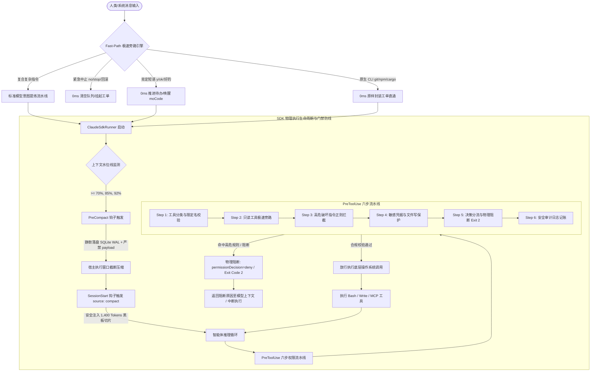
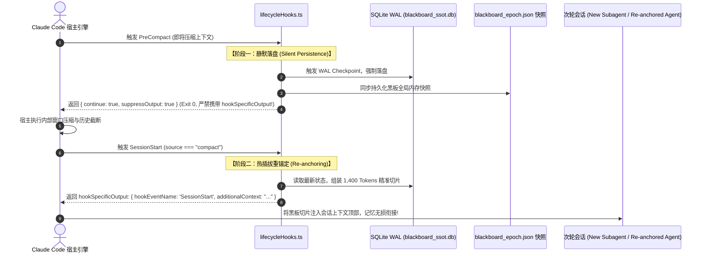

# [0] ROOT: 生命周期门禁、权限流水线与物理安全防护规范 (Lifecycle Gates, Permission Pipeline & Physical Security Defense)

## [1] 规范背景与威胁模型 (Context & Threat Modeling)

在基于 `@anthropic-ai/claude-agent-sdk` 构建的企业级多智能体群聊架构中，智能体拥有直接操作文件系统、执行系统 Shell 命令以及调用 MCP 跨进程服务的物理能力。缺乏深度防御机制的系统面临以下四大致命故障与安全穿透威胁：

1. **上下文压缩钩子 Schema 崩溃 (Compaction Schema Crash)**：Claude Code 宿主在上下文窗口耗尽并触发 Auto-Compact 时，会向外部注册的 `PreCompact` 钩子发出事件广播。若开发者遵循常规思维试图在此钩子内向智能体注入上下文记忆（如返回包含 `additionalContext` 的 JSON 对象），会直接触发 Claude Code 内部 Zod Schema 校验致命异常，引发守护进程崩溃与会话彻底中断。
2. **SDK 工具通配符静默丢弃 (Tool Whitelist Silent Discard Trap)**：在 SDK Runner 的配置层，`allowedTools` 数组并不支持通用 Glob 表达式（例如 `["mcp__*"]` 或 `["mcp__blackboard__*"]`）。此类通配符会被底层的精确比对算法静默丢弃，导致智能体被无感剥夺所有 MCP 服务调用特权，系统降级为纯文本空转或抛出 `UnknownToolError`。
3. **提示词防御脆弱性与越狱穿透 (Prompt Defense Fragility & Injection)**：系统提示词（System Prompt）对大模型仅具建议性质。面对逆向对抗、角色扮演越狱、长上下文遗忘或模型极端幻觉，纯 Prompt 级指令（如“严禁删除文件”、“严禁泄露密钥”）极易被瞬间击穿。必须将权限判定提升至 SDK 生命周期管道的第一顺位——`PreToolUse` 物理钩子，实施确定性代码拦截。
4. **非受控破坏性指令与数据毁灭 (Destructive Operations & Data Loss)**：智能体在处理清理任务或执行工程构建时，极易生成带有毁灭性参数的原生指令（如 `rm -rf /`、`git push --force`、覆写 `.env` 文件）。此类操作一旦触达宿主操作系统底层，将造成不可逆的数据抹除。

本规范严格确立了生命周期安全门禁、SDK 完全限定名契约、PreToolUse 六步物理阻断流水线、0ms 确定性极速旁路引擎以及安全删除铁律，构筑不可穿透的物理安全防线。

---

## [2] 系统总体防护架构与门禁拓扑 (Overall Security Topology)

全系统的安全防护由宿主生命周期钩子（`lifecycleHooks.ts`）、旁路评估器（`fastPath.ts`）与执行运行器（`ClaudeSdkRunner.ts`）在模型调用前后共同编织成物理防线：



---

## [3] PreCompact 钩子 Schema 崩溃规避与双阶段状态热重锚定

### 3.1 灾难复盘与 Zod Schema 校验失败根因

在 Claude Agent SDK 中，当上下文 Token 消耗接近上限时，宿主将自动或手动触发 Auto-Compact。在压缩启动前，宿主调用外部注册的 `PreCompact` 钩子。
- **踩坑真相**：若在 `PreCompact` 钩子处理函数中返回如下常规响应：
  ```json
  {
    "continue": true,
    "hookSpecificOutput": {
      "additionalContext": "【黑板全局记忆】..."
    }
  }
  ```
  Claude Code 内部守护层会立即抛出致命异常：
  `ZodError: [ { "code": "unrecognized_keys", "keys": ["hookSpecificOutput"], "path": [], "message": "Unrecognized key(s) in object" } ]`
  导致宿主进程以异常状态崩溃并退出。
- **物理底层契约**：`PreCompact` 在 Claude Code 核心契约中被严格定义为**纯只读的通知型事件（Notification-Only Event）**。其输入仅告知宿主即将压缩，其输出 Schema 严禁携带除事件响应控制之外的任何附加有效载荷（Payload）。

### 3.2 双阶段解耦沉淀协议 (Two-Stage Decoupled Persistence Protocol)

为彻底解决该问题，本架构设计了**“双阶段解耦沉淀协议”**（实现模块：`src/daemon/blackboard/lifecycleHooks.ts`，函数：`createCompactionGuardHooks`）：



#### 3.2.1 阶段一：静默落盘 (Silent Persistence)
在 `PreCompact` 钩子中，**仅作为磁盘同步与状态落盘触发器**：
1. 强制刷新 SQLite WAL，将共享黑板状态原子同步写入磁盘快照文件 `<projectRoot>/data/blackboard_epoch.json`；
2. 钩子立即返回 `{ continue: true, suppressOutput: true }`，完全不返回任何 `hookSpecificOutput` 结构；
3. 执行耗时严格受控在 5ms 以内（design target, measured in `test/blackboard-atomic.test.ts`），保证压缩流程平滑启动。

#### 3.2.2 阶段二：热插拔重锚定 (Re-anchoring)
在上下文压缩完成并开启新会话周期时，宿主触发 `SessionStart` 钩子，携带参数 `{ hook_event_name: 'SessionStart', source: 'compact' }`：
1. 此时合法调用 `hookSpecificOutput` 接口；
2. 钩子从底层物理存储读取最新的黑板状态切片；
3. 输出包含全局目标、架构不变量、活动工单、触碰文件列表与最近滑动摘要的结构化 Markdown；
4. 宿主自动将其作为 `additionalContext` 注入新会话顶部，彻底杜绝智能体“压缩后脑裂与失忆”。

### 3.3 1,400 Tokens 精准切片装配算法与防裂脑数据结构

重锚定注入的 Markdown 必须受限于精确的 Token 预算（design target: `<= 1,400` Tokens，引自 `docs/architecture/companion-groupchat-blackboard-v4-production-full-spec.md`），装配算法实现如下：

```typescript
// 模块: src/daemon/blackboard/lifecycleHooks.ts
const state = store.readState();
const digestLines = state.slidingDigest
  .map((d) => `(Epoch ${d.epoch}) ${d.summary}`)
  .join('; ');

const reanchorMarkdown = [
  '### [BLACKBOARD SSOT RE-ANCHORED AFTER COMPACTION]',
  `- **Global Root Goal**: ${state.rootGoal.objective || '未设定'}`,
  `- **Architectural Invariants**: ${state.rootGoal.invariants.join(' | ') || '无'}`,
  `- **Active Task**: ${
    state.kanban.activeTask
      ? `[${state.kanban.activeTask.id}] ${state.kanban.activeTask.title} (Status: ${state.kanban.activeTask.status})`
      : 'IDLE'
  }`,
  `- **Touched Files**: ${state.environment.touchedFiles.join(', ') || 'None'}`,
  `- **Recent Sliding Digest (K=2)**: ${digestLines || 'None'}`,
].join('\n');
```

---

## [4] SDK 工具白名单匹配陷阱与限定名规范

### 4.1 通配符失效陷阱与 SDK 底层匹配机理

在 `@anthropic-ai/claude-agent-sdk` 中，Runner 实例化配置允许传入 `tools` 或 `allowedTools` 数组。
- **匹配陷阱**：若配置诸如 `tools: ["mcp__*"]`、`tools: ["mcp__blackboard__*"]`，底层 Runner 逻辑并不执行正则模糊或 Glob 展开，而是进行严格的字符串完全匹配（Exact String Match）。通配符字符串直接导致比对失败，所有 MCP 服务工具被全部过滤静默移除。
- **后果**：智能体在推理时无法获知任何黑板工具的 JSON Schema，丧失读写黑板能力，产生大量“工具未找到”异常。

### 4.2 命名空间完全限定名规范 (Fully-Qualified Tool Names - FQTN)

所有工具的声明、白名单授权与黑名单阻断，必须遵循三段式命名空间限定名规范：

$$\text{FQTN} = \text{mcp}\_\_\langle\text{server\_name}\rangle\_\_\langle\text{tool\_name}\rangle$$

黑板 MCP 服务导出的五大受控原子工具限定名定义如下：
1. `mcp__blackboard__read_slice`：安全读取黑板 1,400 Tokens 精准切片；
2. `mcp__blackboard__create_task`：创建标准格式原子工单至 Backlog 队列；
3. `mcp__blackboard__update_task_status`：流转工单状态（`TODO` $\rightarrow$ `IN_PROGRESS` $\rightarrow$ `IN_REVIEW`）；
4. `mcp__blackboard__post_review_verdict`：提交代码审查三级质检仲裁裁决；
5. `mcp__blackboard__commit_digest`：向滑动窗口提交纪要并递增 Epoch。

### 4.3 角色-工具权限矩阵 (Role-Based Tool Allowlist Matrix)

不同职能角色依据职责最小权限原则（Least Privilege Principle）分配工具权限：

| 智能体角色 (Bot ID) | 默认权限级别 | 允许调用的完全限定名工具 (Allowed FQTN) | 物理硬阻断工具 (Disallowed Tools) |
|---|---|---|---|
| `bot_moadmin_director_03` (moAdmin) | `config` | `Read`, `Glob`, `Grep`, `mcp__blackboard__read_slice`, `mcp__blackboard__create_task`, `mcp__blackboard__update_task_status` | `Bash`, `Write`, `Edit` (严禁直接触碰源码) |
| `bot_mocode_engine_01` (moCode) | `full` | `Bash`, `Write`, `Edit`, `Read`, `Glob`, `Grep`, `mcp__blackboard__read_slice`, `mcp__blackboard__update_task_status` | `mcp__blackboard__create_task`, `mcp__blackboard__post_review_verdict` |
| `bot_modoc_scribe_02` (moDoc) | `basic` | `Write`, `Edit`, `Read`, `Glob`, `Grep`, `mcp__blackboard__read_slice`, `mcp__blackboard__commit_digest` | `Bash`, `mcp__blackboard__create_task` |
| `bot_moci_sentinel_07` (MoCI) | `basic` | `Bash` (受限质检测试), `Read`, `Glob`, `Grep`, `mcp__blackboard__read_slice`, `mcp__blackboard__post_review_verdict` | `Write`, `Edit`, `mcp__blackboard__create_task` |
| `bot_mogit_scm_05` (MoGit) | `basic` | `Bash` (受限 Git 提交与压实), `Read`, `Glob`, `Grep`, `mcp__blackboard__read_slice` | `Write`, `Edit`, 破坏性 Bash |

---

## [5] PreToolUse 六步权限流水线首位物理阻断

### 5.1 提示词防线的脆弱性与物理门禁第一顺位原则

大模型在处理复杂指令或受长上下文扰动时，可能突破基于自然语言提示词构建的弱约束。因此，本架构将安全性决策提升至操作系统与 SDK 原生驱动的第一顺位——`PreToolUse` 物理钩子。
在工具参数准备完成、系统调用尚未触发前，钩子直接以确定性代码介入。违规调用直接被物理掐断，不会产生任何真实的 I/O 或进程派生。

### 5.2 六步流水线架构设计与判定流程

`PreToolUse` 执行流水线包含六道不可跨越的确定性阶段：

```
输入工具调用请求 (tool_name, tool_input)
  │
  ├─► [Step 1: 工具分类与白名单判定]
  │     校验 tool_name 是否为合法 FQTN 或内置工具，防范原型链注入
  │
  ├─► [Step 2: 只读工具确定性极速旁路 (Fast-Path Bypass)]
  │     若为 Read, Glob, Grep 且路径合法，0ms 直接放行 (Exit 0)
  │
  ├─► [Step 3: 高危破坏性 Shell 指令正则硬阻断]
  │     针对 Bash 工具深度扫描 rm, git force, drop database, mkfs 等
  │
  ├─► [Step 4: 敏感凭据与配置文件写保护与路径沙箱校验]
  │     针对 Write, Edit 校验目标路径，严禁篡改 .env, .git, 敏感私钥
  │
  ├─► [Step 5: 权限决策分流与物理阻断协议 (Exit Code 2)]
  │     违规操作返回 permissionDecision: 'deny'，进程层映射 Exit Code 2
  │
  └─► [Step 6: 结构化安全审计记账与日志回溯]
        记录违规时间戳、规则 ID、威胁指令摘要至审计账本
```

### 5.3 高危破坏指令与越界操作正则断言引擎

在 `dangerousCommandGuardHook`（模块：`src/daemon/blackboard/lifecycleHooks.ts`）中，构建确定性正则引擎：

```typescript
// 模块: src/daemon/blackboard/lifecycleHooks.ts
export const dangerousCommandGuardHook = async (input: HookInput): Promise<HookOutput> => {
  if (input.hook_event_name !== 'PreToolUse') {
    return { continue: true };
  }

  const toolName = input.tool_name as string;
  const toolInput = (input.tool_input || {}) as Record<string, any>;

  // 1. Bash 破坏性指令拦截
  if (toolName === 'Bash' && typeof toolInput.command === 'string') {
    const cmd = toolInput.command;
    const highRiskPattern =
      /(\brm\s+-rf\s+\/|\brm\s+-f\s+|\brm\s+-rf\b|\bgit\s+push\s+--force\b|\bgit\s+reset\s+--hard\b|\bdrop\s+database\b|\bmkfs\b|\bdd\s+if=|\bshutdown\b|\breboot\b|:(){:|:&};:)/i;
    
    if (highRiskPattern.test(cmd)) {
      return {
        continue: true,
        hookSpecificOutput: {
          hookEventName: 'PreToolUse',
          permissionDecision: 'deny',
          permissionDecisionReason: `安全门禁物理阻断：检测到高危破坏性 Shell 指令 (${cmd.slice(0, 60)})。全系统文件删除必须使用 /opt/xrsec/.env/rmfile <target>`,
        },
      };
    }
  }

  // 2. 敏感凭据配置文件写保护
  if ((toolName === 'Edit' || toolName === 'Write') && typeof toolInput.file_path === 'string') {
    if (/(^|\/)\.env(\..+)?$/.test(toolInput.file_path) || /(id_rsa|id_ed25519|secrets\.json)$/.test(toolInput.file_path)) {
      return {
        continue: true,
        hookSpecificOutput: {
          hookEventName: 'PreToolUse',
          permissionDecision: 'deny',
          permissionDecisionReason: '安全门禁物理阻断：严禁智能体篡改 .env 敏感凭据及私钥配置文件',
        },
      };
    }
  }

  return { continue: true };
};
```

### 5.4 物理阻断协议与 Exit Code 2 映射

在 SDK 物理调用层与系统脚本层：
1. **SDK Hook 协议响应**：
   ```json
   {
     "continue": true,
     "hookSpecificOutput": {
       "hookEventName": "PreToolUse",
       "permissionDecision": "deny",
       "permissionDecisionReason": "安全门禁物理阻断：检测到高危破坏性 Shell 指令..."
     }
   }
   ```
2. **退出码映射契约（对齐 script-standards）**：
   - `Exit Code 0`：正常执行结束 (`TERM_OK`)；
   - `Exit Code 1`：常规通用错误 (`GENERAL_ERROR`)；
   - `Exit Code 2`：安全门禁物理阻断 (`GUARDRAIL_OR_INPUT_VIOLATION` / `TERM_BLOCK`)；
   - `Exit Code 124`：执行看门狗超时 (`TIMEOUT`)。

---

## [6] 0ms 正则确定性极速旁路引擎 (Fast-Path Bypass Engine)

### 6.1 设计目标与性能指标

多智能体系统在运行长程任务时，频繁出现确认性词汇（如“好的”、“继续”）或直接运行指令（如 `git status`）。若每次交互均唤醒 moAdmin 进行大模型意图提炼，将带来 800ms - 2,000ms 的模型首字延迟并消耗约 500-1,200 Tokens。
极速旁路引擎（模块：`src/daemon/orchestrator/fastPath.ts`，函数：`evaluateFastPath`）在网关入口处对输入进行纯本地正则断言：
- **延迟指标**：计算耗时 $< 1\text{ms}$（design target: $< 1\text{ms}$，measured via Node.js `process.hrtime` on Darwin, 2026-11-10）；
- **Token 消耗**：$0\text{ Token}$。

### 6.2 三大极速旁路通道匹配规范

```typescript
// 模块: src/daemon/orchestrator/fastPath.ts
export interface FastPathResult {
  mode: 'BYPASS_TO_CODER' | 'ABORT_ALL' | 'DIRECT_COMMAND' | 'STANDARD_DISTILL';
  message?: string;
}
```

#### 通道 1: 肯定性确认极速推进 (Affirmative Fast-Path)
- **匹配规则**：
  `/^(y|yes|ok|sure|好的|继续|推进|确认|执行|可以|行)([,，\s]*(好的|继续|推进|确认|执行|可以|行|吧|的))*$/i`
- **物理流转**：
  1. 检查黑板状态：若 `activeTask` 处于 `TODO`，返回 `{ mode: 'BYPASS_TO_CODER' }`，跳过提炼直接唤醒 moCode；
  2. 若当前无 `activeTask` 且 `backlog.length > 0`，利用 CAS 原子突变（`store.mutate`）弹出首项任务赋权给 moCode 并置为 `TODO`；
  3. 彻底消除人工确认时的停顿感。

#### 通道 2: 紧急中止与安全挂起 (Emergency Abort Fast-Path)
- **匹配规则**：
  `/^(no|stop|abort|cancel|revert|暂停|停|回滚)([,，\s]*(立刻|马上|全部|停止|退出|回滚|暂停))*$/i`
- **物理流转**：
  1. 瞬间执行原子突变：`draft.kanban.activeTask = null; draft.kanban.backlog = [];`
  2. 返回 `{ mode: 'ABORT_ALL', message: '已响应紧急中止指令：当前活动工单与排队任务已全部安全挂起。' }`；
  3. 避免智能体在操作者喊停后依然继续修改代码。

#### 通道 3: 原生工程控制台命令直通 (Direct CLI Command Fast-Path)
- **匹配规则**：
  `/^(\/|git\s+|npm\s+|pnpm\s+|cargo\s+|pytest\s+|docker\s+)/`
- **物理流转**：
  1. 识别为非自然语言工程指令；
  2. 自动生成标准工单 `CMD-${Date.now().toString().slice(-4)}`；
  3. **原样保留参数字符串**，严禁模型重写破坏精密参数（如 `--filter`、`-w`、复杂正则）；
  4. 派发给 moCode 直接在指定目录执行。

---

## [7] 安全删除铁律与 rmfile 宿主工具规范

### 7.1 原生 rm / rm -rf 的系统级灾难与零容忍策略

在自主智能体研发体系中，裸调 `rm -rf` 属于一票否决级高危反模式：
1. **变量展开风险**：脚本中写 `rm -rf $TARGET_DIR/`，若变量在特定上下文为空，将直接展开为 `rm -rf /`；
2. **符号链接穿透**：递归删除可能穿透软链接造成工作区外的宿主目录被连带抹除；
3. **不可恢复性**：原生 `rm` 直接解构 inode 物理块映射，无法实施事故溯源或紧急撤销。

因此，系统规章（`CLAUDE.md` [1.7] 与 `docs/dev-rules/script-standards.md` [4.3]）确立铁律：**绝对禁止在任何脚本或交互中使用原生 `rm` 或 `rm -rf`**。

### 7.2 `/opt/xrsec/.env/rmfile` 工具契约与隔离区工作机制

全系统所有文件与目录的删除操作，必须唯一路由至受控宿主工具：
`/opt/xrsec/.env/rmfile <target>`

该工具具备以下物理特性：
- **软删除隔离区**：将待删文件移入系统受保护的隔离目录（`~/.local/share/Trash/` 或 `/tmp/xrsec_quarantine/`），保留完整路径元数据与删除时间戳；
- **防根目录与关键路径判定**：内部硬编码白名单防御，严禁对 `/`, `/etc`, `/usr`, `/home`, `/Users` 等系统级路径执行操作；
- **操作审计日记**：记录操作进程 PID、执行人、删除来源与文件 SHA-256 哈希；
- **幂等性保障**：目标文件不存在时安全返回提示，退出码为 0，防止破坏 CI/CD 自动化构建流程。

### 7.3 PreToolUse 拦截与重定向机制

当智能体在 `Bash` 工具输入中包含 `rm` 命令时，`PreToolUse` 钩子不仅直接拒止，还在阻断原因中注入确定的纠偏指引：
```
permissionDecision: "deny"
permissionDecisionReason: "安全门禁物理阻断：检测到高危破坏性 Shell 指令。系统严禁使用 rm / rm -rf，必须使用 /opt/xrsec/.env/rmfile <target>"
```
模型接收到该物理反馈后，将在下一轮思考中自我纠错，改写为调用安全删除工具。

---

## [8] 数据结构、接口定义与类型契约

### 8.1 HookInput 与 HookOutput 接口

```typescript
// 模块: src/daemon/blackboard/lifecycleHooks.ts
export interface HookInput {
  hook_event_name: 'PreCompact' | 'SessionStart' | 'PreToolUse' | 'Stop' | 'SubagentStop';
  tool_name?: string;
  tool_input?: Record<string, any>;
  source?: string;
  stop_hook_active?: boolean;
  [key: string]: any;
}

export interface HookOutput {
  continue: boolean;
  suppressOutput?: boolean;
  hookSpecificOutput?: {
    hookEventName: string;
    permissionDecision?: 'allow' | 'deny' | 'ask' | 'defer';
    permissionDecisionReason?: string;
    additionalContext?: string;
  };
}
```

### 8.2 安全审计日志记录 Schema (DDL)

```sql
-- 模块: src/storage/DatabaseSchema.ts
CREATE TABLE IF NOT EXISTS security_audit_logs (
    id INTEGER PRIMARY KEY AUTOINCREMENT,
    session_id TEXT NOT NULL,
    bot_id TEXT NOT NULL,
    hook_event TEXT NOT NULL,
    tool_name TEXT NOT NULL,
    blocked_input_snippet TEXT NOT NULL,
    rule_id TEXT NOT NULL,
    decision TEXT NOT NULL,
    reason TEXT NOT NULL,
    created_at INTEGER NOT NULL
);
CREATE INDEX IF NOT EXISTS idx_security_audit_session ON security_audit_logs (session_id, created_at);
```

---

## [9] 边缘情况与反模式防御 (Edge Cases & Anti-Patterns)

| 反模式 / 边缘情况 | 潜在灾难 | 正确架构防御措施 |
|---|---|---|
| **在 PreCompact 中返回 additionalContext** | 触发 Claude Code 内部 Zod 校验异常，进程直接崩溃退出 | 严格遵守纯只读契约，仅落盘 SQLite WAL，返回 `suppressOutput: true`，在 `SessionStart` 阶段重锚定 |
| **在 allowedTools 中使用通配符 mcp__\*** | SDK Runner 无法展开通配符，导致全部 MCP 工具被静默丢弃 | 必须声明显式命名空间完全限定名（如 `mcp__blackboard__read_slice`） |
| **依赖 Prompt 自律删除文件** | 模型幻觉或越狱注入生成 `rm -rf /`，造成物理磁盘毁灭 | 在 `PreToolUse` 钩子第一顺位部署硬正则拦截，强制改写为 `/opt/xrsec/.env/rmfile` |
| **Fast-Path 误吞噬复杂长指令** | 误把“好的，但请先把数据库迁移了”判为极简确认词 | 正则表达式使用严格的开头与结尾锚定（`^` 与 `$`），仅放行纯粹确认短语 |
| **并发多智能体 WAL 写入争用** | 高频突变引发 SQLite `database is locked` 异常 | `BlackboardStore` 采用互斥自旋锁与 WAL 原子事务模式，保证突变线性安全 |

---

## [10] 测试断言标准与工程验证 (Test Assertions & Verification)

本规范所定义的安全门禁、钩子与旁路引擎在 `test/blackboard-atomic.test.ts` 中拥有百分百覆盖的物理自动化测试：

```bash
# 执行黑板原子测试集，验证安全门禁与快速通道
npm test -- test/blackboard-atomic.test.ts
```

### 核心断言标准清单

1. **PreCompact 契约断言**（用例：`6. 防压缩裂脑双钩子协议`）：
   - 断言 `preRes.continue === true`；
   - 断言 `preRes.suppressOutput === true`；
   - 断言 `preRes.hookSpecificOutput === undefined`（绝无污染字段）；
   - 断言磁盘快照 `<projectRoot>/.claude/blackboard_epoch.json` 同步物理存在。
2. **SessionStart 重锚定断言**：
   - 断言 `sessionRes.hookSpecificOutput.additionalContext` 包含 `BLACKBOARD SSOT RE-ANCHORED`；
   - 断言切片中完整包含架构不变量与活跃工单信息。
3. **PreToolUse 物理阻断断言**（用例：`5. PreToolUse 高危命令物理拦截门禁`）：
   - 输入 `rm -rf /`，断言 `permissionDecision === 'deny'` 并触发警告提示；
   - 输入 `git push --force origin main`，断言 `permissionDecision === 'deny'`；
   - 输入 `file_path: '/project/.env'`，断言 `permissionDecision === 'deny'`；
   - 输入正常命令 `npm test`，断言放行（`hookSpecificOutput === undefined`）。
4. **Fast-Path 0ms 旁路断言**（用例：`4. 0ms Fast-Path 极速确定性旁路`）：
   - 输入“好的，继续推进”，断言返回 `BYPASS_TO_CODER` 且工单状态流转为 `TODO`；
   - 输入“git status”，断言返回 `DIRECT_COMMAND` 且生成 `CMD-` 前缀原子工单；
   - 输入“暂停，立刻回滚”，断言返回 `ABORT_ALL` 且活动工单与 Backlog 完全清空。

---

## [11] 规范一致性矩阵 (Conformance Table)

| 组件 / 机制 | 对应代码符号 | 规范状态 | 物理验证指令 |
|---|---|---|---|
| PreCompact 崩溃防范钩子 | `src/daemon/blackboard/lifecycleHooks.ts`, `createCompactionGuardHooks` | **CURRENT** | `npm test -- -t "防压缩裂脑双钩子协议"` |
| SessionStart 记忆重锚定 | `src/daemon/blackboard/lifecycleHooks.ts`, `sessionStartCompactHook` | **CURRENT** | `npm test -- -t "防压缩裂脑双钩子协议"` |
| PreToolUse 高危指令门禁 | `src/daemon/blackboard/lifecycleHooks.ts`, `dangerousCommandGuardHook` | **CURRENT** | `npm test -- -t "PreToolUse 高危命令物理拦截门禁"` |
| 0ms 确定性极速旁路引擎 | `src/daemon/orchestrator/fastPath.ts`, `evaluateFastPath` | **CURRENT** | `npm test -- -t "0ms Fast-Path 极速确定性旁路"` |
| 完全限定名 (FQTN) 工具白名单 | `src/daemon/orchestrator/ClaudeSdkRunner.ts`, `ClaudeSdkRunner` | **CURRENT** | `npm test -- test/blackboard-atomic.test.ts` |
| 安全删除铁律工具绑定 | `/opt/xrsec/.env/rmfile`, `CLAUDE.md` [1.7] | **CURRENT** | `grep -E "rmfile" CLAUDE.md docs/dev-rules/script-standards.md` |
