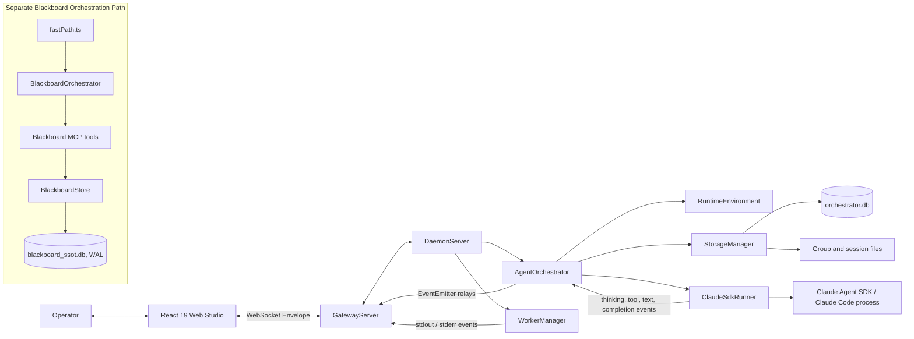

<!--
Purpose: Map the repository's current architecture and distinguish implementation from design specifications.
Context: Synthesized from the three architecture specifications and the active source tree.
Usage: Read before changing daemon, gateway, orchestration, persistence, or web integration boundaries.
Prerequisites: Treat source code and tests as implementation evidence; treat architecture documents as design evidence.
-->

# Repository Architecture Overview

## 1. Executive Model

This repository is a local multi-agent orchestration platform. Its implemented runtime is organized around a Node.js daemon, a WebSocket gateway, a React web client, per-agent Claude SDK runners, and SQLite-backed operational storage. Group charter and memory files provide a readable coordination surface alongside database state.

The three source specifications describe a broader target architecture: deterministic host orchestration, a shared blackboard, bounded agent turns, Prompt Distill, isolated agent permissions, and observable execution. These ideas are useful design constraints, but they do not all describe one fully integrated runtime path in the current tree.

Use these evidence labels throughout this document:

- **Implemented**: directly visible in current source or tests.
- **Specified**: described by an architecture document, not necessarily wired into the active entry path.
- **Assessment**: an engineering conclusion from comparing the specifications with current source.

## 2. System Topology

The upper path is the daemon's active composition. The lower path is a separately implemented blackboard workflow; the current `DaemonServer` constructs `AgentOrchestrator`, not `BlackboardOrchestrator`.

## 3. Runtime Request Flow

### 3.1 Main Daemon Path

1. The browser connects through `WebGatewayClient` to the gateway's WebSocket endpoint and sends typed envelope requests.
2. `GatewayServer` handles the `/gateway` upgrade, channel allowlisting, request dispatch, subscriptions, and topic-scoped pushes. `/health` is an HTTP probe.
3. `DaemonServer` composes the gateway, `StorageManager`, `RuntimeEnvironment`, `AgentOrchestrator`, `WorkerManager`, and `BackpressureGuard`; it registers invoke handlers and relays execution events.
4. `AgentOrchestrator` records the incoming message, resolves a bot and runner, assembles context, invokes one agent turn, records the result, and updates group memory when applicable.
5. `ClaudeSdkRunner` invokes the Claude Agent SDK, configures the agent's working directory, tool access, MCP servers, model, hooks, and isolated `CLAUDE_CONFIG_DIR`, then translates SDK events into callbacks.
6. Orchestration events return through `DaemonServer` and `GatewayServer` as topic pushes. The web client consumes the stream and renders thinking, tool execution, text deltas, and completion state. The separate Web REST plane can provide history and fallback responses, but a successful REST response is not equivalent to a Claude SDK execution.

`AgentOrchestrator` tracks single-speaker state and a bounded-turn circuit breaker, but the active Gateway path does not itself enforce mention arbitration or automatically dispatch the next Bot. The active default `maxTurnsPerRound` is 10; room records also carry `max_consecutive_steps = 5`, but `AgentOrchestrator` does not read that room value. The main method does not automatically invoke a next Bot after a Bot reply, so this is not yet a complete autonomous multi-Bot DAG loop. `fastPath.ts` and Prompt Distill are used by the separate `BlackboardOrchestrator` path, not by this Gateway request path.
### 3.2 Blackboard FSM Path

`BlackboardOrchestrator` implements a more explicit task workflow: local fast-path classification, optional moAdmin distillation, a TypeScript-controlled FSM loop, role-specific moCode/moCI/moAdmin turns, MCP-mediated blackboard mutations, cross-review, and human escalation. `BlackboardStore` persists a versioned state and audit entries in SQLite WAL; lifecycle hooks handle dangerous commands and compaction re-anchoring.

This path has its own state model and database under `<projectRoot>/.claude/blackboard_ssot.db`. It is not the store used by the daemon's `AgentOrchestrator` path. Tests such as `test/blackboard-atomic.test.ts` validate this blackboard subsystem directly, but that does not establish that the web-to-daemon request path uses it.

### 3.3 Web API and Fallback Plane

`src/web/server/vite-room-api-plugin.ts` mounts REST-style room, message, Bot, workspace, skills, session, and configuration routes. `src/web/server/common.ts` is hard-coded to `<projectRoot>/.daemon/orchestrator.db` and the repository `groups/` directory, while `DaemonServer` accepts a configurable `dataDir`. These paths coincide under the default daemon configuration, but can diverge when `dataDir` is overridden. This is a second access layer over parts of the daemon's state, not a second independent agent runtime.

`useRoomMessages` prefers the WebSocket `agent:chat` channel and falls back to `POST /api/rooms/:slug/messages`. The fallback controller inserts the human message and returns resolved target Bot IDs, but it does not call `AgentOrchestrator`, `ClaudeSdkRunner`, or emit real execution events. Treat it as persistence/display fallback, not as successful Agent execution.

The web layer still contains SSE-related comments, `DistillStreamEvent` types, and proxy handling for `text/event-stream`; current controller search did not find an active endpoint that emits `text/event-stream`. Treat SSE as a residual or unused contract in this tree; the active daemon stream is WebSocket push.
## 4. Repository Map

| Directory | Current responsibility |
|---|---|
| `src/daemon/gateway/` | WebSocket gateway, envelope protocol, invoke allowlist, client-facing event topics. |
| `src/daemon/transport/` | Daemon lifecycle, gateway composition, backpressure and watchdog behavior. |
| `src/daemon/orchestrator/` | Main `AgentOrchestrator`, `ClaudeSdkRunner`, worker management, fast path, and separate `BlackboardOrchestrator`. |
| `src/daemon/blackboard/` | Blackboard state types, SQLite WAL store, MCP tools, lifecycle hooks. |
| `src/daemon/config/` | Model, MCP, skill, and per-agent configuration loading. |
| `src/storage/` | SQLite schema and access, runtime context assembly, user-data path resolution. |
| `src/web/server/` | Vite middleware, REST controllers, configuration services, room/message APIs, and compatibility/fallback behavior. This plane accesses the daemon database directly and does not instantiate the daemon orchestrator. |
| `src/web/src/` | React application, gateway client/hooks, room and session UI, execution cards, settings, and remaining mock data modules. |
| `Bots/` | Repository-local agent definitions and runtime assets. |
| `Customizations/agents/` | Custom agent definitions and overrides. `Customizations/AGENTS.md` supplies shared runtime directives. |
| `Customizations/skills/` | Project-level skill assets and aliases. Skill discovery also checks centralized user locations. |
| `groups/` | Repository-local group metadata, charter, and shared memory assets. Runtime paths can vary with daemon storage configuration. |
| `docs/architecture/` | System architecture specifications, design history, and this repository-level synthesis. |
| `docs/protocols/`, `docs/dev-rules/`, `docs/reviews/` | Protocol contracts, implementation rules, and review/integration records. |
| `test/` | Unit, integration, boundary, adversarial, web, and E2E coverage. |
| `scripts/` | Daemon, room, bot-scaffolding, autonomous collaboration, and health-check entry points. |
| `poc/` | Isolated experiments, including bot/MCP process-isolation work. |
| `storage/` | Repository-local runtime artifacts such as transcript fixtures/logs; primary daemon records are SQLite-backed. |

## 5. State, Persistence, and Configuration Boundaries

| Concern | Current mechanism | Boundary to keep in mind |
|---|---|---|
| Bots, rooms, sessions, messages, cursors | `StorageManager` and `orchestrator.db` | The daemon passes a configurable data directory; its default is `<projectRoot>/.daemon`. Direct `StorageManager` construction without a custom path uses `~/.multiagent-orchestration/storage`. |
| Group coordination | `groups/<slug>/room.json`, `GROUP_CHARTER.md`, `GROUP_MEMORY.md`, plus room/message rows in SQLite | The main daemon path appends readable summaries to `GROUP_MEMORY.md`; this is not the same representation as the structured blackboard SSOT. |
| V4 blackboard task state | `BlackboardStore` in `.claude/blackboard_ssot.db` with WAL and audit table | Separate database and orchestration lifecycle; do not assume automatic synchronization with `orchestrator.db` or group markdown. |
| Agent identity and capabilities | `profile.json`, `capabilities.json`, `workbench.json`, `SOUL.md`, per-agent `claude_config/` | Agents may resolve from user agents, `Customizations/agents`, or repository `Bots`; precedence differs by resolver and should be kept explicit. |
| Model/provider settings | `UniversalConfigLoader` and `models.json` from user data or project customization fallback | API keys may be interpolated from environment variables. MCP discovery also reads host Claude MCP configuration in the current loader. |
| Runtime environment | `RuntimeEnvironment` and `ClaudeSdkRunner` | Sensitive environment variables are stripped and per-agent config directories are set, but the source still contains machine-specific executable/MCP paths and legacy SDK lookup candidates. |
| UI transport and streaming | WebSocket envelopes and topic pushes on the daemon path; REST history/fallback on the web server path | SSE references remain in comments, types, and Vite proxy handling, but no active controller emitting `text/event-stream` was verified. |

## 6. Architectural Assessment

The strongest shared principle across the three specifications is sound and visible in code: the host should own routing, state transitions, bounds, and permission decisions; agents should contribute domain reasoning and execution within those bounds. The gateway envelope, channel allowlist, SQLite-backed message sequencing, role-specific runner options, and explicit anti-loop state are concrete building blocks for that model.

The most important current architectural fact is split ownership. The daemon's active path, the Web REST/Vite path, and the v4 blackboard path each expose part of the same product surface, but they do not share one orchestrator or one state transition engine:

- **Daemon execution path**: `GatewayServer -> DaemonServer -> AgentOrchestrator -> ClaudeSdkRunner`.
- **Web API path**: Vite middleware/controllers -> direct SQLite and group-file access; fallback message persistence does not invoke the Agent runtime.
- **Blackboard FSM path**: `BlackboardOrchestrator -> Blackboard MCP -> BlackboardStore`, validated by focused tests but not constructed by `DaemonServer`.

Without an explicit adapter or migration boundary, a change can pass blackboard tests while leaving the user-facing Gateway path unchanged. Treat `AgentOrchestrator` as the current live request handler and `BlackboardOrchestrator` as a parallel/alternate subsystem until an end-to-end test proves otherwise.

The current source exposes these concrete risks and inconsistencies:

1. **Runner isolation is keyed too broadly.** `AgentOrchestrator` caches runners by `botId`, while runner construction accepts `roomId` and creates a room-specific sandbox CWD. Reusing one Bot in another room can therefore reuse the first room's runner and workspace. Key the cache by the actual isolation scope or make the runner workspace immutable.
2. **Peer delta context is calculated but not injected.** `AgentOrchestrator` computes a delta slice and passes it to `RuntimeEnvironment.assembleContextPrompt`, but that method ignores its delta argument. `assembleTurnContext` returns delta messages separately, while `assembleContextPrompt` returns only `systemPrompt`; the runner receives neither the returned array nor an appended delta block. Add a test that proves a new peer message reaches the model prompt.
3. **Abort reports can be false positives.** `DaemonServer` conditionally calls `orchestrator.abortExecution(...)`, but `AgentOrchestrator` does not define that method. The server can publish `agent:turn_interrupted` with `stopped: false` while the SDK turn continues. Implement cancellation at runner/orchestrator level or make the protocol report that cancellation is unsupported.
4. **Task routing is only partially end-to-end.** The REST resolver can identify mentioned Bots, but the Gateway handler defaults to moAdmin and does not parse message mentions into a multi-Bot dispatch plan. The documented fallback-dispatch and DAG behavior is therefore a design goal or web-layer helper, not a demonstrated property of the active Gateway path.
5. **The readable Markdown blackboard is not transactionally equivalent to the WAL blackboard.** `StorageManager.appendToBlackboard` reads and rewrites `GROUP_MEMORY.md`, while `BlackboardStore.mutate` uses `BEGIN IMMEDIATE` and an audit table. These are different consistency guarantees and must not both be called a universal SSOT.

6. **Configurable storage can split the Web API from the daemon.** The daemon accepts a custom `dataDir`, and `StorageManager` derives its `groups/` directory from that location. The Vite server instead uses fixed project paths for `.daemon/orchestrator.db` and `groups/`. A non-default daemon configuration can therefore leave REST history/configuration views attached to different storage than Gateway execution.

Other documentation and implementation drift to track:

- `docs/architecture.md` describes a headless subprocess architecture and says third-party SDK dependencies were removed, while the current package depends on `@anthropic-ai/claude-agent-sdk` and `ClaudeSdkRunner` uses it.
- The enterprise compendium describes SSE and frontend assets that do not match the active WebSocket gateway and current `src/web/src` inventory. SSE references still exist in the web layer, but no active `text/event-stream` controller was verified.
- The specifications make broad self-contained-host claims, but `UniversalConfigLoader` reads host Claude MCP configuration and `ClaudeSdkRunner` contains absolute machine-specific executable/MCP paths. Isolation is partial, not absolute.
- `src/web/server/services/bot-execution-service.ts` can synthesize tool-status cards by parsing backtick text when stored metadata is absent. The claim that all fake/regex tool traces were removed is therefore too broad.
- The literal safe-delete policy has an internal lifecycle exception: `DaemonServer.stop()` removes its known PID file with `fs.unlinkSync`. This is a constrained runtime cleanup path, not an arbitrary user-selected deletion; either document the exception or route it through the approved deletion mechanism.
- Mock modules remain in `src/web/src/mock/`. Their existence alone does not prove active routes depend on them, but it does mean the claim that all mock data has been removed requires route-level verification.

## 7. Recommended Source-of-Truth Rules

1. Use active source and tests to describe runtime behavior; use specifications to describe intent and target invariants.
2. Name the active request path (`GatewayServer -> DaemonServer -> AgentOrchestrator`) in implementation docs.
3. Decide whether `BlackboardOrchestrator` is a replacement, a room-workflow plugin, or an experimental/alternate runtime. Until then, document it as separate.
4. Assign one authoritative owner for task state. If both SQLite databases and Markdown memory remain, define explicit ownership and synchronization rules instead of treating all of them as a universal SSOT.
5. Add integration coverage for cross-room runner isolation, delivery of peer deltas to model context, Gateway mention routing, abort semantics, REST fallback semantics, event ordering, and the selected blackboard execution path.
6. Remove stale architecture claims or annotate them with status and evidence links when the implementation changes.

## 8. Source Documents

- `docs/architecture/companion-groupchat-blackboard-v4-production-full-spec.md`
- `docs/architecture/moadmin-orchestration-and-agent-first-standards-deep-dive.md`
- `docs/architecture/enterprise-multiagent-orchestration-architecture-compendium.md`
