# Multi-Agent Storage & Runtime Architecture Specification
**Document ID**: `SPEC-ARCH-STORAGE-RUNTIME-2026`  
**Status**: `APPROVED / ARCHITECTURAL BASELINE`  
**Language Plane**: `100% Machine-Facing en-US Technical Specification`

---

## 1. Storage Mechanism Architectural Decision (SQLite vs. JSON vs. Markdown)

### 1.1 Comparative Analysis & Boundary Allocation

To eliminate the "one-size-fits-all" trap, the `multiagent-orchestration` platform implements a **Hybrid Tiered Storage Architecture**. The table below establishes the deterministic boundary matrix:

| Criterion | SQLite (WAL + FTS5 + JSON1) | JSON / JSON5 / YAML | Markdown (`.md`) |
| :--- | :--- | :--- | :--- |
| **Primary Domain** | High-concurrency mutable relational states, transactional timelines, search indices. | Deterministic schemas, declarative manifests, bot configs, tool definitions. | High-density semantic knowledge, agent persona/soul, human-agent shared blackboard. |
| **Specific Entities** | Sessions, Messages Timeline, Topic DAG, Read Cursors (`sequence`), FTS Search (`fts.db`), Vector Embeddings. | `profile.json`, `capabilities.json`, `workbench.json`, `meta.json`, `mcp.json`, `settings.json`. | `SOUL.md`, `MEMORY.md`, `GROUP_CHARTER.md`, `GROUP_MEMORY.md`, Domain references. |
| **Concurrency / Lock** | Multi-Reader Single-Writer via WAL (`PRAGMA journal_mode=WAL`), microsecond read latency. | Atomic file replace via temp file swap (`fs.renameSync`), read-heavy / write-infrequent. | Append-friendly or overwrite snapshot, synchronized with Git or memory cache. |
| **Query Capability** | Complex SQL, transactional joins, FTS5 tokenized full-text search, BM25 ranking. | Direct key-path traversal (`O(1)` memory access), no query engine overhead. | LLM-native reading, zero serialization overhead for Prompt assembly. |
| **Durability & Crash** | ACID compliant, page-level checksums, crash resilient across process abrupt kills. | Susceptible to truncation on crash if not written atomically via tempfile swap. | Text-file durability, human-recoverable even under severe filesystem corruption. |

### 1.2 Decision Invariants
1. **Never use JSON for Linear Message Logs**: Storing unbounded chat histories in massive `.json` files causes `O(N)` JSON parse/stringify penalties, memory leaks, and write collision risks. All linear chat messages MUST reside in SQLite.
2. **Never use SQLite as the Sole Truth for LLM Personas**: Storing agent prompts or blackboard facts purely in binary DB tables destroys transparency, prevents Git versioning, and impairs inspection. Personas and Blackboards MUST be Markdown files on disk.
3. **Dual-Index Synchronization Invariant**: Every Markdown memory card (`memories/*.md`) is automatically parsed and mirrored into the Bot's local SQLite `fts.db` (`memory_fts` virtual table) upon creation or modification.

---

## 2. Storage Topology (Storage Locations Specification)

> **Status note**: the per-room `room.db` and per-DM `chat.db` below are a target layout and are not implemented. The implementation uses one `orchestrator.db` under `<storageDir>` (default `$MULTIAGENT_HOME/storage`) with `rooms`, `sessions`, `messages` and `member_cursors` tables. `BlackboardStore` writes `blackboard_ssot.db` under `<projectRoot>/data`. The Web API server opens `<projectRoot>/.daemon/orchestrator.db`. These three locations must be reconciled before a non-default data directory is supported.

The file system hierarchy is strictly partitioned into three distinct planes: **Global State Plane**, **Workspace Project Plane**, and **Bot Asset Plane**.

```
~/.multiagent-orchestration/                   <-- [Global State Plane]
├── storage/
│   ├── orchestrator.db                       <-- Global SQLite: active sessions, room registries, routing table
│   ├── orchestrator.db-wal
│   └── orchestrator.db-shm
├── groups/                                   <-- Group Chat & Room Plane
│   └── <room-slug>/                          <-- e.g., "core-engineering", "research-taskforce"
│       ├── room.json                         <-- Room metadata, member bot list, security level
│       ├── GROUP_CHARTER.md                  <-- Room constitution, rules of engagement, speaker protocol
│       ├── GROUP_MEMORY.md                   <-- Shared Blackboard: verified facts, current state, decisions
│       └── room.db                           <-- Room SQLite: message timeline, delta sequences, thread roots
│           ├── tables: messages, thread_nodes, delta_acks
├── chats/                                    <-- Direct Message (1-on-1 DM) Plane
│   └── dm_<botId>/
│       ├── session.json                      <-- Session config, token counts, canonical flags
│       └── chat.db                           <-- DM message history, user steers, tool call envelopes
│
<workspace-root>/                             <-- [Workspace Project Plane]
├── .multiagent-orchestration/
│   ├── workspace-manifest.json               <-- Project binding, active room pointers
│   └── task-runs/                            <-- Ephemeral execution run artifacts
│       └── run-<timestamp>-<uuid>/
│           ├── dispatch.json
│           └── receipts/
│
Bots/                                         <-- [Bot Asset Plane]
└── <BotDirectoryName>/                       <-- e.g., "moCode", "MoAdmin"
    ├── profile.json                          <-- Identity, model override, avatar, canonical session pointer
    ├── capabilities.json                     <-- Permission tier, toolset mode (allowlist), harness
    ├── workbench.json                        <-- UI layout, mounted panels
    ├── SOUL.md                               <-- Core Persona, Three-Tier Boundary Architecture
    ├── README.md                             <-- Technical overview & operational playbook
    ├── MEMORY.md                             <-- High-density summary of persistent knowledge
    ├── claude_config/                        <-- [Isolated Bot MCP & Tool Plane]
    │   ├── mcp.json                          <-- Dedicated in-process / stdio MCP servers for THIS bot only
    │   └── settings.json                     <-- Locked: {"settingSources": []} strictly isolates host ~/.claude
    └── memories/                             <-- [Bot Knowledge Shard Store]
        ├── meta.json                         <-- Storage mapping metadata
        ├── fts.db                            <-- Local SQLite FTS5 search engine
        ├── MEMORY.md                         <-- Shard memory catalog
        ├── user_agent-first-multi-agent-system.md
        ├── user_language-discipline.md
        ├── user_skills-are-for-machines.md
        └── reference_<domain-spec>.md        <-- Domain specific reference knowledge
```

### 2.1 Detailed Storage Entity Mapping

#### A. Rooms (Groups) Storage
- **Path**: `~/.multiagent-orchestration/groups/<room-slug>/`
- **`room.json`**:
  ```json
  {
    "id": "room_core_engineering_01",
    "slug": "core-engineering",
    "name": "Core Engineering Taskforce",
    "created_at": 1793868000000,
    "members": ["moAdmin", "moCode", "moDoc", "MoCI", "MoGit"],
    "single_speaker_mode": true,
    "max_consecutive_steps": 5,
    "storage_mode": "hybrid"
  }
  ```
- **`GROUP_CHARTER.md`**: Defines who speaks when, consensus thresholds, and domain responsibilities.
- **`GROUP_MEMORY.md`**: The live blackboard. Agents write structured state cards (Status, Decisions, Assigned Tasks).
- **`room.db` (SQLite Schema)**:
  - `messages`: `(id TEXT PK, sequence INTEGER AUTO_INCREMENT, thread_id TEXT, sender_id TEXT, role TEXT, content TEXT, created_at INTEGER, metadata JSON)`
  - `thread_nodes`: `(thread_id TEXT PK, parent_message_id TEXT, title TEXT, status TEXT)`
  - `member_cursors`: `(member_id TEXT, room_id TEXT, last_seen_sequence INTEGER, PRIMARY KEY (member_id, room_id))`

#### B. Topics & Threads Storage
- **Path**: Managed within `room.db` as a DAG hierarchy.
- **Thread Root Isolation**: Threads branch from a parent message ID (`thread_nodes`).
- **Thread Local Storage**: If a thread requires prolonged deep divergence, an optional subfolder `threads/<thread_id>/` stores dedicated scratchpads without polluting the main `GROUP_MEMORY.md`.

#### C. Direct Messages (DM) Storage
- **Path**: `~/.multiagent-orchestration/chats/dm_<botId>/`
- **Schema**: Dedicated `chat.db` for pairwise conversation between the human operator and the individual bot.
- **Prompt Cache Protection**: Dedicated 1-on-1 DM sessions maintain a stable conversation history, avoiding KV prompt cache eviction.

#### D. Tool & MCP Configuration Storage
- **Path**: `Bots/<BotDirectoryName>/claude_config/`
- **Isolation Guarantee**:
  - `mcp.json`: Declares exactly and only the MCP servers permitted for this specific Bot.
  - `settings.json`: Hardcodes `"settingSources": []`, completely cutting off host `~/.claude/settings.json`.

---

## 3. Runtime Topology (Runtime Execution Locations Specification)

The runtime architecture separates the **Control Plane (Host Orchestrator)** from the **Execution Plane (Bot Subprocesses / Sandboxes)**.

```mermaid
flowchart TB
    subgraph ControlPlane["Host Control Plane (Node.js / Electron Daemon)"]
        Orchestrator["Orchestrator Coordinator"]
        RoomManager["Room & Group Manager"]
        ContextAssembler["Context & Blackboard Assembler"]
        StorageEngine["SQLite & Memory Sync Engine"]
    end

    subgraph Sandboxes["Execution Plane: Process & Sandbox Boundaries"]
        subgraph WorkerCode["moCode Subprocess"]
            EnvCode["Env: CLAUDE_CONFIG_DIR=Customizations/agents/moCode/claude_config<br/>CWD: . (Project Root)<br/>Privilege: Code Read/Write/Lint"]
            ClaudeCode["Claude Agent SDK / CLI Engine (Stream-JSON)"]
            McpCode["moCode Dedicated MCP Servers"]
        end

        subgraph WorkerDoc["moDoc Subprocess"]
            EnvDoc["Env: CLAUDE_CONFIG_DIR=Customizations/agents/moDoc/claude_config<br/>CWD: docs/<br/>Privilege: Markdown Authoring & Schema Validation"]
            ClaudeDoc["Claude Agent SDK / CLI Engine (Stream-JSON)"]
            McpDoc["moDoc Dedicated MCP Servers"]
        end

        subgraph WorkerAdmin["moAdmin Subprocess"]
            EnvAdmin["Env: CLAUDE_CONFIG_DIR=Customizations/agents/moAdmin/claude_config<br/>CWD: . (Project Root)<br/>Privilege: Audit & Task Dispatch"]
            ClaudeAdmin["Claude Agent SDK / CLI Engine (Stream-JSON)"]
            McpAdmin["moAdmin Dedicated MCP Servers"]
        end
    end

    ContextAssembler -->|Inject Assembled System Prompt & Slice| ClaudeCode
    ContextAssembler -->|Inject Assembled System Prompt & Slice| ClaudeDoc
    ContextAssembler -->|Inject Assembled System Prompt & Slice| ClaudeAdmin

    StorageEngine <---> Orchestrator
```



### 3.1 Process Execution Model
1. **Subprocess Isolation**:
   - Each active Bot execution runs in an isolated sandbox via `@anthropic-ai/claude-agent-sdk` (`ClaudeSdkRunner`) / native `claude` runtime binary.
   - Mode: Non-interactive, full-duplex NDJSON stream (`--input-format stream-json --output-format stream-json`).
2. **Process Watchdog & Lifetime**:
   - Each subprocess has a hard execution watchdog timer (`45s` zombie eviction / `180s` long-tool grace).
   - In-flight cancellations use graceful signal interruption (`control_request: interrupt` / `agent:abort`), followed by `SIGTERM` / `SIGKILL` on timeout.

### 3.2 Working Directory (CWD) Assignment Rules
The current working directory (CWD) of each Bot subprocess is deterministically bound based on its operational domain (`workbench.json` & `AGENTS.md`) to prevent accidental filesystem destruction:

| Bot Name | Runtime Working Directory (CWD) | Allowed Filesystem Write Scope |
| :--- | :--- | :--- |
| `moAdmin` | `.` (Project Root) | `groups/`, `Customizations/group/`, `docs/`, `logs/` |
| `moCode` | `.` (Project Root) | `src/`, `test/`, `poc/`, `scripts/` |
| `moDoc` | `docs/` | `docs/`, `*.md` |
| `MoCI` | `test/` | `test/`, `logs/`, `reports/`, `coverage/`, `.github/` |
| `MoGit` | `.` (Project Root) | `.git/`, release scripts, tags, changelogs |
| `MoDeep` | `./workspace/tmp/` | `docs/research/`, `poc/`, `./workspace/tmp/`, `./workspace/documents/` |
| `Mo` | `Customizations/` | `Customizations/skills/`, `Customizations/agents/<NewBot>/`, `Bots/<NewBot>/` |

### 3.3 Environment Variable Cleansing & Injection
When spawning any Bot subprocess:
1. **Dynamic Injection**:
   ```bash
   CLAUDE_CONFIG_DIR="<ProjectRoot>/Bots/<BotName>/claude_config"
   ```
2. **Mandatory Sanitization Stripping**:
   The following 20 sensitive environment variables are stripped from the child environment:
   `ANTHROPIC_API_KEY`, `CLAUDE_API_KEY`, `ANTHROPIC_AUTH_TOKEN`, `CLAUDE_CONFIG_PATH`, `CLAUDE_USER_CONFIG`, `CLAUDE_PROJECT_DIR`, `AWS_ACCESS_KEY_ID`, `AWS_SECRET_ACCESS_KEY`, `AWS_SESSION_TOKEN`, `OPENAI_API_KEY`, `GEMINI_API_KEY`, `GITHUB_TOKEN`, `GH_TOKEN`, `SUBAGENT_MODEL`, `CLAUDE_SUBAGENT_OVERRIDE`, `CLAUDE_CODE_ENTRY`, `HOST_CLAUDE_DIR`, `CLAUDE_HOST_SETTINGS`, `CLAUDE_DEV_OVERRIDE`, `CLAUDE_INTERCEPT_PROXY`.
3. **Dedicated Port & Local IPC**:
   Communication with in-process or child MCP servers is routed through local named pipes / `stdio` / loopback ports strictly bound to that specific child process.

### 3.4 Context Assembly & Blackboard Ingestion Pipeline
Before each turn, the `ContextAssembler` builds the dynamic prompt stream:
1. **Base System Prompt**: `SOUL.md` (Role, Boundaries, Anti-Hallucination rules).
2. **Charter Ingestion**: `GROUP_CHARTER.md` (If executing in a room context).
3. **Blackboard Snapshot**: Latest state of `GROUP_MEMORY.md`.
4. **Delta Slicing**:
   - Query `messages` in `orchestrator.db` for rows where `sequence > bot.last_seen_sequence`.
   - Deliver only incremental delta messages.
   - Update `bot.last_seen_sequence = max(sequence)`.
5. **Anti-Loop Safety Token**:
   - Enforce `NO_REPLY` silent token capability.
   - If user is not the trigger, enforce single-speaker step quota check.

---

## 4. Implementation Validation & Integrity Guarantees

All components of this specification are verified against the following invariants:
1. **Host isolation**: the host Claude config directory mtime is unchanged across a test run, verified by storage-runtime Test 9. Scope: files this system writes.
2. **Schema Uniformity**: Every bot created conforms strictly to the standard `@Bots` schema (JSON + MD + SQLite FTS5).
3. **ACID Transactionality**: Group messages, sequence counters, and cursor updates are wrapped in SQLite transactions.


---

## 5. Session persistence, rewind and compaction

See [session-lifecycle-compaction-and-rewind-specs.md](session-lifecycle-compaction-and-rewind-specs.md). It owns these rules.
