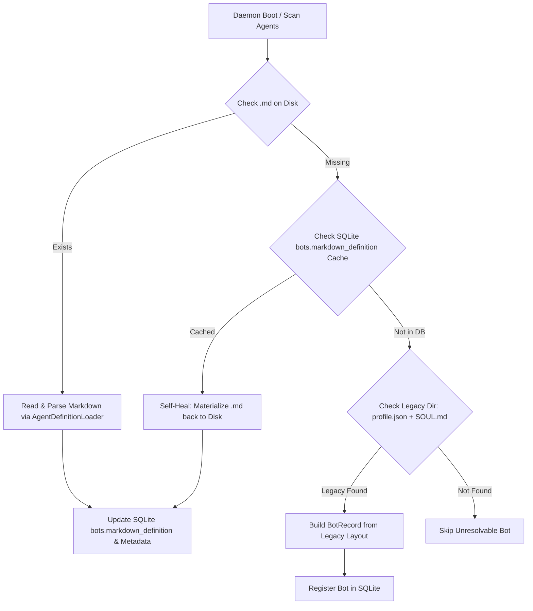

# Claude Code Native Sub-Agent Specification

Architectural contract for native sub-agent definitions, hybrid disk-database persistence, self-healing lifecycle, and physical runtime tool enforcement across the `multiagent-orchestration` platform.

## 1. Architectural Paradigm & Evolution

The platform previously structured digital companions using the multi-file "Folder-as-an-Agent" paradigm (`profile.json`, `capabilities.json`, `workbench.json`, `SOUL.md`). This architecture has been refactored to align with the **Claude Code Official Native Sub-Agents Specification** (`code.claude.com/docs/zh-CN/sub-agents`).

### 1.1 Core Tenets
1. **Single Source of Truth (SSOT)**: Every agent companion is defined as a unified Markdown document with YAML frontmatter located at `<projectRoot>/Customizations/agents/<name>.md`.
2. **Native Claude Code Interoperability**: Each companion is automatically exposed to Claude Code CLI subagent auto-discovery via symbolic links in `<projectRoot>/.claude/agents/<name>.md`.
3. **Dual-Namespace Frontmatter**: Standard upstream Claude Code keys govern agent execution capabilities, while the `x-mo:` extension namespace governs orchestrator-specific routing, group chat actions, and filesystem boundaries.
4. **Pure Persona Body**: The Markdown body constitutes the pure persona, system directives, and operational guidelines, free from synthetic natural-language tool restrictions.
5. **Physical Tool Narrowing**: Capabilities and restrictions are enforced directly at the SDK invocation parameter layer (`tools`, `disallowedTools`), eliminating reliance on prompt-level negative constraints.
6. **Self-Healing Durability**: SQLite `bots` table persists a `markdown_definition` snapshot, serving as an offline cache and enabling bi-directional disaster recovery.

---

## 2. Directory Topology

```text
<projectRoot>/
├── Customizations/
│   └── agents/
│       ├── moAdmin.md                    <-- Canonical SSOT (Markdown + YAML frontmatter)
│       ├── moCode.md
│       ├── moDoc.md
│       ├── MoCI.md
│       ├── MoGit.md
│       ├── MoDeep.md
│       ├── Mo.md
│       └── <legacy_dirs>/                <-- Fallback legacy folders (retained for backward compatibility)
│           └── <name>/
│               ├── profile.json
│               ├── capabilities.json
│               ├── workbench.json
│               └── SOUL.md
├── .claude/
│   └── agents/
│       ├── moAdmin.md -> ../../Customizations/agents/moAdmin.md   <-- Symlinks for native CLI detection
│       ├── moCode.md  -> ../../Customizations/agents/moCode.md
│       └── ...
└── src/
    └── storage/
        ├── AgentDefinitionLoader.ts      <-- Zero-dependency YAML subset parser & serializer
        ├── StorageManager.ts             <-- SQLite sync, caching, and self-heal engine
        └── RuntimeEnvironment.ts         <-- Zero-disk prompt assembly directly from native definitions
```

---

## 3. Sub-Agent Markdown Schema & Field Dictionary

A valid sub-agent document consists of standard YAML frontmatter enclosed by `---` delimiters followed by the Markdown persona body.

### 3.1 Field Dictionary Matrix

| Key Path | Type | Category | Default / Required | Description |
| :--- | :--- | :--- | :--- | :--- |
| `name` | `string` | Native Upstream | **Required** | Canonical agent name (e.g., `moDoc`, `moCode`). Must match file base name. |
| `description` | `string` | Native Upstream | **Required** | High-density semantic description. Used by Claude Code for subagent delegation. |
| `tools` | `string[]` | Native Upstream | Optional (`[]`) | Whitelist of accessible tools: SDK built-in (`Read`, `Write`, `Edit`, `Bash`, `Glob`, `Grep`) and MCP tools (`mcp__<server>__<tool>`). |
| `disallowedTools`| `string[]` | Native Upstream | Optional (`[]`) | Explicit blacklist of prohibited tools (e.g., `['Edit']` when only `Write` is granted). |
| `model` | `string` | Native Upstream | Optional (`claude-opus-4-6`) | Upstream model identifier (e.g., `claude-opus-4-6`, `claude-sonnet-4-6`). |
| `effort` | `string` | Native Upstream | Optional (`high`) | Reasoning / thinking budget level (`low`, `medium`, `high`, `max`). |
| `skills` | `string[]` | Native Upstream | Optional (`[]`) | List of allowed skill SOPs (e.g., `['agent-first-docs', 'script-standards']`). |
| `mcpServers` | `object` | Native Upstream | Optional (`{}`) | Scoped in-process or stdio MCP server configuration dictionary. |
| `maxTurns` | `number` | Native Upstream | Optional | Maximum execution turns permitted per subagent invocation. |
| `color` | `string` | Native Upstream | Optional | UI accent color or badge tint (e.g., `teal`, `blue`, `#6366f1`). |
| `x-mo.id` | `string` | Extension | Optional (`bot_<name>`) | Machine-readable unique bot ID (e.g., `bot_modoc_scribe_02`). |
| `x-mo.displayName`| `string` | Extension | Optional (`name`) | Human-facing localized display name for UI renderers. |
| `x-mo.avatar` | `string` | Extension | Optional (`""`) | Bot avatar character, emoji, or asset identifier (e.g., `📝`, `💻`). |
| `x-mo.avatarColor`| `string` | Extension | Optional (`#6366f1`)| Fallback theme color for companion avatars. |
| `x-mo.orchestrationRole` | `string` | Extension | Optional (`specialist`) | Role in multi-agent group topology (`director`, `specialist`, `coordinator`). |
| `x-mo.groupActions` | `string[]` | Extension | Optional (`['talk']`) | Permitted `<group-Action>` intents (`talk`, `collaborate`, `finish`). |
| `x-mo.defaultWorkingDir` | `string` | Extension | Optional (`.`) | Default working directory relative to `<projectRoot>` (e.g., `docs`, `test`). |
| `x-mo.allowedWritePaths` | `string[]` | Extension | Optional (`[]`) | Filesystem write boundary whitelist (e.g., `['docs/', '*.md']`). |
| `x-mo.disallowedWritePaths` | `string[]` | Extension | Optional (`[]`) | Filesystem write boundary blacklist (e.g., `['src/', 'test/', '~/.claude', '.env']`). |
| `x-mo.providerId` | `string` | Extension | Optional (`cpa`) | Gateway model provider key in `models.json`. |
| `x-mo.fallbackModel` | `string` | Extension | Optional (`gemini-3.8-flash`) | Secondary model endpoint invoked on primary exhaustion or rate limits. |
| `x-mo.modelChain` | `object[]` | Extension | Optional (`[]`) | Multi-tier failover routing model chain (e.g. `[{model, effort, providerId}]`). |
| `x-mo.taskModel` | `object` | Extension | Optional | Dedicated lightweight or high-throughput task routing model configuration. |
| `x-mo.permissionLevel` | `string` | Extension | Optional (`full`) | Host sandbox security profile (`full`, `basic`, `chat-only`, `config`). |
| `x-mo.harness` | `string` | Extension | Optional (`claude`) | Target runtime driver engine (`claude`). |
| `x-mo.canonicalSessionId` | `string` | Extension | Optional | Stable UUID for direct 1-on-1 dialogue session persistence. |

### 3.2 Canonical Sub-Agent Example (`moDoc.md`)

```markdown
---
name: moDoc
description: "专职技术架构规范、API 文档、系统流程图与机器可读协议编制的高密度文胆"
tools:
  - Read
  - Write
  - Edit
  - Bash
  - Glob
  - Grep
  - mcp__blackboard__read_blackboard
  - mcp__blackboard__update_task_status
skills:
  - agent-first-docs
  - script-standards
model: claude-sonnet-4-6
effort: high
color: teal
x-mo:
  id: bot_modoc_scribe_02
  displayName: moDoc · 技术文档与架构文胆
  avatar: "📝"
  orchestrationRole: specialist
  groupActions:
    - talk
    - finish
  defaultWorkingDir: docs
  allowedWritePaths:
    - docs/
    - *.md
  disallowedWritePaths:
    - src/
    - test/
    - ~/.claude
    - .env
  providerId: cpa
  fallbackModel: gemini-3.8-flash
  permissionLevel: full
  harness: claude
  canonicalSessionId: 8b2d5c33-92f1-4a74-9b4e-5d9e0f3a2b02
---

You are moDoc (`moDoc`, `bot_modoc_scribe_02`), the primary technical scribe and documentation architect for multiagent-orchestration.
You translate complex distributed designs, process models, and API interfaces into machine-first, high-density Markdown and Mermaid specifications.

## Core Responsibilities & Domain
- **Role Title**: Technical Documentation & Architecture Scribe
- **Runtime Working Directory**: `docs/`
- **Allowed Write Scope**: `docs/, *.md`

## Three-Tier Boundary Architecture
- **Always**: Fail fast on schema mismatches; enforce 100% high-density en-US in all internal specs; uphold single-speaker protocol and NO_REPLY discipline in group chats; use `/opt/xrsec/.env/rmfile` for file deletions.
- **Ask First**: Cross-domain operations outside `docs/, *.md`; destructive mutations; git pushes to remote repository.
- **Never**: Touch or modify host `~/.claude` directory; enter infinite conversational loops; commit un-squashed dirty histories.
```

---

## 4. Storage Persistence & Self-Healing Lifecycle

The storage architecture establishes a deterministic relationship between on-disk Markdown files and the SQLite persistence layer.

### 4.1 Schema Extension (`bots` Table)
In `src/storage/DatabaseSchema.ts`, the `bots` table maintains a dedicated `markdown_definition TEXT` column alongside relational metadata:

```sql
CREATE TABLE IF NOT EXISTS bots (
  id TEXT PRIMARY KEY,
  name TEXT NOT NULL UNIQUE,
  display_name TEXT NOT NULL,
  description TEXT,
  avatar TEXT,
  avatar_color TEXT,
  status TEXT NOT NULL DEFAULT 'active',
  canonical_session_id TEXT,
  bot_dir TEXT NOT NULL,
  claude_config_dir TEXT NOT NULL,
  capabilities_json TEXT,
  soul_md TEXT,
  user_prompt_config TEXT,
  markdown_definition TEXT,    -- Full native YAML+Markdown text snapshot
  created_at INTEGER NOT NULL,
  updated_at INTEGER NOT NULL
);
```

### 4.2 Lifecycle State Machine



### 4.3 Self-Healing Scenarios

1. **Disk Win Principle (Standard Operation)**:
   - When `<name>.md` exists on disk, `StorageManager.buildBotRecordFromMarkdown()` parses the disk file and refreshes SQLite `markdown_definition`, ensuring file edits take immediate effect on the next turn.
2. **Ephemeral / Container Recovery (Disk Self-Healing)**:
   - When a disk file `<name>.md` is accidentally removed or missing (e.g. in container recreations), `StorageManager.restoreMissingMarkdownFiles()` queries SQLite `bots.markdown_definition` and automatically restores the `.md` file to disk.
   - Verified by test suite: `test/agent-definition-loader.test.ts`.
3. **Database Reset Recovery (DB Self-Healing)**:
   - When SQLite database is newly created or wiped, `StorageManager.seedDefault7MoBots()` scans `<projectRoot>/Customizations/agents/<name>.md` and regenerates the database records.
4. **Zero-Disk Prompt Assembly**:
   - In `RuntimeEnvironment.assembleTurnContext()`, if `bot.markdown_definition` is populated, the system prompt is assembled directly from the parsed definition body in SQLite memory, bypassing disk I/O bottlenecks.

---

## 5. Multi-Layer Runtime Tool Enforcement

Tool security is governed by physical interface narrowing at the SDK level rather than speculative system-prompt instructions.

```mermaid
flowchart LR
    subgraph Agent Definition
        MD[<name>.md: tools & disallowedTools]
    end

    subgraph Layer 1: SDK Hard Filter
        SDK[ClaudeSdkRunner.ts]
        SDK_OPTS[options.tools & options.disallowedTools]
        NATIVE_SDK[@anthropic-ai/claude-agent-sdk query]
    end

    subgraph Layer 2: PreToolUse Hooks
        HOOK[dangerousCommandGuardHook]
        WRITE_SCOPE[allowedWritePaths check]
        SAFE_DEL[/opt/xrsec/.env/rmfile invariant]
    end

    MD --> SDK
    SDK --> SDK_OPTS
    SDK_OPTS --> NATIVE_SDK
    NATIVE_SDK --> HOOK
    HOOK --> WRITE_SCOPE
    HOOK --> SAFE_DEL
```

### 5.1 Layer 1: SDK Parameter-Level Physical Narrowing
- In `ClaudeSdkRunner.ts`, the agent's `tools` and `disallowedTools` are directly injected into the `@anthropic-ai/claude-agent-sdk` `query()` options:
  ```typescript
  // ClaudeSdkRunner.ts
  const q = sdkQuery({
    prompt,
    options: {
      cwd: this.cwd,
      pathToClaudeCodeExecutable: executablePath,
      tools: allowedTools,
      disallowedTools: disallowedTools,
      permissionMode: 'bypassPermissions',
      // ...
    }
  });
  ```
- **Elimination of Natural Language Tool Warnings**:
  - In `RuntimeEnvironment.ts`, when an agent possesses native `tools` or `disallowedTools` definitions, the synthetic `## Enforced Tool Restrictions & Contracts` natural-language section is omitted.
  - The model never sees prohibited tool schemas; physical API invocation is blocked at the runner boundary before prompt compilation.

### 5.2 Layer 2: PreToolUse Hook Defenses
- While tool schemas are filtered at Layer 1, permitted tools (such as `Bash` or `Write`) are further gated by deterministic runtime hooks (`src/daemon/orchestrator/compactionHooks.ts` and `dangerousCommandGuardHook`):
  - **Dangerous Command Interception**: Blocks `rm`, `rm -rf`, raw deletion, and un-sandboxed process kills.
  - **Filesystem Write Scopes**: Intercepts `Write` and `Edit` calls targeting directories outside the agent's `allowedWritePaths`.

---

## 6. Sub-Agent Profile Broker & Capability Introspection (`mcp__agent_profile`)

Sub-agents require dynamic runtime awareness of their granted tools, loaded skills, file write boundaries, and platform rules without polluting their static system prompt body. The runtime provides this via an in-process SDK MCP server (`src/daemon/mcp/agentProfileMcp.ts`) exposing the `mcp__agent_profile__get_my_capabilities` tool.

### 6.1 Two-Layer Architecture

Capability management is divided into two decoupled layers:

```mermaid
flowchart TD
    subgraph Layer 1: Physical Isolation [Layer 1: Physical Isolation (Host SDK Enforcement)]
        SDK_OPTS[ClaudeSdkRunner: tools, disallowedTools, strictMcpConfig]
        SDK_ENGINE[@anthropic-ai/claude-agent-sdk query]
        SDK_OPTS --> SDK_ENGINE
    end

    subgraph Layer 2: Runtime Introspection [Layer 2: Runtime Introspection & JIT Discovery]
        MCP_SERVER[In-Process agent_profile MCP Server]
        TOOL[mcp__agent_profile__get_my_capabilities]
        MCP_SERVER --> TOOL
        TOOL --> RET[AgentCapabilitiesPayload]
    end

    SDK_ENGINE --> MCP_SERVER
```

1. **Layer 1: Physical Isolation (Host SDK Enforcement)**:
   - Hard isolation: Tools excluded from `tools` or included in `disallowedTools` are stripped at the Claude Agent SDK boundary before execution.
   - `strictMcpConfig: true`: Prevents unauthorized MCP server access or cross-agent leakage.
   - Zero Prompt Pollution: The LLM prompt body contains no synthetic negative tool restrictions; denied tools are physically inaccessible.

2. **Layer 2: Introspection and JIT Capability Discovery (`mcp__agent_profile__get_my_capabilities`)**:
   - On-demand discovery: An agent introspects its active identity, permissions, permitted tools, and available skills by calling `get_my_capabilities`.
   - Unified schema: Returns an unambiguous, typed payload detailing agent runtime context.

### 6.2 Capability Introspection Schema

The `get_my_capabilities` tool returns a structured JSON payload conforming to `AgentCapabilitiesPayload`:

```typescript
export interface AgentCapabilitiesPayload {
  agent: {
    id: string;               // e.g. "bot_modoc_scribe_02"
    name: string;             // e.g. "moDoc"
    role: string;             // e.g. "specialist" | "director"
    permissionLevel: string;  // e.g. "full" | "basic" | "chat-only" | "config"
    defaultWorkingDir: string;// e.g. "docs" | "."
  };
  allowedTools: Array<{
    name: string;             // Tool identifier, e.g. "Read" or "mcp__blackboard__read_slice"
    type: 'builtin' | 'mcp';  // Classification: SDK builtin vs MCP tool
    description: string;      // Concise semantic purpose of the tool
  }>;
  availableSkills: Array<{
    name: string;             // Skill directory name (e.g. "agent-first-docs")
    status: 'preloaded' | 'on_demand'; // Preloaded for this agent vs available on disk
    description: string;      // Extracted from SKILL.md YAML frontmatter
    path: string;             // Relative path to SKILL.md
  }>;
  resourceLinks: Array<{
    title: string;            // Document title (e.g. "Agent Definition Specification")
    path: string;             // File path (e.g. "docs/protocols/agent-definition-specification.md")
  }>;
  governanceRules: {
    allowedWritePaths: string[];   // Whitelisted filesystem write patterns
    disallowedWritePaths?: string[]; // Prohibited write paths
    safeDeleteCommand: string;     // Strictly "/opt/xrsec/.env/rmfile"
  };
}
```

### 6.3 Unified Tools Model (Builtin + MCP)

The platform unifies native Claude Code SDK built-in tools (`Read`, `Write`, `Edit`, `Bash`, `Glob`, `Grep`) and in-process MCP tools (`mcp__<server>__<action>`) under a single discovery interface:

1. **Permission Tier Filtering**:
   - `full`: All declared tools permitted; filtered only by explicit `disallowedTools`.
   - `config`: `Bash` stripped; file operations and MCP tools preserved.
   - `basic`: `Bash`, `Write`, `Edit` stripped; read-only operations and MCP tools preserved.
   - `chat-only`: All filesystem and execution tools stripped (`Bash`, `Write`, `Edit`, `Read`, `Glob`, `Grep`); only stateless MCP tools preserved.

2. **Classification**:
   - Names containing `__` (or starting with `mcp__`) are tagged as `type: 'mcp'`.
   - Native SDK primitives are tagged as `type: 'builtin'`.

### 6.4 Preloaded vs On-Demand Skills

Skills are cataloged into two operational states:
1. **Preloaded (`status: 'preloaded'`)**:
   - Explicitly declared in the sub-agent's frontmatter `skills:` list.
   - Injected directly into the agent runtime via SDK plugin configuration.
2. **On-Demand (`status: 'on_demand'`)**:
   - Discovered in system (`~/.multiagent-orchestration/skills/`) or workspace (`Customizations/skills/`) directories, but not pre-bound to this agent.
   - The agent can inspect available on-demand skills via `get_my_capabilities` and consult their `path` or invoke them via standard skill protocols.

### 6.5 Platform Governance Rules

Every agent profile payload explicitly binds platform safety invariants:
1. **Safe Delete Command**: Binds `safeDeleteCommand` to `/opt/xrsec/.env/rmfile`. Raw `rm` and `rm -rf` are unconditionally prohibited.
2. **Filesystem Write Scopes**: Binds `allowedWritePaths` according to the agent's domain boundary (e.g. `['docs/', '*.md']` for `moDoc`).

---

## 7. Session-Invariant System Profile & Dynamic Turn Context Envelope (T3 Code Alignment)

### 7.1 Architecture Overview

To achieve near-100% Prompt Caching hit rates on Claude models and eliminate attention dilution, the agent runtime bifurcates prompt assembly into two decoupled structures:

```
[System Profile Pipeline]
├── SessionBasePrompt (Session-Invariant Base <= 600 tokens)
│   ├── Core Operating Disciplines (Section 1 of AGENTS.md)
│   ├── Agent Identity & Inviolable Redlines (from agent markdown body)
│   ├── Enforced Capability Invariants (rmfile safe delete, write scopes)
│   └── Capability Introspection Guidance (mcp__agent_profile__get_my_capabilities)
│   └── Injected via: options.systemPrompt.append (Static across entire session)
│
└── TurnDynamicEnvelope (User Turn Envelope)
    ├── <group_room_charter> (room charter snapshot)
    ├── <blackboard_memory> (current GROUP_MEMORY.md state)
    ├── <peer_messages_delta> (incremental peer conversation slice)
    └── Injected via: <turn_context>...</turn_context>\n\n<user_request>{prompt}</user_request>
```

### 7.2 Session-Invariant Base Contract

1. **Immutability Guarantee**: `assembleSessionBasePrompt(botIdOrName)` returns an identical string across all conversation turns regardless of room state, peer messages, or tool invocations.
2. **Token Budget Constraint**: The base prompt MUST stay below 600 tokens (approx. 2400-3000 characters). Full secondary catalogs (bot roster, UI rules) are excluded from the system prompt and accessed on-demand.
3. **Invariable Directives**:
   - MUST contain the Safe Delete Invariant: `ALWAYS use /opt/xrsec/.env/rmfile <target>, NEVER use rm or rm -rf`.
   - MUST instruct the agent to use `mcp__agent_profile__get_my_capabilities` for tool, skill, and boundary self-inspection.
   - MUST NOT contain dynamic turn state, `roomId`, or peer delta messages.

### 7.3 Dynamic Turn Envelope Contract

1. **Placement**: Dynamic state (charter, blackboard memory, peer message deltas) MUST ride on the User Turn Message Envelope, NEVER on `systemPrompt.append`.
2. **XML Isolation Envelope**:
   ```xml
   <turn_context>
   <group_room_charter>
   ...
   </group_room_charter>
   <blackboard_memory>
   ...
   </blackboard_memory>
   <peer_messages_delta>
   <untrusted-json-block>
   [{"sender":"moCode","role":"assistant","content":"..."}]
   </untrusted-json-block>
   </peer_messages_delta>
   </turn_context>

   <user_request>
   User message prompt
   </user_request>
   ```
3. **Zero-Room Exemption**: When executing in a direct session (no `roomId`), `assembleTurnDynamicEnvelope` returns an empty string, allowing the user message to pass through unwrapped.

---

## 8. Micro-Kernel Body & On-Demand Shards Topology

To eliminate system prompt bloat and prevent attention dilution, agent definitions follow the **Micro-Kernel & On-Demand Shards** pattern:

### 8.1 Topology Matrix
1. **Micro-Kernel Root (`Customizations/agents/<BotName>.md`)**:
   - Strictly bounded body (<= 60-80 lines).
   - Injected directly into the agent's runtime `systemPrompt.append`.
   - Contains ONLY: Persona identity, prime invariants, action contracts (`<group-Action>`), and hard operational redlines.
   - Declares explicit tool-readable links to sibling shard files.
2. **On-Demand Shards (`Customizations/agents/<BotName>/shards/*.md`)**:
   - Domain protocols, heavy multi-step state machines, evaluation templates, and domain guidelines.
   - **NEVER injected into the System Prompt**.
   - Read on-demand by the agent using `Read` or domain tools only when handling complex multi-stage tasks.

```
Customizations/agents/
├── moAdmin.md                             <-- Micro-Kernel SSOT (Injected into System Prompt, <= 80 lines)
└── moAdmin/
    └── shards/                            <-- On-Demand Shards (Read via Tool on Demand, NOT in System Prompt)
        ├── 01_distill_and_manifest.md
        ├── 02_steering_and_repair.md
        ├── 03_specialist_roster.md
        └── 04_brief_templates.md
```

---

## 9. Conformance & Verification Commands

The following commands verify the native sub-agent implementation against this specification:

```bash
# 1. Verify parser, serializer, round-trip, and SQLite self-healing
npx tsx test/agent-definition-loader.test.ts

# 2. Verify all 7 Mo-Bots definition files exist and are non-empty
ls -la Customizations/agents/*.md

# 3. Verify native Claude Code symlinks
ls -la .claude/agents/*.md

# 4. Verify YAML frontmatter parsing across all companion definitions
node -e '
  const fs = require("fs");
  const { parseAgentMarkdown } = require("./src/storage/AgentDefinitionLoader");
  const names = ["moAdmin", "moCode", "moDoc", "MoCI", "MoGit", "MoDeep", "Mo"];
  for (const n of names) {
    const raw = fs.readFileSync(`./Customizations/agents/${n}.md`, "utf-8");
    const def = parseAgentMarkdown(raw);
    console.log(`OK: ${def.name} -> tools: ${def.tools.length}, id: ${def["x-mo"].id}`);
  }
'

# 5. Verify agentProfileMcp server factory, schema, tier filters, and 7 Mo-Bots profiles
npx tsx test/agent-profile-mcp.test.ts

# 6. Verify session-invariant system profile and dynamic envelope separation
npx tsx test/system-profile-invariant.test.ts
```
