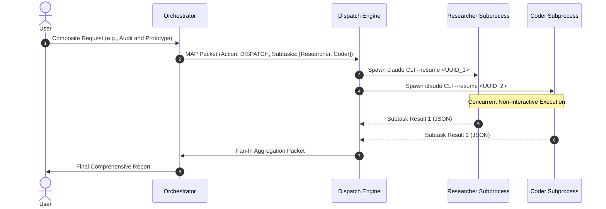

# Concurrency Dispatch Protocol (Fan-Out & Fan-In)

Defines parallel task decomposition, asynchronous subprocess execution, and barrier aggregation.

## 1. Concurrency Sequence

## 2. Invariants

1. **Orthogonality**: Subtasks must be independent and share no race-condition locks on the same target files.
2. **Barrier Synchronization**: All subtasks must report status before the final synthesis prompt is fed to the Orchestrator.
3. **Timeout Strategy**: Max runtime per subtask defaults to 120 seconds ($T_{max} = 120s$). If a subtask breaches timeout, the host terminates the child process and injects a `STATUS_TIMEOUT` error packet into the fan-in aggregator.
