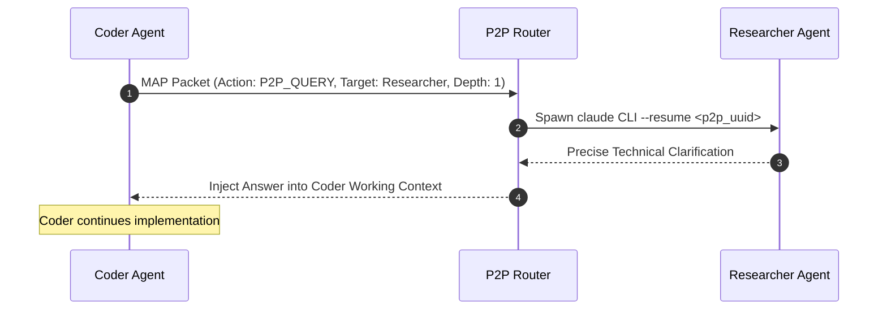

# Agent-to-Agent P2P Query Protocol

Defines isolated side-channel queries between subagents to verify technical assumptions without polluting the group chat timeline.

## 1. Sequence & Bounded Depth

## 2. Invariants

1. **Recursion Bound**: Call depth limit is strictly $MaxDepth = 3$. If depth exceeds 3, the host rejects further recursive queries and halts with error `E_P2P_MAX_DEPTH`.
2. **Timeline Isolation**: P2P transactions are stored in temporary ephemeral namespaces (`p2p_*`) and are never appended to the user-facing group history.
3. **P2P Prompt Structure**: The query must be factual, atomic, and self-contained.
