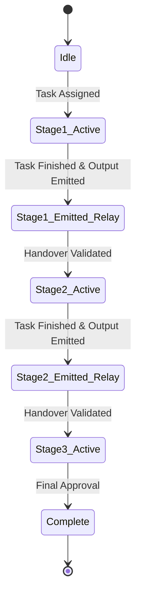

# Pipeline Relay Protocol (Handoff FSM)

The Relay Protocol defines the sequential state machine for multistage task execution (e.g., `researcher -> coder -> reviewer`).

## 1. Finite State Machine (FSM)

## 2. Invariants

1. **Unidirectional Execution**: Stage $i$ passes artifacts to Stage $i+1$. Stage $i$ cannot bypass or skip directly to Stage $i+2$ without explicit Orchestrator intervention.
2. **State Suspension**: When Agent A emits `action: "RELAY"`, Agent A's execution context is marked as `SUSPENDED`. It will not accept new inputs until the pipeline terminates or returns control.
3. **Rejection Handling**: If a downstream agent (e.g., `reviewer`) finds severe defects, it may emit a reverse `RELAY` targeting `coder` with explicit failure logs.
