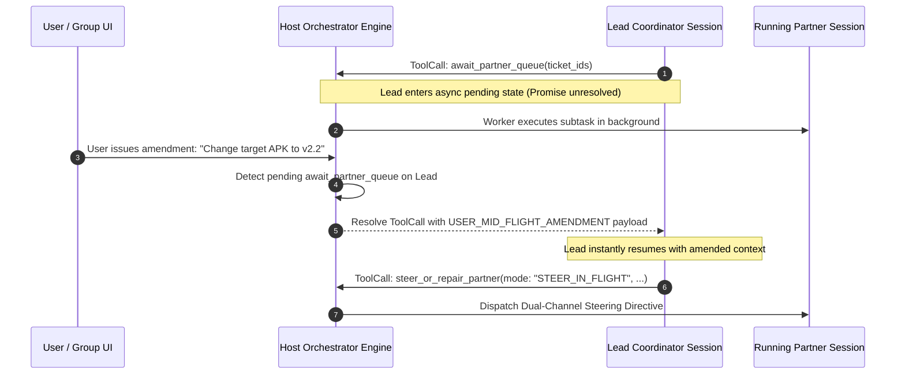
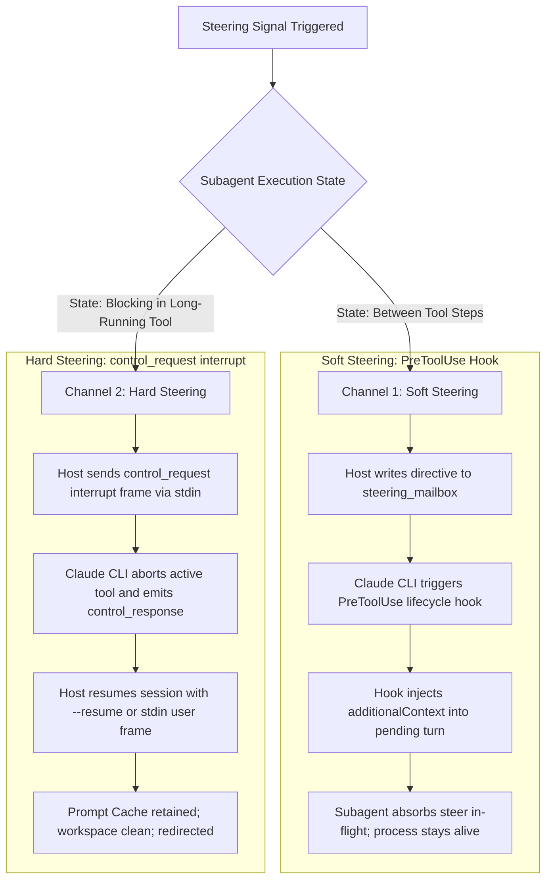

# Protocol Specification: Real-Time Mid-Flight Steering & Dual-Channel Intervention

## 1. Context and Problem Statement

Under native headless Claude Code CLI execution, streaming input (`{"type": "user", ...}`) written to standard input during an active turn is by default buffered at the tail of the turn queue (Issue #30492 / #41665). 

To achieve sub-second dynamic steering when a user amends requirements mid-execution—without killing the process, corrupting the workspace, or invalidating Prompt Caching—the system implements the **Dual-Channel Steering Protocol**.

---

## 2. Lead Coordinator Wakeup Sequence



---

## 3. Dual-Channel Subagent Steering Protocol



### 3.1 Channel 1: Soft Steering (PreToolUse Hook Injection)
- **Applicability**: Normal multi-step tool loops (e.g., iterative file inspection, sequential edits).
- **Protocol**:
  1. The host orchestrator writes the amendment directive to `~/.multiagent-orchestration/mailboxes/<bot_id>.json` (or in-memory `PreToolUse` callback).
  2. The hook configured in `<bot_dir>/claude_config/settings.json` intercepts the tool call (strictly `0` host `~/.claude` touch).
  3. The hook returns `additionalContext` containing high-priority instructions:
     ```json
     {
       "hook": "PreToolUse",
       "additionalContext": "[CRITICAL_LEAD_STEER]: Requirements revised. Abort current parameter search and redirect immediately."
     }
     ```
  4. If the pending tool is obsolete, the hook exits with status code `2`, blocking tool execution while preserving the conversation context.

### 3.2 Channel 2: Hard Steering (`control_request: interrupt`)
- **Applicability**: Subagent stalled in a long-latency monolithic command (e.g., extensive decompilation, large build).
- **Protocol**:
  1. Host writes a standardized NDJSON control request to `stdin`:
     ```json
     {
       "type": "control_request",
       "request_id": "steer_ctrl_<uuid>",
       "request": {
         "subtype": "interrupt",
         "session_id": "<PARTNER_SESSION_UUID>",
         "reason": "Host user requested dynamic mid-flight steering"
       }
     }
     ```
  2. Claude CLI traps the signal, halts execution of the child tool safely, and emits:
     ```json
     {
       "type": "control_response",
       "request_id": "steer_ctrl_<uuid>",
       "subtype": "success"
     }
     ```
  3. Host follows up by injecting the revised user turn via `stdin`:
     ```json
     {
       "type": "user",
       "message": {
         "role": "user",
         "content": "[STEER_REDIRECT]: Halt analysis on v2.1. Redirect to v2.2 immediately using discovered symbols."
       }
     }
     ```
