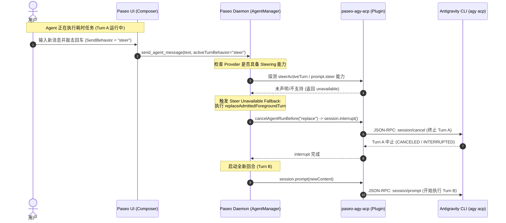

# Paseo 与 Antigravity ACP (agy) 消息排队 (Queue) 与引导 (Steer) 机制深度调研报告

**调研人**：MoDeep (`bot_modeep_scout_04`)  
**报告归档路径**：`docs/research/2026-11-16-paseo-agy-acp-steer-queue-mechanism.md`  
**涉及模块**：`paseo-agy-acp/`, Paseo Core (`@getpaseo/server`, `@getpaseo/client`, `@getpaseo/plugin`), `@agentclientprotocol/sdk`, Antigravity CLI (`agy`)

---

## 1. 执行摘要 (Executive Summary)

针对用户在 Paseo 中遇到“每次发消息都是马上发出，设置了‘引导’但困惑到底属于排队还是引导”的现象，MoDeep 深入逆向与分析了 Paseo 核心服务源码、`paseo-agy-acp` 适配器源码以及 ACP 协议底层。

**核心结论直击**：
用户在 Paseo 设置中开启的“引导 (Steer)”，在 Antigravity ACP (`paseo-agy-acp`) 运行时体系下，**实际行为既不是真正的回合内指令引导（Steering），也不是等待上一任务完成的排队（Queueing），而是“静默打断并以新消息替换重开新回合（Interrupt & Replace）”**。

- **为什么马上发出**：Paseo UI 在 `steer`（默认）设置下，将 Enter 键解析为立即向后端发起 RPC 请求（不暂存前端队列）。
- **底层的真实处理**：由于 `paseo-agy-acp` 以及 ACP 协议本身**完全不支持**运行中追加指令（Steering），Paseo Daemon 探测到适配器返回 `unavailable`，触发了内置的 **“Steer Unavailable Fallback”** 机制——先调用 `session.interrupt()` 向 Antigravity 发送 `session/cancel` 强行掐断上一轮正在运行的任务，紧接着把新消息作为全新 Turn 发送给 `session.prompt()`。

---

## 2. 核心架构时序与处理流图 (Architecture & Sequence)



---

## 3. Paseo 内部机制定义：Steer vs Queue vs Interrupt

在 Paseo 官方规范与核心代码中，三者的职责界限极其清晰：

| 机制名称 | 运行环境 | 定义与运行时行为 | 对前序任务的影响 |
| :--- | :--- | :--- | :--- |
| **Queue (排队)** | **纯前端客户端 (Client-Side)** | 消息暂存在前端 React 本地状态 (`Composer.tsx`) 中，**完全不发出网络请求**。页面上展示为待发送队列气泡。只有当检测到 Agent 回合结束（`!running` / idle）时，才逐条出队发送给后端。 | **完全不影响**前序任务，等待其完整执行完毕。 |
| **Steer (引导)** | **协议与服务端 (Mid-Turn Protocol)** | 消息立即发出，请求在 Agent **同一个正在运行的回合（Turn）内**动态吸收追加新指令（例如 Claude push 到 SDK query input、Codex `turn/steer`、Pi `steer` RPC）。 | **不打断**当前回合，前序回合合并新指令继续执行。 |
| **Interrupt (打断)** | **服务端会话生命周期** | 显式中止当前执行流。向模型运行时发送 Cancel 信号，终止当前的思考或工具调用，回合以 `CANCELED` 或 `INTERRUPTED` 状态收尾。 | **直接掐断**前序任务正在进行的执行。 |

### 3.1 前端 Composer 的行为判定源码 (`paseo-bots/client/chat/composer/logic.ts`)
```ts
/** Reads sendBehavior out of persisted app settings. Default "steer". */
export type SendBehavior = "interrupt" | "steer" | "queue";
export const DEFAULT_SEND_BEHAVIOR: SendBehavior = "steer";

/** Enter / the send button (input/state.ts runDefaultSendAction). */
export function resolveDefaultAction(input: { behavior: SendBehavior; running: boolean; canQueue: boolean }): SendAction {
  // 只有当设置为 "queue" 且正在运行且可以排队时，才执行 queue 操作
  return input.behavior === "queue" && input.running && input.canQueue ? "queue" : "send";
}
```
当设置为 `steer` 时，`resolveDefaultAction` 始终返回 `"send"`，导致前端立即执行网络调用：
```ts
const options = {
  messageId,
  activeTurnBehavior: activeTurnBehaviorFor(sendBehavior), // 返回 "steer"
  ...
};
await host.api.agents.ref(agentId).send(outgoing, options);
```

---

## 4. Paseo Core 的核心回退逻辑：Steer Unavailable Fallback

Paseo Daemon 在收到 `activeTurnBehavior: "steer"` 时，有严密的 Provider 适配机制。

### 4.1 `agent-prompt.js` 调度逻辑
```javascript
async function steerOrReplaceActiveRun(agentManager, agentId, prompt, options) {
    if (options?.activeTurnBehavior !== "steer") return null;
    const result = await agentManager.steerOrReplaceActiveTurn(agentId, prompt, steerOptions);
    if (result.status === "steered") return { disposition: "steered" };
    if (result.status === "replaced") return { disposition: "turn_started", iterator: result.iterator };
    return null;
}
```

### 4.2 `agent-manager.js` 中的降级替换关键代码
```javascript
async steerOrReplaceActiveTurn(agentId, prompt, options) {
    await this.runs.waitForForegroundStart(agentId);
    const agent = this.requireSessionAgent(agentId);
    const expectedTurnId = agent.activeForegroundTurnId ?? agent.activeTurnId;
    if (!expectedTurnId) return { status: "inactive" };

    // 1. 探测 Provider 是否支持 steerActiveTurn
    const result = agent.session.steerActiveTurn
        ? await this.runSteerAdmission(...)
        : { status: "unavailable" }; // <-- paseo-agy-acp 没有此方法，直接返回 unavailable

    if (result.status === "accepted") {
        return { status: "steered" };
    }

    // 2. 如果 Provider 不支持 Steering，触发替换逻辑 (Fallback to Replacement)
    this.assertSteerAdmissionOwnsTurn(agent, expectedTurnId);
    return {
        status: "replaced",
        iterator: await this.replaceAdmittedForegroundTurn(agent, expectedTurnId, prompt, stripSteerOptions(options)),
    };
}

async replaceAdmittedForegroundTurn(agent, expectedTurnId, prompt, options) {
    this.assertSteerAdmissionOwnsTurn(agent, expectedTurnId);
    agent.pendingReplacement = true;
    agent.lifecycle = "running";
    // 3. 关键动作：打断当前正在运行的前台回合！
    await this.cancelAgentRunBefore(agent.id, "replace"); // 内部调用 session.interrupt()
    // 4. 重开全新回合并流式传输
    return this.streamAgent(agent.id, prompt, options);
}
```

---

## 5. `paseo-agy-acp` 源码剖析与底层限制

### 5.1 Provider 能力声明 (`server/provider.ts`)
在 `supported` 能力集合中，明确排除了 `'prompt.steer'`：
```typescript
const supported = [
  'prompt.message',
  'prompt.command',
  'prompt.image',
  'session.configure',
  'session.list',
  'session.persistence',
  'session.revert.conversation',
  'session.revert.files',
  'session.revert.both',
  'session.can_stop_runtime',
  'permission',
  'permission.tool_policy',
  'session.subsession',
] as const;
```

### 5.2 显式拒绝 Steering (`server/session.ts`)
适配器明确在 `promptSession` 中防范了并发 turn 与 steer 调用：
```typescript
if (session.state.turn) throw new Error('Session already has an active turn')
if (p.delivery === 'steer' || p.outputSchema)
  throw new Error('Steering and output schemas are not supported')
```

### 5.3 官方文档定性声明 (`README.zh-CN.md` / `README.md`)
> *“暂不支持运行中追加指令（steering）、回退（rewind）、归档操作、结构化输出或 Artifacts 面板。”*

### 5.4 中断实现细节 (`session.interrupt()`)
当 Paseo 降级触发中断时，`paseo-agy-acp` 执行：
```typescript
state.turnAbort?.abort();
cancelPermissions();
const canceling = subagents.cancelRunning();
await currentTransport.request(
  currentTransport.rpc.cancel({ sessionId: state.nativeId }),
  { timeoutMs: 5000, fatalOnTimeout: false }
);
```
该操作会直接向底层 `agy acp` 服务端发出 JSON-RPC `session/cancel` 强行中止 Antigravity 原生执行进程。

---

## 6. Antigravity CLI / ACP 协议底层分析

### 6.1 ACP 协议规范 (`@agentclientprotocol/sdk`)
审查官方 ACP 规范（v1/v2 schema 及 TypeScript 定义）：
- Agent 侧方法仅包含：
  `session/new`, `session/load`, `session/list`, `session/delete`, `session/fork`, `session/resume`, `session/close`, `session/set_mode`, `session/set_config_option`, `session/prompt`, `session/cancel`。
- **协议层根本不存在 `session/steer` 或针对 running turn 动态推送消息的通道**。
- `session/prompt` 是单一请求-响应模型：一次 prompt 发送后，连接保持挂起状态，通过 `session/update` 流式接收工具调用与通知，直至整个回合 `stopReason` 终结。在此期间，ACP 服务端不接受重入或并发的二次 `prompt`。

### 6.2 Antigravity CLI (`agy`) 原生架构
`agy` 引擎设计为严格的单回合状态机（Single Turn State Machine）。在执行任务时，它通过 LLM 推理 -> 工具调用（Tool Execution） -> 结果反馈的闭环循环。底层并没有预留“非阻塞指令追加管道”。

---

## 7. 答复用户的结论要点与操作指南

### 7.1 针对用户疑惑的一对一解答

| 用户疑惑 | 技术真相与根因 |
| :--- | :--- |
| **“为什么每次发消息都是马上就发出去了？”** | 因为 Paseo 设置的是“引导 (Steer)”。在前端 UI 逻辑中，`steer` 模式认为你想立即介入，不会放入本地排队框，直接向后台发送了网络请求。 |
| **“这到底属于排队还是引导？”** | **既不是排队，也不是真正的引导，而是“隐式打断并替换（Interrupt & Replace）”**。因为底层 Antigravity ACP 无法在同一个运行流中动态接收追加指令，Paseo 自动采取了回退方案：**强行掐断上一轮运行，用新消息直接重开新回合**。 |
| **会有什么不良影响？** | 如果 Agent 上一轮正在进行复杂的跨文件分析、代码重构或耗时工具调用，你在此期间发消息，上一轮工作会被直接 Cancel（未完成的代码操作或结论将丢失或中断），直接跳转执行你的新指令。 |

### 7.2 给用户的操作与配置建议

1. **若期望“上一条指令跑完后再自动执行新指令”**：
   - **方式一（全局设置）**：打开 Paseo 设置 -> 将 **“When the agent is working”** 从 `steer` 改为 **`queue`（排队）**。此后在 Agent 运行时按 Enter，输入框会显示排队气泡，待上一条完整完成后自动触发下一条。
   - **方式二（临时快捷键）**：在保持当前设置不变的情况下，Agent 运行时使用快捷键 **`Cmd + Enter`（Mac）或 `Ctrl + Enter`（Windows/Linux）**，可临时将当前消息强制加入排队轨道，不打断正在进行的任务。
2. **若期望“立刻停止上一个任务，转而执行新指令”**：
   - 保持当前的“引导 (Steer)”设置即可，按回车会立即打断上一轮并以新指令重开；或显式敲击 `Esc` / 点击红色 Stop 按钮中断后再发。
