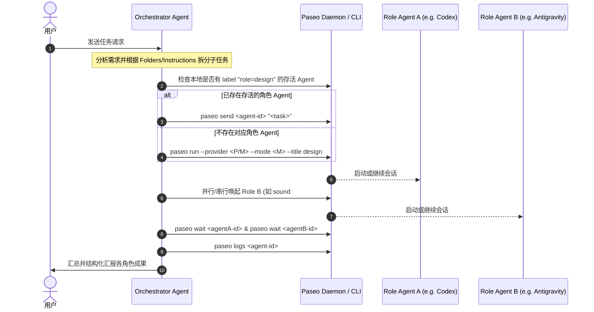

# Paseo 官方插件 `gyuha/agent-team` 深度技术调研报告

- **调研对象**: `plugins.paseo.sh/gyuha/agent-team` (`paseo-agent-team`)
- **源码仓库**: [https://github.com/gyuha/paseo-agent-team.git](https://github.com/gyuha/paseo-agent-team.git)
- **本地定位**: `~/.paseo/plugins/paseo-agent-team/75f34dc7-cd5b-4897-a3bd-b484b6cc9a22/checkout`
- **本地配置**: `~/.paseo/config.json`（已安装且激活）
- **版本**: `0.2.20`（Git Commit: `5870a3ff19902c1819f032af8077a5ff782d010a`）
- **调研员**: MoDeep (`bot_modeep_scout_04`)
- **调研日期**: 2026-11-15

---

## 一、 来源与仓库定位

### 1.1 插件源与官方 Registry
- **插件标识符**: `gyuha/agent-team`（插件内部 ID: `paseo-agent-team`）。
- **插件市场 URL**: [https://plugins.paseo.sh/gyuha/agent-team](https://plugins.paseo.sh/gyuha/agent-team)
- **GitHub 仓库**: [https://github.com/gyuha/paseo-agent-team.git](https://github.com/gyuha/paseo-agent-team.git)
- **作者**: `gyuha` (신규하)
- **官方安装指令**:
  ```bash
  paseo plugin add gyuha/agent-team
  ```
  或通过本地源码安装：
  ```bash
  git clone https://github.com/gyuha/paseo-agent-team.git
  cd paseo-agent-team
  npm install
  paseo plugin install "$(pwd)"
  ```

### 1.2 本机环境与工作区检查
- **本地全局配置**: 在 `~/.paseo/config.json` 第 133-137 行明确已配置并激活：
  ```json
  "paseo-agent-team": {
    "source": "directory",
    "path": "~/.paseo/plugins/paseo-agent-team/75f34dc7-cd5b-4897-a3bd-b484b6cc9a22/checkout",
    "enabled": true
  }
  ```
- **本地源码副本**: 位于 `~/.paseo/plugins/paseo-agent-team/75f34dc7-cd5b-4897-a3bd-b484b6cc9a22/checkout/`，包含完整的 TypeScript 源码、测试用例和文档。
- **当前工程目录 (`multiagent-orchestration`)**: 工作区根目录下未直接存放该插件自身代码，但工作区受 `~/.paseo/config.json` 插件系统管理并直接加载该插件；此外工作区存在同类的个人 bot 插件 `paseo-bots/`。

---

## 二、 插件清单与代码架构

### 2.1 Manifest 描述文件

#### 1. `paseo-plugin.json`
出处: `~/.paseo/plugins/paseo-agent-team/75f34dc7-cd5b-4897-a3bd-b484b6cc9a22/checkout/paseo-plugin.json`
```json
{
  "id": "paseo-agent-team",
  "name": "Paseo Agent Team",
  "media": [],
  "requirements": {
    "paseo": ">=0.13.0"
  }
}
```

#### 2. `package.json`
出处: `~/.paseo/plugins/paseo-agent-team/75f34dc7-cd5b-4897-a3bd-b484b6cc9a22/checkout/package.json`
- **Name**: `paseo-agent-team`
- **Version**: `0.2.20`
- **License**: `MIT`
- **Description**: "Project-scoped agent teams for Paseo: one role per workspace, each with its own provider and model, led by an orchestrator."
- **核心依赖**:
  - `@getpaseo/client`: `0.13.0`
  - `@getpaseo/plugin`: `0.13.0`
  - `@tanstack/react-query`: `^5.90.11`
  - `react`: `19.1.0`
  - `react-native`: `0.81.5`
  - `typescript`: `^5.9.3`
  - `vitest`: `^4.1.11`
  - `zod`: `^4.4.3`

### 2.2 目录结构与核心模块全景

```
~/.paseo/plugins/paseo-agent-team/.../checkout/
├── paseo-plugin.json        # Paseo 插件元数据规范
├── package.json             # NPM 依赖与构建配置
├── OVERVIEW.md              # 架构设计思想与用户指南
├── README.md                # 快速入门与图文说明
├── index.server.ts          # 后端守护进程 (Daemon) 插件入口
├── index.client.tsx         # 前端 UI (React Native Web) 插件入口
├── server/
│   └── team.ts              # 核心服务端逻辑：规划、生效、重启、删除、共享等
├── shared/
│   ├── rpc.ts               # 17 个 RPC 通信接口的 Zod 协议契约
│   ├── team.ts              # Team / Role / Orchestrator 数据模型定义
│   ├── prompt.ts            # Orchestrator 系统提示词构建器与更新通知
│   ├── proposal.ts          # Planner / Team Editor / Instructions 提示词及 JSON 提取
│   ├── validate.ts          # Provider / Model 可用性检查与 Agent Mode 推导
│   ├── permissions.ts       # Claude 本地设置文件 `.claude/settings.local.json` 规则注入
│   ├── cleanup.ts           # 规划器与协调者 Agent 归档与生命周期清理
│   ├── team-files.ts        # 团队文件路径解析 (`.agents/teams/*.json`) 与共享管理
│   ├── apply-plan.ts        # 工作区按需创建与映射规划
│   ├── agent-tree.ts        # 层次化 Agent 树与活动状态 (working/awaiting/idle) 构建
│   ├── subagents.ts         # Provider Sub-agents (如 Claude Explore) 状态融合
│   └── dashboard-density.ts # 大盘卡片密度 (Brief/Normal/Detailed) 布局
└── client/
    ├── TeamPanel.tsx        # 工作区内部团队管理面板与编辑流
    ├── TeamScreen.tsx       # 全局跨项目团队列表、全量大盘与侧边栏未决 Badge
    ├── AgentDashboard.tsx   # 动态 Agent 树状拓扑网络大盘
    └── i18n.ts              # 国际化文案 (en, ko, ja, zh-Hans)
```

---

## 三、 核心功能与实现细节

该插件并未注册独立的外部 MCP 工具，而是作为 **Paseo 平台扩展插件**，通过 **RPC 通信**、**前端 React Native Web 面板** 以及 **Paseo 原生 Agent API / CLI 工具** 实现完整的 Agent 团队生命周期编排。

### 3.1 注册的扩展项清单

#### 1. 前端扩展项 (`index.client.tsx`)
- **Workspace Panel (`agent-dashboard`)**:
  - 标题: "Agent dashboard" / "에이전트 대시보드" / "智能体大盘"
  - 挂载位置: `workspace` 及 `explorer`（右侧边栏）。
  - 功能: 树状可视化展示当前工作区/项目下的 Agent 拓扑关系与执行状态。
- **Workspace Panel (`team`)**:
  - 标题: "Agent team" / "智能体团队"
  - 挂载位置: `workspace`
  - 功能: 查看、编辑、复制、共享、应用团队配置。
- **Full Screen (`team`)**:
  - 跨项目的 Agent 团队管理控制台，包含所有项目的团队列表及全局 `All agents` 大盘。
- **Sidebar Header Item (`team`)**:
  - 侧边栏常驻图标组件 `TeamSidebarItem`，带动态红/黄圆点脉冲徽标（`AwaitingBadge`），显示等待用户审批权限或提问回复的 Agent 数量。
- **Command Center Item (`team`)**:
  - 快捷呼出面板，支持中英日韩多语言关键字匹配（`team`, `agents`, `orchestrator`, `팀`, `团队`, `智能体` 等）。

#### 2. 后端 RPC 接口 (`index.server.ts` & `shared/rpc.ts`)
后端注册了 17 个由 Zod 强校验的 RPC 接口：

| RPC 名称 | 功能与内部逻辑 | 输入参数 | 输出规范 |
|---|---|---|---|
| `team.projects` | 列出主机所有注册项目及其关联的工作区与团队配置 | `{}` | `Project[]` (包含每个团队的 file, goal, roles 数量等) |
| `team.read` | 读取指定工作区或项目的团队配置、可用 Provider 模型目录与校验错误 | `{ workspaceId }` 或 `{ projectId }` | 包含 `team`, `project`, `catalog`, `validation` 等 |
| `team.propose` | 启动 `Team planner` 代理，根据目标自然语言规划团队角色 | `Target & { goal: string }` | `{ agentId: string }` |
| `team.proposal` | 轮询/获取 Planner 生成的完整团队 JSON 方案 | `{ agentId: string }` | `running` / `done` (含 Team 数据) / `failed` |
| `team.proposal.pending` | 查找当前工作区正在运行的未归档 Planner Agent | `Target` | `{ agentId: string \| null }` |
| `team.proposal.cancel` | 取消并归档指定目标的 Planner Agent | `Target` | `{}` |
| `team.edit.propose` | 启动 `Team editor` 代理，根据用户的新增/修改需求调整团队草案 | `Target & { request: string, team: Team }` | `{ agentId: string }` |
| `team.edit.proposal` | 轮询并提取 Team Editor 修改后的团队，并自动归档 Editor Agent | `{ agentId: string }` | `running` / `done` / `failed` |
| `team.instructions.improve`| 启动 `Instructions planner` 针对某个角色优化指令 | `Target & { role, request, team }` | `{ agentId: string }` |
| `team.instructions.proposal`| 轮询并获取优化后的角色指令文本 | `{ agentId: string }` | `running` / `done` (含 instructions) / `failed` |
| `team.apply` | **核心生效 RPC**: 写入磁盘团队文件、配置 Claude 权限、创建工作区、启动/通知 Orchestrator、归档 Planner | `Target & { team: unknown }` | `{ ok: true, file, workspaces, orchestratorAgentId, cleanup, permission }` |
| `team.restore` | 根据磁盘已有团队文件重新执行 `apply` 流程 | `{ projectId, file }` | 与 `team.apply` 一致 |
| `team.restart-orchestrator` | 归档工作区旧 Orchestrator，从磁盘重新启动全新 Orchestrator（保留 Role 会话） | `Target` | `{ ok: true, orchestratorAgentId, archived }` |
| `team.roster` | 供大盘展示当前项目的团队角色花名册与对应工作区 | `{ workspaceId }` | `RosterTeam[]` |
| `team.delete` | 先归档该团队在对应工作区下的所有 Role 与 Orchestrator，成功后删除磁盘团队 JSON | `{ projectId, file }` | `{ files, archived, failures, fileFailures }` |
| `team.reconnect` | 工作区改名后，将现有团队文件重新绑定到新工作区标题 | `{ projectId, file, workspaceId }` | `{ ok: boolean, files }` |
| `team.share` | 将团队共享至项目内另一空闲工作区，并在该工作区启动 Orchestrator | `{ projectId, file, workspaceId }` | 与 `team.apply` 一致 |
| `team.unshare` | 解除某工作区对该团队的共享，归档该工作区中的 Orchestrator | `{ projectId, file, workspaceId }` | `{ ok: boolean, files, archived, failures }` |

---

### 3.2 多 Agent 协作与编排机制实现细节

#### 1. 团队定义的数据拓扑与存储标准
- 团队配置**不存放在数据库或插件私有目录**，而是直接存放在项目的 Git 仓库中（出处: `shared/team.ts` ADR 261029-093300）：
  - 默认路径: `.agents/teams/<orchestrator-workspace>.json`（单团队向后兼容 `.agents/team.json`）。
  - 配置通过 Git 提交并跟踪，保证团队配置与代码版本一致。
  - 工作区采用**名称（Title）匹配而非 ID 匹配**，确保在不同开发者机器上拉取代码后能够平滑恢复。

#### 2. Orchestrator 单一工作区编排模型
- **共享 Workspace 模式**: 团队内所有 Role 均在 Orchestrator 所在的工作区（同一个本地目录 Checkout）内运行，避免多工作区多目录产生文件锁或同步冲突。
- **Orchestrator System Prompt 注入**:
  在 `shared/prompt.ts` 中，Orchestrator 启动时会注入包含团队花名册的系统提示词：
  ```markdown
  You are the orchestrator of this project's agent team in Paseo.
  Team goal: ...
  The team is defined in .agents/teams/<workspace>.json at the project root. Re-read it before delegating;
  
  ## Team
  | Role | Provider/model | Mode | Folders | Features |
  | --- | --- | --- | --- | --- |
  | ui | codex/gpt-6.1-sol | auto-review | src/ui | - |
  | sound | antigravity/gemini-4-argon | full-access | assets/audio | - |
  
  ## How to delegate
  - Split each request into parts and give each part to the role that owns it.
  - Start a role's agent in your own workspace with exactly that role's provider and model:
    `paseo run --workspace <workspace-id> --provider <provider>/<model> --mode <mode> --title <role>#<id> --label role=<role> --no-wait "<task>"`
  - Look in your own workspace for an unarchived agent labelled role=<role> and continue it using send (`paseo send <agent-id> "<task>"`) instead of starting another.
  - Keep roles inside their folders. When two parts touch the same files, run them one after another, not at the same time.
  - Wait for the agents you started (`paseo wait <agent-id>`), read their results (`paseo logs <agent-id>`), then report what each role did and what is left.
  ```

#### 3. 动态角色执行与生命周期链条


#### 4. 权限与自动化模式（Mode & Permission Automation）
在多 Agent 协同体系中，不同模型有不同的审核级别，若由主 Agent 自动化调用子 Agent，常常会因为权限拦截而卡死。插件在 `shared/validate.ts` 与 `shared/permissions.ts` 中设计了针对性的自动化模式推导链：
1. **模式降级优先级**:
   - `auto-review`（Codex 的自动审查模式）。
   - `auto`（Claude 的自动审查模式）。
   - 包含 `auto` 字样的模式（如 `auto_edit`, `Auto accept`）。
   - 标记为 `isUnattended: true` 的模式。
   - 标记为 `colorTier: "dangerous"` 的模式（如 Antigravity 的 `full-access`）。
   - `auto_accept` 特性开关（针对 Cursor 等）。
   - 否则回退至 `default`。
2. **Claude 自动放行白名单（Auto Allow Rules）**:
   当 Orchestrator 为 Claude 时，如果下属 Role 使用了无人值守模式（如 Antigravity 的 `full-access`），Claude 的 Auto-mode Reviewer 默认会拦截 `paseo run` 调用。
   为突破此瓶颈，插件在 `team.apply` 和 `team.restart-orchestrator` 时会自动向项目根目录下的 `.claude/settings.local.json` 写入：
   ```json
   {
     "permissions": {
       "allow": [
         "Bash(paseo run *)",
         "mcp__paseo__create_agent"
       ]
     }
   }
   ```
   从而使 Claude 具备免人工审批、平滑拉起子 Agent 的能力。

#### 5. 全景观测大盘与子代理穿透（Agent Dashboard & Subagents）
- **森林树渲染**: 根节点为 Orchestrator 或独立 Solo Agent，其下自动挂载对应的工作区 Role Agents。
- **子代理穿透**: 针对 Claude Code 的 `Agent` 工具启动的轻量子代理（Sub-agent），插件在 `shared/subagents.ts` 中通过扫描 Timeline 中的 `tool_call`（`sub_agent` 类型）以及实时 WebSocket 事件流进行融合，将子代理层级渲染在 Role Agent 下方。
- **状态感知三态**:
  - `working`: 正在执行。
  - `awaiting`: 挂起等待用户处理权限（`question` 徽标）或遭遇报错中断（`attention` 徽标）。
  - `idle`: 完成或空闲。

---

## 四、 配置项与依赖矩阵

### 4.1 配置规范 (`TeamSchema`)

插件没有在 Paseo 全局配置中设立额外参数，其全部业务配置由项目内的团队 JSON 文件（`.agents/teams/<workspace>.json`）定义：

```typescript
export const OrchestratorSchema = z.object({
  workspace: z.string().trim().min(1),
  provider: z.string().trim().min(1),
  model: z.string().trim().min(1),
  sharedWorkspaces: z.array(z.string().trim().min(1)).optional(),
});

export const RoleSchema = z.object({
  name: z.string().trim().min(1),
  provider: z.string().trim().min(1),
  model: z.string().trim().min(1),
  folders: z.array(z.string().trim().min(1)).default([]),
  instructions: z.string().default(""),
});

export const TeamSchema = z.object({
  version: z.literal(1),
  goal: z.string().default(""),
  orchestrator: OrchestratorSchema,
  roles: z.array(RoleSchema).min(1),
});
```

#### 典型配置文件样例
```json
{
  "version": 1,
  "goal": "2D platformer game",
  "orchestrator": {
    "workspace": "orchestrator",
    "provider": "claude",
    "model": "claude-opus-5-5"
  },
  "roles": [
    {
      "name": "design",
      "provider": "codex",
      "model": "gpt-6.1-sol",
      "folders": ["src/ui", "assets/images"],
      "instructions": "Owns the UI and visual assets."
    },
    {
      "name": "sound",
      "provider": "antigravity",
      "model": "gemini-4-argon",
      "folders": ["assets/audio"],
      "instructions": "Sound effects and background music."
    }
  ]
}
```

### 4.2 外部依赖与环境要求
- **Paseo Host API**:
  - `@getpaseo/plugin` 与 `@getpaseo/client` 版本 `>= 0.13.0`。
  - Paseo 服务端必须暴露 `paseo.projects`, `paseo.workspaces`, `paseo.agents`, `paseo.providers` 四组核心 Handler 上下文接口。
- **外部 CLI / MCP**:
  - 系统需可用 `paseo` CLI（用于执行 `paseo run`, `paseo send`, `paseo wait`, `paseo logs`）。
  - 若 Provider 包含 Cursor 等具备 `auto_accept` 特性的供应商，则强制依赖 MCP 工具 `mcp__paseo__create_agent`（因为 CLI 的 `paseo run` 暂无法注入 feature 字段）。
- **语言模型 Provider**:
  - 依赖宿主机已安装并配置认证的 Provider（如 Claude, Codex, Copilot, Antigravity, OpenCode 等）。

---

## 五、 局限性与工程注意事项

1. **单文件系统检出（无硬性沙箱隔离）**：
   - 团队中所有 Role 都在同一个工作区目录运行，共享同一套本地 Git 工作树。
   - `folders` 配置主要通过 Orchestrator Prompt 起到提示约束作用，**没有底层的 OS/容器级文件读写沙箱硬隔离**。如果某个子 Agent 破坏性地修改了属于其他角色的目录，系统无法在文件系统层面拦截。
2. **Workspace 改名脱钩机制**：
   - 团队配置文件使用 `orchestrator.workspace`（标题）定位工作区。由于 Paseo 核心目前未提供工作区重命名广播事件，一旦用户在 Paseo 界面修改了工作区名称，团队会进入 `workspace not found` 状态，必须手动通过 `Reconnect` 界面重新绑定。
3. **`/clear` 指令的破坏性陷阱**：
   - 用户在与 Orchestrator 对话时，若习惯性输入 `/clear`，Paseo 核心会归档原 Agent 并生成一个没有任何 Label、丢失了团队编排 Prompt 的全新纯净 Agent，导致其丧失协调能力。
   - 开发者必须使用面板上的 `Reset session` 按钮，该按钮在归档原协调者的同时，会使用完整的团队配置重新启动新的协调者。
4. **Agent 无法物理销毁**：
   - 受限于 `@getpaseo/client` 提供的 API（仅支持 `archive`），大盘中卡片点击 `×` 只是前端级别的 Dismiss/Hide，并不能从 Paseo 后台物理删除 Agent 实体。
5. **单页数据读取与海量 Agent 瓶颈**：
   - 工作区与 Agent 列表目前采用单页查询（Single-page list）。如果宿主机存在海量 Agent（数百个以上），可能存在超出单页导致检索遗漏、归档不彻底的问题。
6. **本地授权文件泄露风险**：
   - 插件自动写入 `.claude/settings.local.json` 规则（`Bash(paseo run *)`）。开发者必须确保该文件被加入 `.gitignore`，避免将高权限本地运行规则误提交至公共代码仓库。

---

## 六、 总结与多 Agent 平台参考价值

`gyuha/agent-team` 是 Paseo 生态中一个非常典范的**声明式 Git-ops 多 Agent 编排插件**。它给我们的 `multiagent-orchestration` 架构带来如下关键启示：
- **Prompt + CLI 组合编排**：由高智能模型（如 Claude Opus 5.5）充当 Orchestrator，利用平台 CLI（`paseo run`/`paseo send`/`paseo wait`）作为动态工具调度领域特化 Agent，具有极低的侵入性和极高的灵活性。
- **基于 Git 的团队定义**：`.agents/teams/*.json` 使得多 Agent 架构成为项目代码资产的一部分，团队拓扑与代码演进天然绑定。
- **全生命周期大盘（Agent Tree）**：通过父子关联与 Timeline 工具调用挖掘，直观展示多 Agent 及 Sub-agents 协作网络，极大降低多 Agent 运行黑盒感。
- **自动审查权限自愈**：通过分析 Role 的安全等级，自动为 Orchestrator 补充精准的放行规则（如 `.claude/settings.local.json`），有效解决了多 Agent 自动化协同中的权限阻塞痛点。
